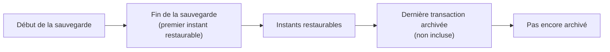

# Comment restaurer une base PostgreSQL à un instant précis

Une base PostgreSQL sauvegardée archive en continu ses **journaux de transactions** vers sa destination, entre deux sauvegardes. Ce guide s'en sert pour ramener une base à un instant précis, par exemple juste avant une suppression accidentelle, depuis la [console Hikube](https://console.hikube.cloud).

## Prérequis

- Une base PostgreSQL avec au moins une archive **Prête** et restaurable, prise **avant** l'instant visé.
- Avoir lu [Restaurer une base PostgreSQL ou MariaDB](./restore-database.md#avant-de-commencer) : les mêmes précautions s'appliquent.

## Ce que vous pouvez restaurer

| Choix dans **Restaurer jusqu'à** | Résultat |
|----------------------------------|----------|
| **État de la sauvegarde du …** (par défaut) | L'état exact de l'archive choisie. |
| **État le plus récent** | L'archive, puis tous les journaux archivés depuis, jusqu'à la dernière écriture connue. |
| Un instant sur la frise, ou une **Date** et une **Heure (24 h)** | L'état de la base juste avant la première transaction postérieure à cet instant. |

## Étapes

### 1. Choisir l'archive

1. Ouvrez **PostgreSQL**, la base, puis son onglet **Sauvegardes**.
2. Sur la ligne de l'archive la plus récente **antérieure** à l'instant visé, cliquez sur **Restaurer**.
3. Choisissez la **Cible de la restauration**. Pour examiner les données sans toucher à la base en service, choisissez **Sur une autre base de données** et une base vide de la même version.

### 2. Choisir l'instant

La section **Restaurer jusqu'à** affiche une frise. Réglez l'**Échelle** (**1 h**, **6 h**, **1 jour**, **7 jours**) et naviguez avec **Sauvegarde précédente** / **Sauvegarde suivante**.

- Cliquez sur la frise, ou saisissez une **Date** et une **Heure (24 h)** en heure locale. La console affiche les bornes de la fenêtre : **Restaurable du … au …**.
- Un instant hors de la fenêtre est ramené à la borne la plus proche, et la console l'indique (**Avant la première sauvegarde : ramené au …**, **Pas encore archivé : ramené au …**).
- **Revenir au plus récent** sélectionne l'état le plus récent.

Le libellé du bouton reprend votre choix : **Restaurer l'état au …**, **Restaurer l'état le plus récent**, **Restaurer l'état de la sauvegarde du …**.

### 3. Confirmer

Saisissez le nom demandé, puis cliquez sur le bouton de restauration.

## Comprendre la fenêtre

- **Premier instant** : la fin de la sauvegarde, pas son début. La base n'est cohérente qu'une fois la sauvegarde terminée.
- **Dernier instant** : juste avant la dernière transaction archivée. Une restauration s'arrête sur la première transaction qui **suit** l'instant demandé ; après la dernière transaction, il n'y en a plus, et l'instant ne peut pas être atteint. Pour inclure cette dernière écriture, choisissez **État le plus récent**.
- **Pas encore archivé** : les journaux partent vers la destination avec quelques minutes de décalage ; les toutes dernières minutes ne sont pas encore restaurables.
- **Aucune écriture** : si rien n'a été écrit depuis la sauvegarde, l'état le plus récent est celui de la sauvegarde, et la console l'indique (**Identique à l'état le plus récent**).

## Cas particuliers

| Message | Signification | Que faire |
|---------|---------------|-----------|
| **Dernière écriture inconnue** | Les journaux archivés n'ont pas pu être lus : la fenêtre affichée n'est qu'une estimation. | Réessayez plus tard, ou restaurez l'état de la sauvegarde. |
| « l'archivage des journaux ne fonctionne pas sur cette base » | Aucun instant postérieur à la sauvegarde ne peut être garanti. | Restaurez l'état de la sauvegarde ; contactez le support si l'archivage ne reprend pas. |
| Instants non proposés **à partir du …** (autre branche de l'historique) | Une restauration en place antérieure a créé une nouvelle branche de l'historique ; au-delà de cette date, la restauration partirait d'une archive de l'autre branche. | Choisissez un instant plus ancien, ou une archive de la branche voulue. |
| **Aucune transaction après cet instant** | L'instant est postérieur à la dernière écriture archivée. | Choisissez **État le plus récent** : l'état obtenu est le même. |

## Vérification

- La restauration est **Réussie** ; la colonne **Point de récupération** de la section **Restaurations** affiche l'instant restauré, **État de la sauvegarde** ou **État le plus récent**.
- Connectez-vous à la base et vérifiez que la donnée visée est présente, et que les modifications postérieures à l'instant choisi n'y sont pas.

## Pour aller plus loin

- [Concepts : restauration à un instant précis](../concepts.md#restauration-à-un-instant-précis-postgresql)
- [Dépannage](../troubleshooting.md#une-restauration-est-refusée)
