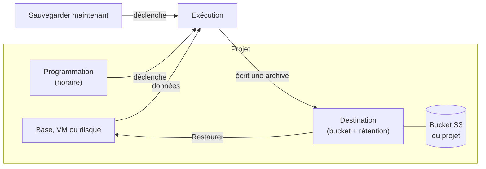

import NavigationFooter from '@site/src/components/NavigationFooter';

# Sauvegardes sur Hikube

Le service de sauvegarde copie l'état d'une ressource de votre projet dans une **archive**, stockée dans un [bucket S3](../storage/buckets/overview.md) que vous possédez, puis permet de **restaurer** cette archive. Il couvre quatre types de ressources :

| Ressource | Ce que contient une archive | Restauration |
|-----------|-----------------------------|--------------|
| **PostgreSQL** | La base complète, plus ses journaux de transactions archivés en continu | Sur la base d'origine ou sur une autre base PostgreSQL, à l'état de la sauvegarde, à l'état le plus récent ou à un **instant précis** |
| **MariaDB** | Un export complet de la base | Sur la base d'origine ou sur une autre base MariaDB |
| **Machine virtuelle** | La VM et **tous ses disques** | Sur la VM d'origine |
| **Disque** | Le disque seul | Sur le disque d'origine, s'il a été supprimé |

MongoDB, Redis, RabbitMQ, les clusters Kubernetes et les buckets ne sont pas couverts par ce service.

Dans la [console Hikube](https://console.hikube.cloud), tout se passe à deux endroits :

- le menu **Infrastructure** > **Sauvegardes**, pour les destinations et la vue d'ensemble du projet (onglets **Destinations**, **Activité**, **Archives** et **Protection**) ;
- l'onglet **Sauvegardes** de chaque base, VM ou disque, pour la programmer, la sauvegarder à la demande et la restaurer.

---

## Ce que vous pouvez faire depuis la console

| Besoin | Où le faire |
|--------|-------------|
| Choisir où écrire les sauvegardes et combien de temps les garder | **Sauvegardes** > **Destinations** > **Créer une destination** |
| Programmer une sauvegarde récurrente | Onglet **Sauvegardes** de la ressource > **Programmer** |
| Sauvegarder tout de suite | Onglet **Sauvegardes** de la ressource > **Sauvegarder maintenant** |
| Suivre les sauvegardes et restaurations en cours ou passées | **Sauvegardes** > **Activité** |
| Voir quelles ressources ne sont pas protégées | **Sauvegardes** > **Protection** |
| Restaurer une archive | Bouton **Restaurer** d'une archive (onglet **Sauvegardes** de la ressource ou **Sauvegardes** > **Archives**) |
| Annuler une sauvegarde ou une restauration en cours | Bouton **Annuler** / **Annuler la restauration** |
| Supprimer une archive | Bouton **Supprimer** d'une archive |

---

## Comment ça s'articule

1. Une **destination** associe un bucket du projet, l'utilisateur de bucket dont elle emprunte les identifiants, et une durée de **rétention**. Sans destination prête, aucune sauvegarde n'est possible.
2. Une **programmation** (plan) déclenche une sauvegarde d'une ressource vers une destination, selon un horaire. Vous pouvez aussi déclencher une sauvegarde **à la demande**.
3. Chaque exécution produit une **archive**. L'archive reste restaurable tant qu'elle est prête et que sa destination existe.
4. Une **restauration** réécrit la ressource à partir d'une archive.

---

## Où sont vos données

- Les archives sont écrites dans **votre** bucket, dans le même projet. Hikube ne conserve pas de copie ailleurs.
- L'espace qu'elles occupent est celui du bucket : il n'existe pas de quota propre aux sauvegardes.
- Une restauration écrit dans une ressource qui existe déjà : elle ne consomme pas de quota supplémentaire. Seule exception : une restauration de VM qui **garde** les anciens disques crée des disques supplémentaires (voir [Restaurer une VM ou un disque](./how-to/restore-vm-or-disk.md)).

:::tip Bucket verrouillé (WORM)
Une destination peut écrire dans un bucket créé avec le verrouillage d'objets. Chaque archive y est alors verrouillée 365 jours : personne ne peut la supprimer avant, et la rétention de la destination ne peut pas être plus courte. Voir [Concepts](./concepts.md#bucket-verrouillé-worm).
:::

---

## Limites

- **Une seule destination par base PostgreSQL** : une base PostgreSQL déjà sauvegardée vers une destination ne peut pas l'être vers une autre (voir [Concepts](./concepts.md#postgresql--une-seule-destination)).
- **Au plus une sauvegarde programmée par heure** pour une même programmation.
- **Une VM ou un disque ne se restaure que sur lui-même**, jamais sur une autre ressource. Seules les bases PostgreSQL et MariaDB se restaurent sur une autre base.
- **La taille des archives n'est pas affichée.** Pour les VM et les disques, la console affiche la progression du transfert, qui mesure les données lues et non la place occupée dans le bucket.
- Pendant la restauration d'une ressource, aucune sauvegarde à la demande de cette ressource n'est acceptée. Une sauvegarde **programmée**, elle, peut se déclencher : voir [Restaurer une base](./how-to/restore-database.md#avant-de-commencer).

---

## Prochaines étapes

- [Concepts](./concepts.md)
- [Démarrage rapide](./quick-start.md)
- [Créer une destination](./how-to/create-destination.md)

<NavigationFooter
  nextSteps={[
    {label: "Concepts", href: "../concepts"},
    {label: "Démarrage rapide", href: "../quick-start"},
  ]}
  seeAlso={[
    {label: "Buckets S3", href: "../../storage/buckets/overview"},
  ]}
/>
