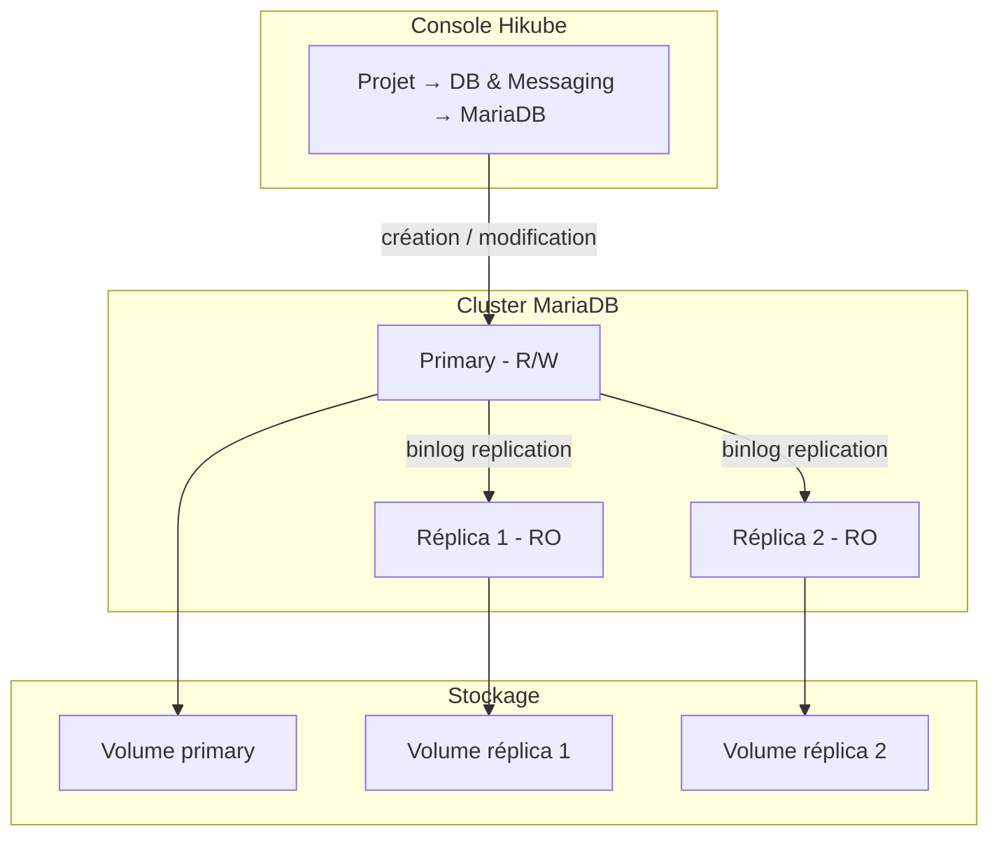
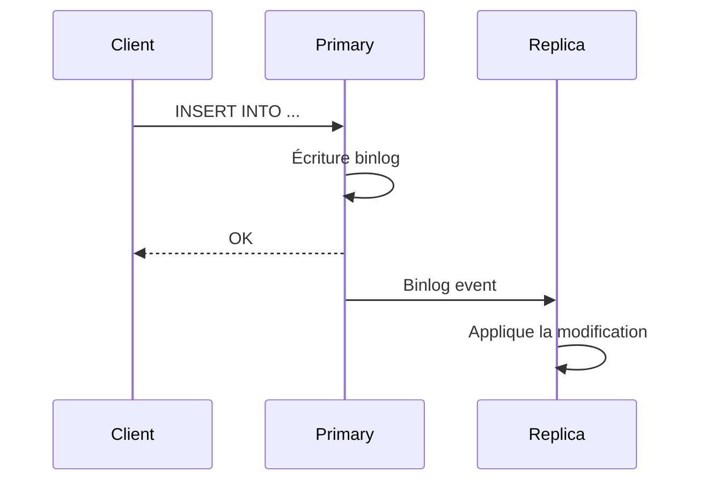

# Concepts — MariaDB

## Architecture

MariaDB sur Hikube est un service managé. MariaDB est un fork de MySQL compatible avec ses clients et son protocole. Chaque cluster créé depuis la console est un ensemble répliqué composé d'un primary et de réplicas éventuels. Il appartient à un **projet** et consomme les quotas de ce projet.

---

## Terminologie

| Terme | Description |
|-------|-------------|
| **Cluster MariaDB** | Instance managée créée depuis la console, composée d'un primary et de réplicas éventuels. |
| **Projet** | Espace isolé qui regroupe vos ressources et porte les quotas. |
| **Primary** | Nœud principal qui accepte les lectures et écritures. |
| **Réplica** | Nœud en lecture seule, synchronisé depuis le primary via la réplication binlog. |
| **Préconfiguration (Preset)** | Gabarit de ressources (CPU, mémoire) alloué à chaque nœud du cluster. |
| **Accès externe** | Option qui expose le cluster sur Internet via une adresse IP publique. |
| **Rôle** | Droit d'un utilisateur sur une base : **Administrateur** ou **Lecture seule**. |

---

## Réplication et haute disponibilité

Le cluster utilise la **réplication binlog** de MariaDB :

1. **Le primary** écrit toutes les modifications dans le binary log
2. **Les réplicas** consomment le binlog et appliquent les modifications
3. **En cas de panne** du primary, la plateforme promeut automatiquement un réplica

Le **Nombre de réplicas** se choisit à la création :

| Valeur proposée | Usage |
|-----------------|-------|
| **1 (Standalone)** | Développement, tests |
| **3 (Haute disponibilité max)** | Production |
| **5 (Très haute disponibilité)** | Production critique |

:::warning
Le nombre de réplicas et la préconfiguration ne peuvent pas être modifiés après la création. Pour les changer, [contactez le support](mailto:support@hidora.io).
:::

La bascule manuelle du primary (switchover) n'est pas proposée dans la console ; contactez le support.

---

## Utilisateurs, bases et rôles

La page d'un cluster MariaDB comporte une section **Utilisateurs** ; il n'y a pas d'onglet dédié aux bases de données. Les droits se donnent base par base : chaque accès associe un **Nom de la base** à des **Droits**, **Administrateur (Admin)** ou **Lecture seule (Read-only)**. **Administrateur** donne tous les privilèges sur la base (`ALL`, avec droit de délégation), **Lecture seule** le droit `SELECT`. Accorder un accès sur une base qui n'existe pas encore la crée. Il n'existe pas de rôle global : un utilisateur n'a accès qu'aux bases qui lui sont attribuées.

- À la création du cluster, l'étape **Utilisateurs** de l'assistant demande pour chaque utilisateur une **Base de données** applicative et un **Rôle**.
- Ensuite, **Créer un utilisateur** et **Gérer les accès** permettent d'attribuer un ou plusieurs accès. Un utilisateur enregistré sans accès n'a de droits sur aucune base.
- La colonne **Bases de données** de la liste des utilisateurs affiche chaque base avec le rôle, par exemple `myapp (Administrateur)`.

Les bases système `mysql`, `information_schema`, `performance_schema` et `sys` ne peuvent pas recevoir d'accès : la console affiche « « mysql » est une base système : choisissez une base applicative. » et l'API refuse la requête. Elles ne peuvent pas non plus être créées ni supprimées.

:::warning Utilisateurs créés avant la console v1.3.0
L'assistant de création de cluster attribuait auparavant à chaque utilisateur un rôle sur la base système `mysql`, qui contient les comptes et les droits du serveur : un accès **Administrateur** sur cette base permet de modifier les droits de tous les utilisateurs, un accès **Lecture seule** de lire les empreintes de mots de passe. Pour ces utilisateurs, ouvrez **Actions** → **Gérer les accès** : la ligne `mysql` y apparaît en erreur. Retirez-la, ajoutez si besoin la base applicative de l'utilisateur, puis cliquez sur **Enregistrer**.
:::

Le mot de passe d'un utilisateur est généré par la plateforme et affiché **une seule fois**. En cas de perte, générez-en un nouveau avec **Changer le mot de passe**.

### Règles de nommage

| Élément | Règle |
|---------|-------|
| Nom du cluster | 3 à 16 caractères : minuscules, chiffres et tirets ; commence par une lettre, se termine par une lettre ou un chiffre |
| Nom d'utilisateur | 3 à 16 caractères : minuscules, chiffres et tirets ; commence par une lettre, se termine par une lettre ou un chiffre. Certains noms, comme `admin` ou `root`, sont réservés |
| Nom de base de données | 1 à 63 caractères : minuscules, chiffres et tirets ; commence par une lettre, se termine par une lettre ou un chiffre. Les bases système `mysql`, `information_schema`, `performance_schema` et `sys` sont refusées |

:::note
Les tirets bas (`_`) ne sont pas acceptés dans les noms de base ni dans les noms d'utilisateur.
:::

---

## Préconfigurations

La **Préconfiguration (Preset)** définit la capacité allouée à **chaque nœud** du cluster. Les presets reprennent les tailles des [machines virtuelles](../../compute/overview.md), séries `u1`, `s1` et `m1` : un preset a les mêmes ressources que la VM du même nom. La liste affichée par l'assistant fait foi :

| Preset | CPU | Mémoire |
|--------|-----|---------|
| `u1.medium` | 1 | 4Gi |
| `u1.large` | 2 | 8Gi |
| `u1.xlarge` | 4 | 16Gi |
| `u1.2xlarge` | 8 | 32Gi |
| `u1.4xlarge` | 16 | 64Gi |
| `u1.8xlarge` | 32 | 128Gi |
| `s1.small` | 1 | 2Gi |
| `s1.medium` | 2 | 4Gi |
| `s1.large` | 4 | 8Gi |
| `s1.xlarge` | 8 | 16Gi |
| `s1.2xlarge` | 16 | 32Gi |
| `s1.4xlarge` | 32 | 64Gi |
| `m1.large` | 2 | 16Gi |
| `m1.xlarge` | 4 | 32Gi |
| `m1.2xlarge` | 8 | 64Gi |
| `m1.4xlarge` | 16 | 128Gi |
| `m1.8xlarge` | 32 | 256Gi |

L'assistant ne présélectionne aucun preset : choisissez-en un pour continuer. Chaque option indique ses ressources, par exemple « u1.medium — 1 CPU / 4Gi ». Si la liste ne peut pas être chargée, l'assistant affiche « La liste des presets n'a pas pu être chargée. Réessayez plus tard ou contactez le support. »

Un cluster créé avec un ancien preset (`nano`, `micro`, `small`, `medium`, `large`, `xlarge` ou `2xlarge`) le conserve et fonctionne comme avant : le formulaire **Modifier** l'affiche tel quel et l'enregistre sans changement. Le preset ne pouvant pas être modifié après la création, [contactez le support](mailto:support@hidora.io) pour ce changement. Si les ressources d'un cluster ont été fixées hors de son preset, le formulaire l'indique par la mention « (forcé) ».

La définition de ressources CPU/mémoire libres n'est pas proposée dans la console ; contactez le support.

---

## Accès réseau

- **Hôte interne** : toujours attribué, affiché dans la zone **Interne** de la carte **Connexion et réseau**. Il pointe vers le serveur qui accepte les écritures et se joint depuis les VM et les clusters Kubernetes du même projet, pas depuis un autre projet ni depuis Internet.
- **Accès externe désactivé** (par défaut) : le cluster n'est pas exposé sur Internet. La zone **Externe** affiche **Désactivé**.
- **Accès externe activé** : la plateforme attribue une adresse IP publique, affichée dans la zone **Externe**. Le port est le port MySQL standard, `3306`.

---

## Sauvegarde et restauration

Les clusters MariaDB se sauvegardent vers un bucket S3 du projet et se restaurent depuis l'onglet **Sauvegardes** de leur page, avec le [service de sauvegarde](../../backups/overview.md). Voir [Configurer les sauvegardes](./how-to/configure-backups.md) et [Restaurer une sauvegarde](./how-to/restore-backup.md).

---

## Quotas et coût

L'assistant affiche le **Coût estimé** et l'impact du cluster sur les quotas du projet. Si le cluster dépasse les quotas disponibles, le bouton **Suivant** reste inactif.

| Paramètre | Valeur |
|-----------|--------|
| Versions | 10.6, 10.11, 11.4, 11.8 ; montée de version uniquement après création |
| Réplicas | 1, 3 ou 5 |
| Taille du disque | 1 à 4 096 Go, dans la limite du quota de stockage du projet ; augmentation uniquement après création |

---

## Pour aller plus loin

- [Vue d'ensemble](./overview.md) : présentation du service
- [Démarrage rapide](./quick-start.md) : créer votre premier cluster
