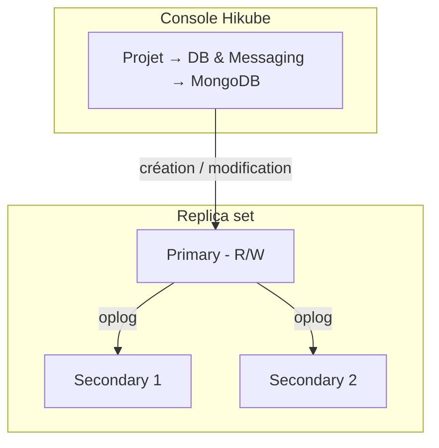

# Concepts — MongoDB

## Architecture

MongoDB sur Hikube est un service managé. Chaque cluster créé depuis la console est, par défaut, un **replica set** : un ensemble de membres qui portent les mêmes données, dont un seul accepte les écritures. Le cluster appartient à un **projet** et consomme les quotas de ce projet.

---

## Terminologie

| Terme | Description |
|-------|-------------|
| **Cluster MongoDB** | Instance managée créée depuis la console. |
| **Projet** | Espace isolé qui regroupe vos ressources et porte les quotas. |
| **Replica set** | Groupe de membres MongoDB qui répliquent les mêmes données. |
| **Primary** | Membre qui accepte les écritures. |
| **Secondary** | Membre qui réplique le primary et peut être élu à sa place en cas de panne. |
| **Oplog** | Journal des opérations du primary, rejoué par les secondaries. |
| **Shard** | Sous-ensemble des données, porté par son propre replica set (topologie shardée). |
| **Serveurs de configuration** | Membres qui stockent les métadonnées de la topologie shardée. |
| **Mongos** | Routeur qui reçoit les requêtes des clients et les dirige vers les bons shards. |
| **Préconfiguration (Preset)** | Gabarit de ressources (CPU, mémoire) alloué à chaque nœud. |

---

## Réplication et haute disponibilité

Les secondaries rejouent en continu l'oplog du primary. Si le primary devient indisponible, les membres restants élisent un nouveau primary ; une majorité de membres doit être disponible pour que l'élection aboutisse.

Le **Nombre de réplicas** se choisit à la création :

| Valeur proposée | Usage |
|-----------------|-------|
| **1 (Standalone)** | Développement, tests |
| **3 (Haute disponibilité max)** | Production : tolère la perte d'un membre |
| **5 (Très haute disponibilité)** | Production critique : tolère la perte de deux membres |

:::warning
Le nombre de réplicas, la préconfiguration et le sharding ne peuvent pas être modifiés après la création. Pour les changer, [contactez le support](mailto:support@hidora.io).
:::

---

## Sharding

L'option **Sharding (Topologie distribuée)** de l'assistant « déploie automatiquement les serveurs de configuration et les routeurs Mongos, et configure les réplicas en tant que Shards ». La console crée alors :

- **2 shards**, chacun composé du nombre de réplicas choisi et d'un disque de la taille choisie ;
- des **serveurs de configuration**, avec le même nombre de réplicas et la même taille de disque ;
- des **routeurs Mongos**, avec le même nombre de réplicas.

La consommation de ressources et le coût estimé en tiennent compte. Voir [Configurer le sharding](./how-to/configure-sharding.md).

---

## Utilisateurs, bases et rôles

La page d'un cluster MongoDB comporte une section **Utilisateurs** ; il n'y a pas d'onglet dédié aux bases de données. Les droits se donnent base par base : chaque accès associe un **Nom de la base** à des **Droits**, **Administrateur (Admin)** ou **Lecture seule (Read-only)**. **Administrateur** correspond aux rôles MongoDB `readWrite` et `dbAdmin` sur la base, **Lecture seule** au rôle `read`. Il n'existe pas de rôle global : un utilisateur n'a accès qu'aux bases qui lui sont attribuées.

- À la création du cluster, l'étape **Utilisateurs** de l'assistant demande pour chaque utilisateur une **Base de données** applicative et un **Rôle**. La base est créée si elle n'existe pas.
- Ensuite, **Créer un utilisateur** et **Gérer les accès** permettent d'attribuer un ou plusieurs accès. Un utilisateur MongoDB doit garder au moins un accès : sinon, la console affiche « Veuillez attribuer au moins un accès à une base de données. » et le bouton reste inactif.
- La colonne **Bases de données** de la liste des utilisateurs affiche chaque base avec le rôle, par exemple `myapp (Administrateur)`.

Les bases système `admin`, `local` et `config` ne peuvent pas recevoir d'accès : la console affiche « « admin » est une base système : choisissez une base applicative. » et l'API refuse la requête.

Tous les utilisateurs sont créés dans la base `admin`, qui sert de base d'authentification (`authSource=admin`), sans recevoir de rôle sur cette base.

:::warning Utilisateurs créés avant la console v1.3.0
L'assistant de création de cluster attribuait auparavant à chaque utilisateur un rôle sur la base système `admin`. Pour ces utilisateurs, ouvrez **Actions** → **Gérer les accès** : la ligne `admin` y apparaît en erreur. Retirez-la, ajoutez si besoin la base applicative de l'utilisateur, puis cliquez sur **Enregistrer**. Tant que cette ligne est présente, les droits de l'utilisateur ne peuvent pas être enregistrés.
:::

Le mot de passe d'un utilisateur est généré par la plateforme et affiché **une seule fois**. En cas de perte, générez-en un nouveau avec **Changer le mot de passe**.

### Règles de nommage

| Élément | Règle |
|---------|-------|
| Nom du cluster | 3 à 16 caractères : minuscules, chiffres et tirets ; commence par une lettre, se termine par une lettre ou un chiffre |
| Nom d'utilisateur | 3 à 16 caractères : minuscules, chiffres et tirets ; commence par une lettre, se termine par une lettre ou un chiffre. Certains noms, comme `admin` ou `root`, sont réservés |
| Nom de base de données | 1 à 63 caractères : minuscules, chiffres et tirets ; commence par une lettre, se termine par une lettre ou un chiffre. Les bases système `admin`, `local` et `config` sont refusées |

:::note
Les tirets bas (`_`) et les majuscules ne sont pas acceptés dans les noms de base ni dans les noms d'utilisateur.
:::

---

## Préconfigurations

La **Préconfiguration (Preset)** définit la capacité allouée à **chaque nœud**. Les presets reprennent les tailles des [machines virtuelles](../../compute/overview.md), séries `u1`, `s1` et `m1` : un preset a les mêmes ressources que la VM du même nom. La liste affichée par l'assistant fait foi :

| Preset | CPU | Mémoire |
|--------|-----|---------|
| `u1.medium` | 1 | 4Gi |
| `u1.large` | 2 | 8Gi |
| `u1.xlarge` | 4 | 16Gi |
| `u1.2xlarge` | 8 | 32Gi |
| `u1.4xlarge` | 16 | 64Gi |
| `u1.8xlarge` | 32 | 128Gi |
| `s1.small` | 1 | 2Gi |
| `s1.medium` | 2 | 4Gi |
| `s1.large` | 4 | 8Gi |
| `s1.xlarge` | 8 | 16Gi |
| `s1.2xlarge` | 16 | 32Gi |
| `s1.4xlarge` | 32 | 64Gi |
| `m1.large` | 2 | 16Gi |
| `m1.xlarge` | 4 | 32Gi |
| `m1.2xlarge` | 8 | 64Gi |
| `m1.4xlarge` | 16 | 128Gi |
| `m1.8xlarge` | 32 | 256Gi |

L'assistant ne présélectionne aucun preset : choisissez-en un pour continuer. Chaque option indique ses ressources, par exemple « u1.medium — 1 CPU / 4Gi ». Si la liste ne peut pas être chargée, l'assistant affiche « La liste des presets n'a pas pu être chargée. Réessayez plus tard ou contactez le support. »

Un cluster créé avec un ancien preset (`nano`, `micro`, `small`, `medium`, `large`, `xlarge` ou `2xlarge`) le conserve et fonctionne comme avant : le formulaire **Modifier** l'affiche tel quel et l'enregistre sans changement. Ce preset n'a pas de prix catalogue : la console affiche « Prix indisponible » et le tableau de bord du projet l'exclut du coût total, jusqu'à ce que le cluster passe à un preset de la liste. Le preset ne pouvant pas être modifié après la création, [contactez le support](mailto:support@hidora.io) pour ce changement. Si les ressources d'un cluster ont été fixées hors de son preset, le formulaire l'indique par la mention « (forcé) ».

---

## Accès réseau

- **Accès externe désactivé** (par défaut) : le cluster n'est pas exposé sur Internet. Le champ **Hôte (Host)** de la carte **Connexion et réseau** affiche **Non défini**.
- **Accès externe activé** : le port est le port MongoDB standard, `27017`, sans TLS.
  - **Cluster shardé** : la plateforme attribue une adresse publique aux routeurs Mongos, affichée dans le champ **Hôte (Host)**. L'assistant fournit une chaîne de connexion de la forme `mongodb://<utilisateur>:<password>@<hôte>`.
  - **Replica set** : chaque membre reçoit sa propre adresse publique. La carte **Connexion et réseau** les liste sous **Membres du replica set rs0**, chacune avec un bouton de copie, et propose une **Chaîne de connexion externe** de la forme `mongodb://<user>:<password>@<membre>:27017/?directConnection=true&authSource=admin`. Connectez-vous ainsi à un membre en connexion directe, sans paramètre `replicaSet` : les membres s'annoncent sous des noms internes au cluster, qui ne se résolvent pas depuis l'extérieur. Le membre joint peut être un secondaire, qui n'accepte pas les écritures : lisez avec `readPreference=secondaryPreferred`, et écrivez sur le membre primaire.

---

## Sauvegarde et restauration

La configuration des sauvegardes et la restauration ne sont pas proposées dans la console ; [contactez le support](mailto:support@hidora.io).

---

## Quotas et coût

L'assistant affiche le **Coût estimé** et l'impact du cluster sur les quotas du projet. Si le cluster dépasse les quotas disponibles, le bouton **Suivant** reste inactif.

| Paramètre | Valeur |
|-----------|--------|
| Versions | 6.0, 7.0, 8.0 ; montée de version uniquement après création |
| Réplicas | 1, 3 ou 5 |
| Taille du disque | 1 à 4 096 Go, dans la limite du quota de stockage du projet ; augmentation uniquement après création |

---

## Pour aller plus loin

- [Vue d'ensemble](./overview.md) : présentation du service
- [Démarrage rapide](./quick-start.md) : créer votre premier cluster
