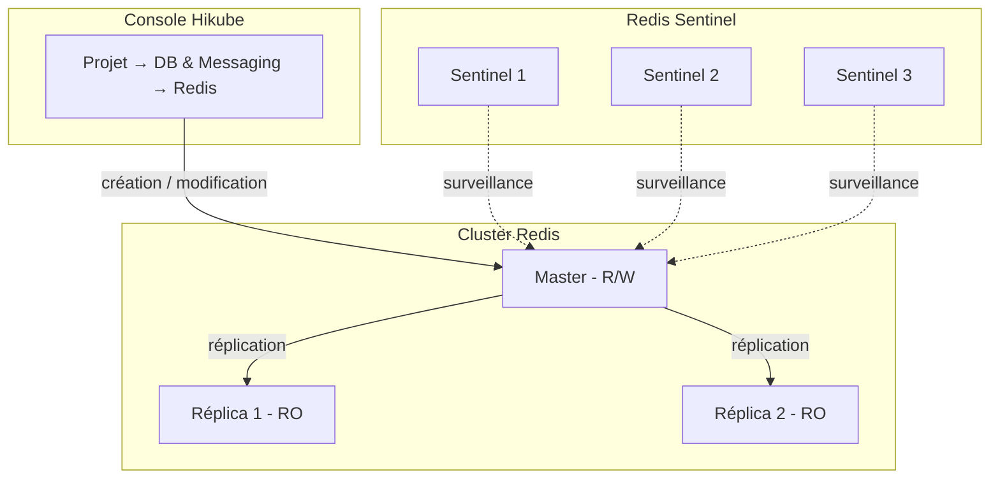
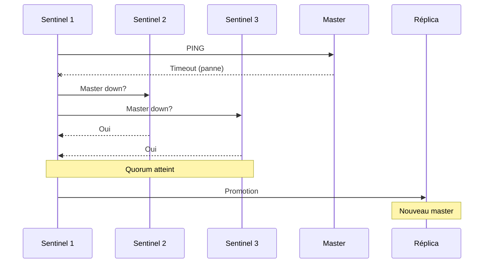

# Concepts — Redis

## Architecture

Redis sur Hikube est un service managé. Chaque cluster créé depuis la console est un ensemble master-réplicas, supervisé par **Redis Sentinel** pour le failover automatique. Il appartient à un **projet** et consomme les quotas de ce projet.

---

## Terminologie

| Terme | Description |
|-------|-------------|
| **Cluster Redis** | Instance managée créée depuis la console, composée d'un master et de réplicas éventuels. |
| **Projet** | Espace isolé qui regroupe vos ressources et porte les quotas. |
| **Master** | Instance principale qui accepte les lectures et écritures. |
| **Réplica** | Instance en lecture seule, synchronisée depuis le master. |
| **Sentinel** | Processus de supervision qui détecte les pannes du master et orchestre le failover automatique. |
| **Préconfiguration** | Gabarit de ressources (CPU, mémoire) alloué à chaque nœud du cluster. |
| **Réseau public** | Option (aussi appelée **Accès externe**) qui expose le cluster sur Internet via une adresse IP publique. |
| **Authentification** | Protection de l'accès par un mot de passe global au cluster. |

---

## Haute disponibilité avec Sentinel

Redis Sentinel assure la haute disponibilité en :

1. **Surveillant** en permanence le master et les réplicas
2. **Détectant** la panne du master par consensus entre Sentinels
3. **Promouvant** automatiquement un réplica en nouveau master
4. **Reconfigurant** les autres réplicas pour suivre le nouveau master

Le **Nombre de réplicas** se choisit à la création (de 1 à 8).

:::tip
Le failover automatique fonctionne dès **2 réplicas** : trois sentinelles sont toujours déployées et forment le quorum. Choisissez **3 réplicas** ou plus pour la production, afin de tolérer davantage de pannes.
:::

:::warning
Le nombre de réplicas ne peut pas être modifié après la création (« Le mode ne peut pas être modifié après création »). Pour le changer, [contactez le support](mailto:support@hidora.io).
:::

---

## Persistance

Chaque nœud dispose d'un volume persistant dont la capacité est fixée par le champ **Taille du volume (Go)** (« La taille de stockage allouée à chaque nœud du cluster »). Redis écrit ses données sur disque via ses mécanismes natifs, ce qui leur permet de survivre aux redémarrages.

---

## Authentification

L'option **Activer l'authentification** est active par défaut dans l'assistant :

- **Activée** : un mot de passe est généré à la création et affiché une seule fois, avec l'utilisateur `default`. Vous pouvez le renouveler à tout moment depuis la section **Sécurité** de la page du cluster (**Effectuer une rotation**).
- **Désactivée** : le cluster accepte les connexions sans mot de passe. À éviter, en particulier avec le réseau public activé.

Redis sur Hikube n'expose pas de gestion d'utilisateurs multiples (ACL) dans la console : l'accès repose sur ce mot de passe global.

---

## Accès réseau

- **Réseau public désactivé** (par défaut, « Privé » dans le récapitulatif) : le cluster n'est pas exposé sur Internet. La section **Connexion** de la page du cluster affiche « En attente d'attribution... » à la place de l'hôte.
- **Réseau public activé** (« Public ») : la plateforme attribue une adresse IP publique, affichée dans le champ **Hôte**. Elle donne accès au master sur le port Redis standard, `6379`, et suit le master après un basculement.

---

## Préconfigurations

La **Préconfiguration** définit la capacité allouée à **chaque nœud** du cluster. Les presets reprennent les tailles des [machines virtuelles](../../compute/overview.md), séries `u1`, `s1` et `m1` : un preset a les mêmes ressources que la VM du même nom. La liste affichée par l'assistant fait foi :

| Preset | CPU | Mémoire |
|--------|-----|---------|
| `u1.medium` | 1 | 4Gi |
| `u1.large` | 2 | 8Gi |
| `u1.xlarge` | 4 | 16Gi |
| `u1.2xlarge` | 8 | 32Gi |
| `u1.4xlarge` | 16 | 64Gi |
| `u1.8xlarge` | 32 | 128Gi |
| `s1.small` | 1 | 2Gi |
| `s1.medium` | 2 | 4Gi |
| `s1.large` | 4 | 8Gi |
| `s1.xlarge` | 8 | 16Gi |
| `s1.2xlarge` | 16 | 32Gi |
| `s1.4xlarge` | 32 | 64Gi |
| `m1.large` | 2 | 16Gi |
| `m1.xlarge` | 4 | 32Gi |
| `m1.2xlarge` | 8 | 64Gi |
| `m1.4xlarge` | 16 | 128Gi |
| `m1.8xlarge` | 32 | 256Gi |

L'assistant ne présélectionne aucun preset : choisissez-en un pour continuer. Chaque option indique ses ressources, par exemple « u1.medium — 1 CPU / 4Gi ». Si la liste ne peut pas être chargée, l'assistant affiche « La liste des presets n'a pas pu être chargée. Réessayez plus tard ou contactez le support. »

Un cluster créé avec un ancien preset (`nano`, `micro`, `small`, `medium`, `large`, `xlarge` ou `2xlarge`) le conserve et fonctionne comme avant : le formulaire **Modifier** l'affiche tel quel et l'enregistre sans changement. Ce preset n'a pas de prix catalogue : la console affiche « Prix indisponible » et le tableau de bord du projet l'exclut du coût total, jusqu'à ce que vous choisissiez un preset de la liste. Si les ressources d'un cluster ont été fixées hors de son preset, le formulaire l'indique par la mention « (forcé) ».

La mémoire du preset borne la taille du jeu de données que Redis peut conserver en mémoire. La définition de ressources CPU/mémoire libres n'est pas proposée dans la console ; contactez le support.

---

## Quotas et coût

L'assistant affiche le **Coût estimé** et l'impact du cluster sur les quotas du projet. Si le cluster dépasse les quotas disponibles, le bouton **Suivant** reste inactif.

En plus des réplicas, le quota compte les trois sentinelles du cluster, chacune avec le CPU et la mémoire de la préconfiguration choisie, sans stockage : un cluster de 3 réplicas réserve donc 6 fois le CPU et la mémoire de sa préconfiguration. Les sentinelles ne sont pas facturées : le coût estimé ne compte que les réplicas.

| Paramètre | Valeur |
|-----------|--------|
| Réplicas | 1 à 8 |
| Taille du volume | 1 à 4 096 Go par nœud, dans la limite du quota du projet ; augmentation uniquement après création |
| Bases Redis | Base logique `0` par défaut |

---

## Pour aller plus loin

- [Vue d'ensemble](./overview.md) : présentation du service
- [Démarrage rapide](./quick-start.md) : créer votre premier cluster
