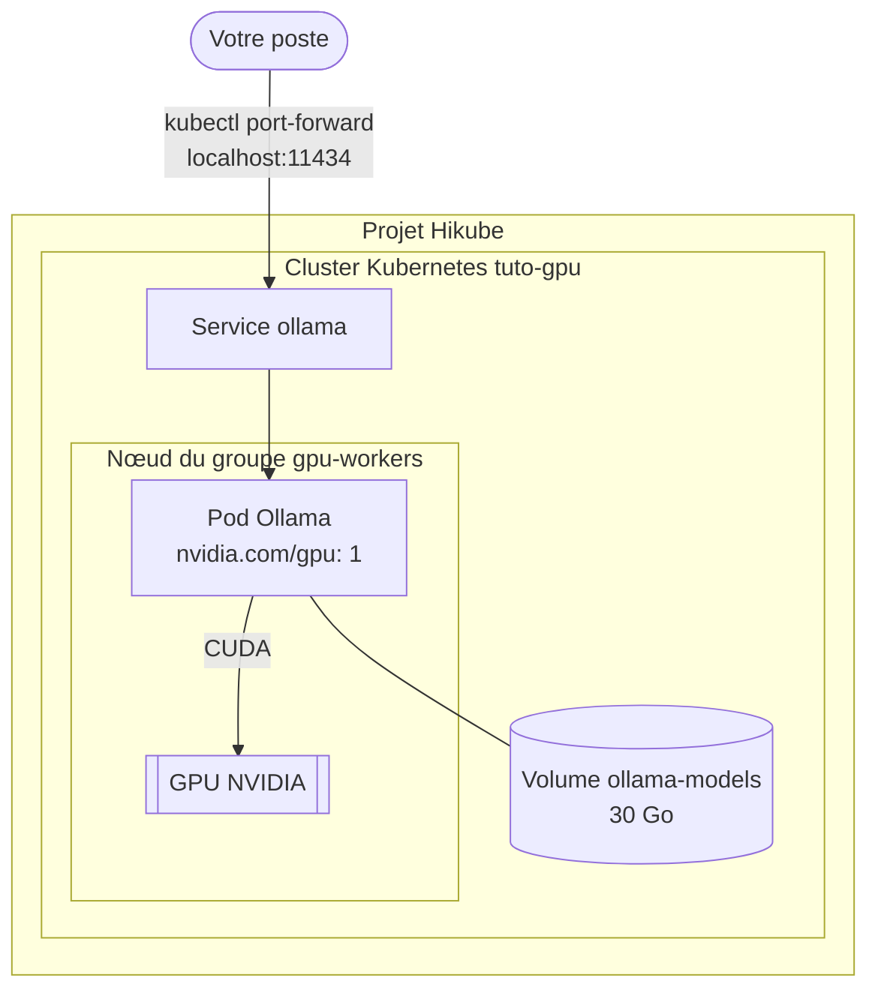

import NavigationFooter from '@site/src/components/NavigationFooter';

# Servir un modèle de langage sur GPU avec Kubernetes

Ce tutoriel vous fait servir un modèle de langage (LLM) open source sur un GPU NVIDIA d'Hikube : un cluster Kubernetes avec un nœud GPU, un serveur d'inférence qui charge le modèle dans la mémoire du GPU, une API compatible OpenAI pour l'interroger, puis la preuve que le calcul se fait bien sur le GPU et la mesure de son débit.

Le serveur d'inférence est [Ollama](https://ollama.com), qui télécharge et sert des modèles ouverts. Le modèle est [Qwen2.5 7B Instruct](https://ollama.com/library/qwen2.5), sous licence Apache 2.0 : environ 5 Go, il tient largement dans la mémoire d'un GPU de centre de données.

| | |
|---|---|
| **Difficulté** | Intermédiaire |
| **Durée** | Environ 45 minutes |
| **Vous apprendrez à** | Ajouter un groupe de nœuds GPU à un cluster, réserver un GPU pour un pod, vérifier qu'un modèle tourne réellement sur le GPU, mesurer son débit de génération |

---

## Ce que vous allez construire



- Le GPU est **réservé au pod** Ollama : aucun autre pod ne peut l'utiliser tant qu'il tourne.
- Le modèle est stocké sur un **volume persistant** : il survit au redémarrage du pod, sans nouveau téléchargement.
- L'API n'est **pas exposée sur Internet** : vous la joignez depuis votre poste par un tunnel `kubectl port-forward`.

---

## Prérequis

- Un **compte Hikube** et un **projet** disposant de quotas suffisants pour un control plane, un nœud `u1.2xlarge` (8 vCPU, 32 Go) avec 100 Go de disque, un GPU et un volume de 30 Go
- Le **rôle administrateur du projet**, pour télécharger le kubeconfig du cluster
- **`kubectl`**, **`curl`** et **`jq`** installés sur votre poste
- Des **notions de base de Kubernetes** : pod, `Deployment`, `Service`

---

## Étape 1 : Créer le cluster avec un groupe de nœuds GPU

1. Dans la [console Hikube](https://console.hikube.cloud), sélectionnez votre projet, puis ouvrez **Infrastructure** > **Kubernetes**.
2. Cliquez sur **Créer un cluster** et renseignez l'assistant :

| Étape de l'assistant | Champ | Valeur |
|----------------------|-------|--------|
| **Général** | **Nom du cluster** | `tuto-gpu` |
| | **Version de Kubernetes** | la version présélectionnée |
| | **Taille de l'instance Control Plane** | **s1.small — 1 CPU / 2Gi** |
| | **Haute Disponibilité du Control Plane** | **3 (HA)** |
| **Nœuds** | **Nom du groupe** | `gpu-workers` |
| | **Type d'instance** | `u1.2xlarge` (8 vCPU, 32 Go) |
| | **Taille du disque des nœuds** | `100` : les images de conteneurs GPU sont volumineuses |
| | **Nombre minimum de nœuds** / **Nombre maximum de nœuds** | `1` / `1` |
| | Section **GPU** | Cliquez sur la carte **NVIDIA L40S**, ou sur un autre modèle disponible ; gardez 1 GPU par nœud |
| **Addons** | | **GPU Operator** est coché et verrouillé (**Requis lorsqu'un groupe de nœuds a des GPU**) ; laissez les autres addons tels quels |

3. À l'étape **Vérification**, cliquez sur **Déployer**.

Le choix du modèle de GPU et ses contraintes sont détaillés dans [Comment provisionner un GPU sur Kubernetes](../services/gpu/how-to/provision-gpu-kubernetes.md) ; les modèles marqués **Indisponible** ne peuvent pas être sélectionnés pour le moment.

**Résultat attendu** : `tuto-gpu` apparaît dans la liste **Clusters Kubernetes** avec le statut **En création**.

---

## Étape 2 : Se connecter au cluster

Attendez que le cluster soit **Prêt** et que son nœud GPU ait démarré, plusieurs minutes après sa création.

1. Ouvrez **Infrastructure** > **Kubernetes**, puis la page du cluster `tuto-gpu`.
2. Cliquez sur **Kubeconfig**. Le navigateur télécharge `kubeconfig-tuto-gpu.yaml`.

```bash
export KUBECONFIG=~/Downloads/kubeconfig-tuto-gpu.yaml
kubectl get nodes
```

**Résultat attendu** : un nœud `kubernetes-tuto-gpu-gpu-workers-…` au statut `Ready`.

:::note Le cluster est Prêt, mais aucun nœud n'apparaît
Le statut **Prêt** concerne le control plane. Le nœud GPU et les addons démarrent ensuite : si `kubectl get nodes` répond `No resources found`, patientez et relancez la commande.
:::

---

## Étape 3 : Vérifier que le GPU est exposé

L'addon **GPU Operator** prépare le nœud : il y installe de quoi exposer le GPU aux pods. Suivez son démarrage :

```bash
kubectl get pods -n cozy-gpu-operator
```

**Résultat attendu** : après quelques minutes, tous les pods sont en `Running`.

Vérifiez ensuite que le nœud annonce son GPU au planificateur de Kubernetes :

```bash
kubectl get nodes -o custom-columns=NAME:.metadata.name,GPU:.status.allocatable.'nvidia\.com/gpu'
```

**Résultat attendu** : la colonne `GPU` du nœud affiche `1`, le nombre de GPU choisi à l'étape 1. Tant qu'elle affiche `<none>`, le GPU Operator n'a pas fini de préparer le nœud : patientez et relancez la commande.

---

## Étape 4 : Déployer le serveur d'inférence

Le manifeste crée trois ressources : un volume pour les modèles, le serveur Ollama, et un `Service` pour le joindre dans le cluster.

```yaml title="ollama.yaml"
apiVersion: v1
kind: PersistentVolumeClaim
metadata:
  name: ollama-models
spec:
  accessModes:
    - ReadWriteOnce
  resources:
    requests:
      storage: 30Gi
---
apiVersion: apps/v1
kind: Deployment
metadata:
  name: ollama
  labels:
    app: ollama
spec:
  replicas: 1
  strategy:
    type: Recreate          # le volume ne s'attache qu'à un pod à la fois
  selector:
    matchLabels:
      app: ollama
  template:
    metadata:
      labels:
        app: ollama
    spec:
      containers:
        - name: ollama
          image: ollama/ollama:0.40.18
          ports:
            - containerPort: 11434
          env:
            - name: OLLAMA_KEEP_ALIVE   # garde le modèle chargé en mémoire du GPU
              value: "-1"
          volumeMounts:
            - name: models
              mountPath: /root/.ollama
          readinessProbe:
            httpGet:
              path: /
              port: 11434
          resources:
            requests:
              cpu: "2"
              memory: 8Gi
            limits:
              memory: 16Gi
              nvidia.com/gpu: 1
      volumes:
        - name: models
          persistentVolumeClaim:
            claimName: ollama-models
---
apiVersion: v1
kind: Service
metadata:
  name: ollama
spec:
  selector:
    app: ollama
  ports:
    - port: 11434
      targetPort: 11434
```

La ligne `nvidia.com/gpu: 1` est celle qui compte : elle réserve un GPU entier au pod, et Kubernetes ne place le pod que sur un nœud qui en a un de libre.

```bash
kubectl apply -f ollama.yaml
kubectl rollout status deployment/ollama --timeout=10m
```

**Résultat attendu** : le déploiement aboutit en quelques minutes, le temps de télécharger l'image.

Au démarrage, Ollama détecte le matériel de calcul et l'écrit dans ses journaux :

```bash
kubectl logs deployment/ollama | grep "inference compute"
```

**Résultat attendu** : la ligne `inference compute` décrit le GPU NVIDIA du nœud, avec son nom et sa mémoire. Si elle indique `library=cpu`, Ollama ne voit pas le GPU : voir le [dépannage GPU](../services/gpu/troubleshooting.md).

:::note Le pod reste en Pending
`kubectl describe pod -l app=ollama` affiche alors `Insufficient nvidia.com/gpu` : aucun nœud n'a de GPU libre. Vérifiez la colonne `GPU` de l'étape 3, et qu'aucun autre pod ne réserve déjà le GPU.
:::

---

## Étape 5 : Télécharger le modèle et l'interroger

Téléchargez le modèle dans le volume du serveur :

```bash
kubectl exec deploy/ollama -- ollama pull qwen2.5:7b
kubectl exec deploy/ollama -- ollama list
```

**Résultat attendu** : après le téléchargement, qui se termine par `success`, le modèle apparaît dans la liste.

```console
NAME          ID              SIZE      MODIFIED
qwen2.5:7b    845dbda0ea48    4.7 GB    2 seconds ago
```

Ouvrez un tunnel vers le serveur. La commande reste au premier plan : lancez-la dans un second terminal, et laissez-le ouvert jusqu'à la fin du tutoriel.

```bash
kubectl port-forward svc/ollama 11434:11434
```

Dans le premier terminal, posez une question au modèle par l'API compatible OpenAI d'Ollama :

```bash
curl -s http://localhost:11434/v1/chat/completions \
  -H "Content-Type: application/json" \
  -d '{"model": "qwen2.5:7b", "messages": [{"role": "user", "content": "Explique en une phrase ce qu'\''est un GPU."}]}' \
  | jq '{model, content: .choices[0].message.content, usage}'
```

**Résultat attendu** : la réponse du modèle, et le nombre de jetons (*tokens*) lus et générés.

```console
{
  "model": "qwen2.5:7b",
  "content": "Un GPU ... est un type de puce spécialisée ...",
  "usage": {
    "prompt_tokens": 40,
    "completion_tokens": 35,
    "total_tokens": 75
    ...
  }
}
```

La première requête est plus lente : Ollama charge le modèle en mémoire. Grâce à `OLLAMA_KEEP_ALIVE`, il y reste pour les suivantes.

Tout client compatible OpenAI peut utiliser ce serveur : donnez-lui l'URL de base `http://localhost:11434/v1` et le modèle `qwen2.5:7b`.

---

## Étape 6 : Vérifier que le modèle tourne sur le GPU

Un modèle qui répond ne prouve pas que le GPU travaille : si le modèle ne tient pas dans la mémoire du GPU, ou si le pod ne voit pas le GPU, Ollama bascule tout ou partie du calcul sur le processeur, sans erreur. Vérifiez où le modèle est chargé :

```bash
kubectl exec deploy/ollama -- ollama ps
```

**Résultat attendu** : la colonne `PROCESSOR` de `qwen2.5:7b` affiche `100% GPU`. La valeur `100% CPU`, ou un partage du type `48%/52% CPU/GPU`, signifie que le modèle n'est pas, ou pas entièrement, dans la mémoire du GPU.

Vérifiez aussi, côté Kubernetes, que le GPU du nœud est attribué :

```bash
kubectl describe nodes | grep -A 15 "Allocated resources" | grep nvidia.com/gpu
```

**Résultat attendu** : `nvidia.com/gpu` avec `1` en demande et en limite, le GPU réservé par le pod Ollama.

---

## Étape 7 : Mesurer le débit de génération

Le débit d'un LLM se mesure en jetons générés par seconde. L'API native d'Ollama renvoie le nombre de jetons générés (`eval_count`) et la durée de génération en nanosecondes (`eval_duration`) : `jq` en déduit le débit.

```bash
PROMPT="Écris un paragraphe de 150 mots sur l'histoire du calcul parallèle."

curl -s http://localhost:11434/api/generate \
  -d "{\"model\": \"qwen2.5:7b\", \"prompt\": \"$PROMPT\", \"stream\": false}" \
  | jq '{tokens: .eval_count, tokens_per_s: (.eval_count / .eval_duration * 1e9 | floor)}'
```

**Résultat attendu** : un objet avec le nombre de jetons générés (`tokens`) et le débit en jetons par seconde (`tokens_per_s`). Relancez-la deux ou trois fois et retenez une valeur typique.

### Point de comparaison : le même modèle sur le processeur

Pour mesurer ce que le GPU apporte, relancez la même requête avec l'option `num_gpu` à `0` : Ollama recharge alors le modèle **sur le processeur du nœud**, sans GPU.

```bash
curl -s http://localhost:11434/api/generate \
  -d "{\"model\": \"qwen2.5:7b\", \"prompt\": \"$PROMPT\", \"stream\": false, \"options\": {\"num_gpu\": 0}}" \
  | jq '{tokens: .eval_count, tokens_per_s: (.eval_count / .eval_duration * 1e9 | floor)}'
```

Comparez les deux valeurs de `tokens_per_s` : l'écart est ce que le GPU apporte à ce modèle, sur ce nœud. `kubectl exec deploy/ollama -- ollama ps` affiche maintenant `100% CPU` : relancez la première commande, sans `num_gpu`, pour recharger le modèle sur le GPU.

---

## Étape 8 : Nettoyer

Arrêtez le tunnel (Ctrl+C dans le second terminal). Si vous ne gardez pas le serveur, supprimez le cluster pour libérer le GPU et les quotas du projet :

1. **Infrastructure** > **Kubernetes** : ouvrez le menu **Actions** de `tuto-gpu`, choisissez **Supprimer**, saisissez le nom du cluster puis cliquez sur **Supprimer définitivement**.

Le serveur, son volume et le modèle téléchargé disparaissent avec le cluster.

:::warning
Cette suppression est irréversible.
:::

---

## Récapitulatif

Vous avez :

- créé un cluster Kubernetes avec un groupe de nœuds GPU, et laissé le GPU Operator préparer le nœud ;
- vérifié que le nœud annonce son GPU (`nvidia.com/gpu`) ;
- déployé un serveur d'inférence qui réserve un GPU entier, avec un volume persistant pour les modèles ;
- interrogé un modèle open source par une API compatible OpenAI ;
- vérifié que le modèle est chargé sur le GPU, puis mesuré son débit et comparé avec le processeur.

## Aller plus loin

- **Partager un GPU** : pour faire tourner plusieurs petits modèles sur un même GPU, activez l'addon [HAMi](../services/kubernetes/plugins/hami.md).
- **Modèles plus grands** : la mémoire du GPU limite la taille du modèle ; les modèles proposés et leurs caractéristiques sont dans les [concepts GPU](../services/gpu/concepts.md).
- **Usage ponctuel** : un groupe de nœuds GPU peut descendre à zéro nœud entre deux utilisations, voir [Comment configurer l'autoscaling](../services/kubernetes/how-to/configure-autoscaling.md).
- **Montée en charge** : pour servir de nombreuses requêtes simultanées, un serveur d'inférence spécialisé comme [vLLM](https://docs.vllm.ai) tire davantage parti du GPU ; la réservation par `nvidia.com/gpu` reste la même.
- **Ouvrir l'API à d'autres applications** : Ollama n'authentifie pas les requêtes. Avant de publier le service, placez-le derrière une authentification, par exemple sur un Ingress, voir [Comment déployer un Ingress avec TLS](../services/kubernetes/how-to/deploy-ingress-tls.md).
- **Sans Kubernetes** : un GPU s'attache aussi à une machine virtuelle, voir [Créer une VM avec GPU](../services/gpu/quick-start.md).

<NavigationFooter
  nextSteps={[
    {label: "Provisionner un GPU sur Kubernetes", href: "../../services/gpu/how-to/provision-gpu-kubernetes"},
    {label: "Plugin GPU Operator", href: "../../services/kubernetes/plugins/gpu-operator"},
  ]}
/>
