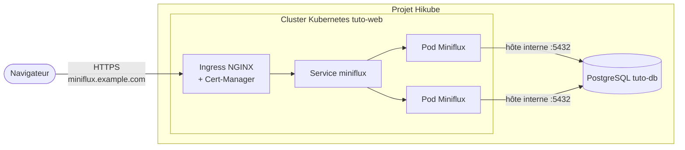

import NavigationFooter from '@site/src/components/NavigationFooter';

# Déployer une application web avec PostgreSQL sur Kubernetes

Ce tutoriel vous fait construire une application web complète sur Hikube : un cluster Kubernetes qui fait tourner l'application, une base **PostgreSQL** managée qui stocke ses données, une publication en HTTPS avec un certificat automatique, puis la surveillance de l'ensemble.

L'application d'exemple est [Miniflux](https://miniflux.app), un lecteur de flux RSS open source : une seule image de conteneur, une base PostgreSQL, une interface web.

| | |
|---|---|
| **Difficulté** | Intermédiaire |
| **Durée** | Environ 45 minutes |
| **Vous apprendrez à** | Relier un cluster Kubernetes à une base managée du même projet, passer des identifiants par un `Secret`, publier un service en HTTPS |

---

## Ce que vous allez construire



- La base n'est **pas exposée sur Internet** : l'application la joint par son hôte interne, réservé aux ressources du projet.
- Le mot de passe de la base ne figure dans aucun fichier : il vit dans un `Secret` Kubernetes.
- Seul l'Ingress est public, en HTTPS, avec un certificat Let's Encrypt renouvelé automatiquement.

---

## Prérequis

- Un **compte Hikube** et un **projet** disposant de quotas suffisants pour un control plane, un nœud `s1.large` (4 vCPU, 8 Go) et une base `s1.small`
- Le **rôle administrateur du projet**, pour télécharger le kubeconfig du cluster
- **`kubectl`** et **`openssl`** installés sur votre poste
- Un **nom de domaine** dont vous gérez la zone DNS, pour la publication en HTTPS (étape 6). Ce tutoriel utilise `miniflux.example.com` : remplacez-le partout par le vôtre.
- Des **notions de base de Kubernetes** : pod, `Deployment`, `Service`

---

## Étape 1 : Créer le cluster Kubernetes

Le cluster est la ressource la plus longue à créer : commencez par lui, vous créerez la base pendant qu'il démarre.

1. Dans la [console Hikube](https://console.hikube.cloud), sélectionnez votre projet, puis ouvrez **Infrastructure** > **Kubernetes**.
2. Cliquez sur **Créer un cluster** et renseignez l'assistant :

| Étape de l'assistant | Champ | Valeur |
|----------------------|-------|--------|
| **Général** | **Nom du cluster** | `tuto-web` |
| | **Version de Kubernetes** | la version présélectionnée |
| | **Taille de l'instance Control Plane** | **s1.small — 1 CPU / 2Gi** |
| | **Haute Disponibilité du Control Plane** | **3 (HA)** |
| **Nœuds** | Groupe `worker-pool-1` | **Type d'instance** `s1.large`, **Nombre minimum de nœuds** 1, **Nombre maximum de nœuds** 3, **Entrée du trafic Internet (IP publique)** activé |
| **Addons** | | Gardez **Cert-Manager**, **Ingress NGINX** et **Monitoring Agents**, cochés par défaut |

3. À l'étape **Vérification**, cliquez sur **Déployer**.

Chaque champ est détaillé dans le [démarrage rapide Kubernetes](../services/kubernetes/quick-start.md).

**Résultat attendu** : `tuto-web` apparaît dans la liste **Clusters Kubernetes** avec le statut **En création**. Passez à l'étape suivante sans attendre.

---

## Étape 2 : Créer la base PostgreSQL

1. Ouvrez **DB & Messaging** → **PostgreSQL**, puis cliquez sur **Créer un cluster**.
2. Renseignez l'assistant :

| Étape de l'assistant | Champ | Valeur |
|----------------------|-------|--------|
| **Général** | **Nom du cluster** | `tuto-db` |
| **Configuration** | **Version PostgreSQL** | `18` |
| | **Preset d'instance** | `s1.small — 1 CPU / 2Gi` |
| | **Taille du disque (Go)** | `10` |
| | **Nombre de réplicas** | `1 (Standalone)` |
| | **Accès externe** | **Désactivé** : l'application joindra la base depuis le projet |
| **Bases** | **Nom de la base de données** | `miniflux`, puis **Ajouter** |
| **Utilisateurs** | **Nom de l'utilisateur** | `miniflux`, **Nom de la base** `miniflux`, **Droits** **Administrateur (Admin)**, puis **Ajouter** |

3. À l'étape **Vérification**, cliquez sur **Déployer**.

L'étape **Résumé** affiche le **Mot de passe** de l'utilisateur `miniflux`, dans la section **Identifiants des utilisateurs**.

:::warning Copiez le mot de passe maintenant
Il n'est affiché qu'une fois. Copiez-le dans votre gestionnaire de mots de passe avant de cliquer sur **Terminer**. En cas de perte, générez-en un nouveau depuis l'onglet **Utilisateurs** du cluster (**Actions** → **Changer le mot de passe**).
:::

4. Cliquez sur **Terminer**. Sur la page du cluster, dans la carte **Connexion et Bases de données**, copiez l'hôte de la zone **Interne** (*Depuis les ressources du projet uniquement*), avec le bouton de copie : c'est l'adresse que l'application utilisera, sur le port `5432`.

**Résultat attendu** : après quelques minutes, `tuto-db` passe au statut **Prêt**, et la zone **Externe** affiche **Désactivé**.

---

## Étape 3 : Se connecter au cluster

Attendez que le cluster soit **Prêt** et que son premier nœud ait démarré, quelques minutes après sa création.

1. Ouvrez **Infrastructure** > **Kubernetes**, puis la page du cluster `tuto-web`.
2. Dans la section **Actions**, cliquez sur **Kubeconfig**. Le navigateur télécharge `kubeconfig-tuto-web.yaml`.

```bash
export KUBECONFIG=~/Downloads/kubeconfig-tuto-web.yaml
kubectl get nodes
```

**Résultat attendu** : un nœud au statut `Ready`.

```console
NAME                                           STATUS   ROLES    AGE   VERSION
kubernetes-tuto-web-worker-pool-1-xxxxx-xxxxx  Ready    <none>   3m    v1.xx.x
```

:::note Le cluster est Prêt, mais aucun nœud n'apparaît
Le statut **Prêt** concerne le control plane. Le premier nœud et les addons démarrent ensuite : si `kubectl get nodes` répond `No resources found`, patientez et relancez la commande.
:::

Vérifiez aussi que les addons tournent :

```bash
kubectl get pods -A | grep -E "cert-manager|ingress-nginx"
```

**Résultat attendu** : tous les pods en `Running`.

---

## Étape 4 : Vérifier l'accès du cluster à la base

Avant de déployer l'application, vérifiez que le cluster joint la base. Saisissez le mot de passe de `miniflux` sans qu'il apparaisse à l'écran ni dans l'historique du shell, puis rangez-le dans un `Secret` :

```bash
read -rs PGPASSWORD   # collez le mot de passe, puis Entrée
export PGHOST=<hôte-interne>   # l'hôte copié à l'étape 2

kubectl create secret generic pg-test --from-literal=PGPASSWORD="$PGPASSWORD"
```

Lancez un client `psql` éphémère dans le cluster :

```bash
kubectl run pg-test --rm -i --restart=Never --image=postgres:18-alpine \
  --overrides='{"spec":{"containers":[{"name":"pg-test","image":"postgres:18-alpine",
    "envFrom":[{"secretRef":{"name":"pg-test"}}],
    "command":["psql","host='"$PGHOST"' port=5432 dbname=miniflux user=miniflux sslmode=require",
               "-c","SELECT current_user, version();"]}]}}'
```

**Résultat attendu** :

```console
 current_user |                       version
--------------+-----------------------------------------------------
 miniflux     | PostgreSQL 18.x ...
(1 row)
```

Supprimez le secret de test :

```bash
kubectl delete secret pg-test
```

Si la commande échoue, voir [Un pod ne joint pas une base de données managée du projet](../services/kubernetes/troubleshooting.md#base-managee-injoignable).

---

## Étape 5 : Déployer l'application

### Ranger les identifiants dans des secrets

Miniflux lit l'adresse de sa base dans la variable `DATABASE_URL`. Créez-la dans un `Secret`, avec le mot de passe saisi à l'étape 4 :

```bash
kubectl create secret generic miniflux-db \
  --from-literal=DATABASE_URL="host=$PGHOST port=5432 dbname=miniflux user=miniflux password='$PGPASSWORD' sslmode=require"
```

Créez ensuite le compte administrateur de Miniflux, avec un mot de passe aléatoire :

```bash
kubectl create secret generic miniflux-admin \
  --from-literal=username=admin \
  --from-literal=password="$(openssl rand -base64 18)"
```

### Déployer Miniflux

```yaml title="miniflux.yaml"
apiVersion: apps/v1
kind: Deployment
metadata:
  name: miniflux
  labels:
    app: miniflux
spec:
  replicas: 1
  selector:
    matchLabels:
      app: miniflux
  template:
    metadata:
      labels:
        app: miniflux
    spec:
      containers:
        - name: miniflux
          image: miniflux/miniflux:2.3.5
          ports:
            - containerPort: 8080
          env:
            - name: LISTEN_ADDR
              value: "0.0.0.0:8080"
            - name: RUN_MIGRATIONS     # crée les tables au premier démarrage
              value: "1"
            - name: DATABASE_URL
              valueFrom:
                secretKeyRef:
                  name: miniflux-db
                  key: DATABASE_URL
            - name: CREATE_ADMIN       # crée le compte admin s'il n'existe pas
              value: "1"
            - name: ADMIN_USERNAME
              valueFrom:
                secretKeyRef:
                  name: miniflux-admin
                  key: username
            - name: ADMIN_PASSWORD
              valueFrom:
                secretKeyRef:
                  name: miniflux-admin
                  key: password
          readinessProbe:
            httpGet:
              path: /healthcheck
              port: 8080
          livenessProbe:
            httpGet:
              path: /healthcheck
              port: 8080
            initialDelaySeconds: 10
          resources:
            requests:
              cpu: 50m
              memory: 64Mi
            limits:
              cpu: 500m
              memory: 256Mi
---
apiVersion: v1
kind: Service
metadata:
  name: miniflux
spec:
  selector:
    app: miniflux
  ports:
    - port: 80
      targetPort: 8080
```

```bash
kubectl apply -f miniflux.yaml
kubectl rollout status deployment/miniflux
kubectl logs deployment/miniflux
```

**Résultat attendu** : le déploiement aboutit, et les journaux montrent la création du schéma, du compte admin, puis le démarrage du serveur.

```console
level=INFO msg="Running database migrations" current_version=0 latest_version=...
level=INFO msg="Created new admin user" username=admin user_id=1
level=INFO msg="Starting HTTP server" listen_address=0.0.0.0:8080
```

### Passer à deux réplicas

Le déploiement a démarré un seul pod, le temps que Miniflux crée ses tables. Maintenant que le schéma existe, ajoutez un second pod : l'application reste disponible si l'un des deux redémarre.

```bash
kubectl scale deployment/miniflux --replicas=2
kubectl get pods -l app=miniflux
```

**Résultat attendu** : deux pods `miniflux-…` en `Running`, `1/1`.

---

## Étape 6 : Publier l'application en HTTPS

### Pointer le domaine vers le cluster

Récupérez l'adresse IP publique du contrôleur Ingress NGINX (colonne `EXTERNAL-IP`) :

```bash
kubectl get svc -n cozy-ingress-nginx ingress-nginx-controller
```

Chez votre fournisseur DNS, créez un enregistrement `A` de `miniflux.example.com` vers cette adresse. Vérifiez la propagation :

```bash
dig +short miniflux.example.com
```

### Créer l'émetteur de certificats

```yaml title="cluster-issuer.yaml"
apiVersion: cert-manager.io/v1
kind: ClusterIssuer
metadata:
  name: letsencrypt-prod
spec:
  acme:
    server: https://acme-v02.api.letsencrypt.org/directory
    email: admin@example.com   # votre adresse, pour les avis d'expiration
    privateKeySecretRef:
      name: letsencrypt-prod-account-key
    solvers:
      - http01:
          ingress:
            ingressClassName: nginx
```

```bash
kubectl apply -f cluster-issuer.yaml
```

### Créer l'Ingress

```yaml title="miniflux-ingress.yaml"
apiVersion: networking.k8s.io/v1
kind: Ingress
metadata:
  name: miniflux
  annotations:
    cert-manager.io/cluster-issuer: letsencrypt-prod
spec:
  ingressClassName: nginx
  tls:
    - hosts:
        - miniflux.example.com
      secretName: miniflux-tls
  rules:
    - host: miniflux.example.com
      http:
        paths:
          - path: /
            pathType: Prefix
            backend:
              service:
                name: miniflux
                port:
                  number: 80
```

```bash
kubectl apply -f miniflux-ingress.yaml
kubectl get certificate miniflux-tls --watch
```

**Résultat attendu** : au bout d'une à deux minutes, le certificat passe à `READY True`. Interrompez la commande avec Ctrl+C.

```console
NAME           READY   SECRET         AGE
miniflux-tls   True    miniflux-tls   90s
```

### Ouvrir l'application

```bash
curl -I http://miniflux.example.com       # 308 : redirection vers HTTPS
curl https://miniflux.example.com/healthcheck   # OK
```

Ouvrez `https://miniflux.example.com` dans votre navigateur. La page **Sign In** de Miniflux s'affiche. Le mot de passe du compte `admin` se lit dans son secret :

```bash
kubectl get secret miniflux-admin -o jsonpath='{.data.password}' | base64 -d; echo
```

Connectez-vous, puis ajoutez un premier flux (**Feeds** → **Add feed**). Chaque flux et chaque article sont enregistrés dans la base `tuto-db`.

Si le certificat reste à `False`, voir la [vérification du certificat](../services/kubernetes/how-to/deploy-ingress-tls.md#verifier-certificat) dans le guide Ingress avec TLS.

---

## Étape 7 : Surveiller l'application

L'addon **Monitoring Agents**, activé à l'étape 1, collecte déjà les métriques et les journaux du cluster. Regardez d'abord ce que consomment vos deux pods :

```bash
kubectl top pods -l app=miniflux
```

**Résultat attendu** : une ligne par réplica, avec une consommation faible tant que l'application reçoit peu de trafic.

```console
NAME                        CPU(cores)   MEMORY(bytes)
miniflux-xxxxxxxxxx-xxxxx   1m           12Mi
miniflux-xxxxxxxxxx-yyyyy   1m           12Mi
```

Lisez ensuite les journaux des deux réplicas :

```bash
kubectl logs -l app=miniflux --prefix --tail=5
```

**Résultat attendu** : les dernières lignes de chaque pod, préfixées par son nom, dont `Starting HTTP server`.

Côté base, la page du cluster `tuto-db` affiche son statut, et l'onglet **Utilisateurs** gère les mots de passe.

Voir [Comment configurer le monitoring](../services/kubernetes/how-to/configure-monitoring.md) pour le détail des agents installés.

---

## Étape 8 : Nettoyer

Si vous ne gardez pas l'application, supprimez les ressources pour libérer les quotas du projet :

1. **Infrastructure** > **Kubernetes** : ouvrez le menu **Actions** de `tuto-web`, choisissez **Supprimer**, saisissez le nom du cluster puis cliquez sur **Supprimer définitivement**. L'application, ses secrets et son certificat disparaissent avec le cluster.
2. **DB & Messaging** → **PostgreSQL** : ouvrez `tuto-db`, cliquez sur **Supprimer le cluster**, saisissez son nom puis cliquez sur **Supprimer définitivement**.
3. Supprimez l'enregistrement DNS `miniflux.example.com` chez votre fournisseur.

:::warning
Ces suppressions sont irréversibles : les données de la base sont définitivement perdues.
:::

---

## Récapitulatif

Vous avez :

- créé un cluster Kubernetes avec Ingress NGINX, Cert-Manager et la supervision ;
- créé une base PostgreSQL managée **sans exposition sur Internet** ;
- relié l'application à la base par l'hôte interne, avec des identifiants rangés dans des `Secret` ;
- déployé l'application sur deux réplicas, après une première migration de schéma ;
- publié l'application en HTTPS avec un certificat Let's Encrypt automatique.

## Aller plus loin

- **Haute disponibilité de la base** : recréez la base avec **2 (Haute disponibilité)** réplicas ; le nombre de réplicas ne change plus après la création. Voir les [concepts PostgreSQL](../services/databases/postgresql/concepts.md).
- **Sauvegardes** : programmez des sauvegardes de la base, voir [Comment configurer les sauvegardes](../services/databases/postgresql/how-to/configure-backups.md).
- **Montée en charge** : le groupe de nœuds monte seul jusqu'à 3 nœuds ; pour adapter le nombre de pods à la charge, voir [Comment configurer l'autoscaling](../services/kubernetes/how-to/configure-autoscaling.md).
- **Déploiement continu** : décrivez l'application dans un dépôt Git et laissez Flux l'appliquer, voir [Comment déployer avec FluxCD](../services/kubernetes/how-to/deploy-gitops-flux.md).
- **Automatisation** : le cluster et la base se créent aussi par l'[API publique](../api/overview.md) ; les onglets **API** des démarrages rapides [Kubernetes](../services/kubernetes/quick-start.md) et [PostgreSQL](../services/databases/postgresql/quick-start.md) donnent les requêtes équivalentes.

<NavigationFooter
  nextSteps={[
    {label: "Guides pratiques Kubernetes", href: "../../services/kubernetes/how-to/manage-node-groups"},
    {label: "Guides pratiques PostgreSQL", href: "../../services/databases/postgresql/how-to/manage-users-databases"},
  ]}
/>
