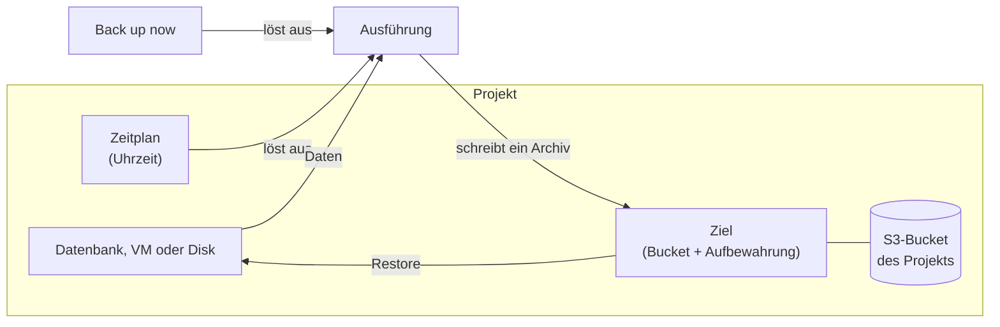

import NavigationFooter from '@site/src/components/NavigationFooter';

# Backups auf Hikube

Der Backup-Service kopiert den Zustand einer Ressource Ihres Projekts in ein **Archiv**, das in einem [S3-Bucket](../storage/buckets/overview.md) gespeichert wird, der Ihnen gehört, und ermöglicht es anschließend, dieses Archiv **wiederherzustellen**. Er deckt vier Ressourcentypen ab:

| Ressource | Inhalt eines Archivs | Wiederherstellung |
|-----------|-----------------------------|--------------|
| **PostgreSQL** | Die vollständige Datenbank sowie ihre kontinuierlich archivierten Transaktionsprotokolle | Auf der ursprünglichen Datenbank oder auf einer anderen PostgreSQL-Datenbank, auf den Stand des Backups, den neuesten Stand oder einen **bestimmten Zeitpunkt** |
| **MariaDB** | Ein vollständiger Export der Datenbank | Auf der ursprünglichen Datenbank oder auf einer anderen MariaDB-Datenbank |
| **Virtuelle Maschine** | Die VM und **alle ihre Disks** | Auf der ursprünglichen VM |
| **Disk** | Nur die Disk | Auf der ursprünglichen Disk, falls sie gelöscht wurde |

MongoDB, Redis, RabbitMQ, Kubernetes-Cluster und Buckets werden von diesem Service nicht abgedeckt.

In der [Hikube-Konsole](https://console.hikube.cloud) spielt sich alles an zwei Stellen ab:

- im Menü **Infrastructure** > **Backups** für die Ziele und die Übersicht des Projekts (Registerkarten **Destinations**, **Activity**, **Archives** und **Protection**);
- in der Registerkarte **Backups** jeder Datenbank, VM oder Disk, um sie zu planen, auf Abruf zu sichern und wiederherzustellen.

---

## Was Sie in der Konsole tun können

| Anforderung | Wo |
|--------|-------------|
| Festlegen, wohin die Backups geschrieben und wie lange sie aufbewahrt werden | **Backups** > **Destinations** > **Create a destination** |
| Ein wiederkehrendes Backup planen | Registerkarte **Backups** der Ressource > **Schedule** |
| Sofort sichern | Registerkarte **Backups** der Ressource > **Back up now** |
| Laufende oder vergangene Backups und Wiederherstellungen verfolgen | **Backups** > **Activity** |
| Sehen, welche Ressourcen nicht geschützt sind | **Backups** > **Protection** |
| Ein Archiv wiederherstellen | Schaltfläche **Restore** eines Archivs (Registerkarte **Backups** der Ressource oder **Backups** > **Archives**) |
| Ein laufendes Backup oder eine laufende Wiederherstellung abbrechen | Schaltfläche **Cancel** / **Cancel restore** |
| Ein Archiv löschen | Schaltfläche **Delete** eines Archivs |

---

## Wie alles zusammenspielt

1. Ein **Ziel** verbindet einen Bucket des Projekts, den Bucket-Benutzer, dessen Zugangsdaten es verwendet, und eine **Aufbewahrungsdauer**. Ohne ein bereites Ziel ist kein Backup möglich.
2. Ein **Zeitplan** (Plan) löst zu festgelegten Zeiten ein Backup einer Ressource in ein Ziel aus. Sie können ein Backup auch **auf Abruf** auslösen.
3. Jede Ausführung erzeugt ein **Archiv**. Das Archiv bleibt wiederherstellbar, solange es bereit ist und sein Ziel existiert.
4. Eine **Wiederherstellung** schreibt die Ressource anhand eines Archivs neu.

---

## Wo Ihre Daten liegen

- Die Archive werden in **Ihren** Bucket im selben Projekt geschrieben. Hikube bewahrt keine Kopie an anderer Stelle auf.
- Der von ihnen belegte Platz ist der des Buckets: Es gibt kein eigenes Kontingent für Backups.
- Eine Wiederherstellung schreibt in eine bereits bestehende Ressource: Sie verbraucht kein zusätzliches Kontingent. Einzige Ausnahme: Eine VM-Wiederherstellung, die die alten Disks **behält**, erstellt zusätzliche Disks (siehe [Eine VM oder eine Disk wiederherstellen](./how-to/restore-vm-or-disk.md)).

:::tip Gesperrter Bucket (WORM)
Ein Ziel kann in einen Bucket schreiben, der mit Objektsperre erstellt wurde. Jedes Archiv wird darin dann 365 Tage lang gesperrt: Niemand kann es vorher löschen, und die Aufbewahrung des Ziels darf nicht kürzer sein. Siehe [Konzepte](./concepts.md#gesperrter-bucket-worm).
:::

---

## Grenzen

- **Nur ein Ziel pro PostgreSQL-Datenbank**: Eine PostgreSQL-Datenbank, die bereits in ein Ziel gesichert wird, kann nicht in ein anderes gesichert werden (siehe [Konzepte](./concepts.md#postgresql-nur-ein-ziel)).
- **Höchstens ein geplantes Backup pro Stunde** für denselben Zeitplan.
- **Eine VM oder eine Disk wird nur auf sich selbst wiederhergestellt**, niemals auf einer anderen Ressource. Nur PostgreSQL- und MariaDB-Datenbanken lassen sich auf einer anderen Datenbank wiederherstellen.
- **Die Größe der Archive wird nicht angezeigt.** Für VMs und Disks zeigt die Konsole den Fortschritt der Übertragung an, der die gelesenen Daten misst und nicht den im Bucket belegten Platz.
- Während der Wiederherstellung einer Ressource wird kein Backup auf Abruf dieser Ressource angenommen. Ein **geplantes** Backup kann dagegen ausgelöst werden: siehe [Eine Datenbank wiederherstellen](./how-to/restore-database.md#bevor-sie-beginnen).

---

## Nächste Schritte

- [Konzepte](./concepts.md)
- [Schnellstart](./quick-start.md)
- [Ein Ziel erstellen](./how-to/create-destination.md)

<NavigationFooter
  nextSteps={[
    {label: "Konzepte", href: "../concepts"},
    {label: "Schnellstart", href: "../quick-start"},
  ]}
  seeAlso={[
    {label: "S3-Buckets", href: "../../storage/buckets/overview"},
  ]}
/>
