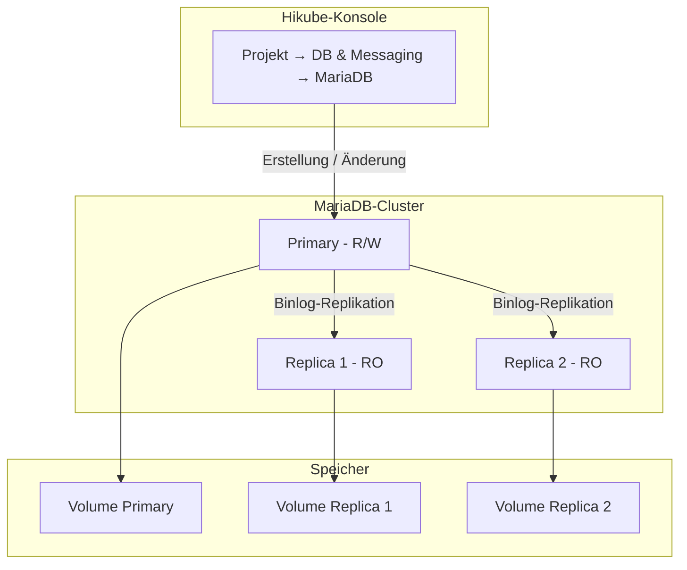
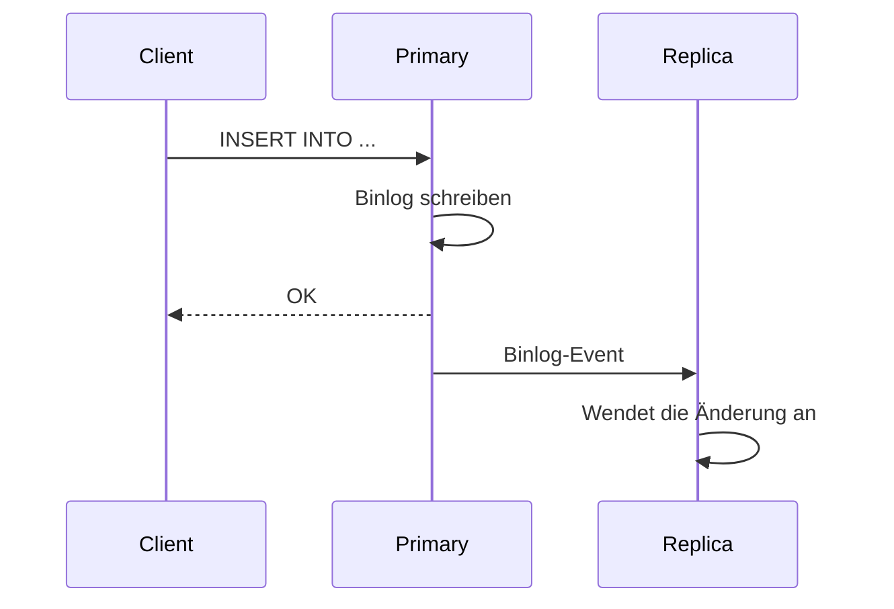

# Konzepte — MariaDB

## Architektur

MariaDB auf Hikube ist ein verwalteter Service. MariaDB ist ein Fork von MySQL, der mit dessen Clients und Protokoll kompatibel ist. Jeder in der Konsole erstellte Cluster ist eine replizierte Gruppe aus einem Primary und gegebenenfalls Replicas. Er gehört zu einem **Projekt** und verbraucht die Quotas dieses Projekts.

---

## Terminologie

| Begriff | Beschreibung |
|-------|-------------|
| **MariaDB-Cluster** | Verwaltete Instanz, die in der Konsole erstellt wird und aus einem Primary und gegebenenfalls Replicas besteht. |
| **Projekt** | Isolierter Bereich, der Ihre Ressourcen bündelt und die Quotas trägt. |
| **Primary** | Hauptknoten, der Lese- und Schreibvorgänge annimmt. |
| **Replica** | Schreibgeschützter Knoten, der über die Binlog-Replikation vom Primary synchronisiert wird. |
| **Preset** | Ressourcenvorlage (CPU, Arbeitsspeicher), die jedem Knoten des Clusters zugewiesen wird. |
| **Externer Zugriff** | Option, die den Cluster über eine öffentliche IP-Adresse im Internet verfügbar macht. |
| **Rolle** | Recht eines Benutzers auf einer Datenbank: **Administrator** oder **Read-only**. |

---

## Replikation und Hochverfügbarkeit

Der Cluster verwendet die **Binlog-Replikation** von MariaDB:

1. **Der Primary** schreibt alle Änderungen in das Binary Log
2. **Die Replicas** lesen das Binlog und wenden die Änderungen an
3. **Bei einem Ausfall** des Primary befördert die Plattform automatisch eine Replica

Die **Number of replicas** wird bei der Erstellung festgelegt:

| Angebotener Wert | Verwendung |
|-----------------|-------|
| **1 (Standalone)** | Entwicklung, Tests |
| **3 (Max High Availability)** | Produktion |
| **5 (Ultra High Availability)** | Kritische Produktion |

:::warning
Die Anzahl der Replicas und das Preset können nach der Erstellung nicht geändert werden. Um sie zu ändern, [wenden Sie sich an den Support](mailto:support@hidora.io).
:::

Ein manueller Wechsel des Primary (Switchover) wird in der Konsole nicht angeboten; wenden Sie sich an den Support.

---

## Benutzer, Datenbanken und Rollen

Die Seite eines MariaDB-Clusters enthält einen Abschnitt **Users**; eine eigene Registerkarte für Datenbanken gibt es nicht. Rechte werden Datenbank für Datenbank vergeben: Jeder Zugriff verbindet einen **Database name** mit **Rights**, **Administrator (Admin)** oder **Read-only**. **Administrator** gewährt alle Privilegien auf der Datenbank (`ALL`, mit Recht zur Weitergabe), **Read-only** das Recht `SELECT`. Wird ein Zugriff auf eine noch nicht existierende Datenbank gewährt, wird diese erstellt. Eine globale Rolle gibt es nicht: Ein Benutzer hat nur auf die ihm zugewiesenen Datenbanken Zugriff.

- Bei der Erstellung des Clusters fragt der Schritt **Users** des Assistenten für jeden Benutzer eine Anwendungsdatenbank (**Database**) und eine **Role** ab.
- Danach lassen sich mit **Create a user** und **Manage Access** ein oder mehrere Zugriffe vergeben. Ein ohne Zugriff gespeicherter Benutzer hat auf keine Datenbank Rechte.
- Die Spalte **Databases** der Benutzerliste zeigt jede Datenbank mit der Rolle an, zum Beispiel `myapp (Administrator)`.

Die Systemdatenbanken `mysql`, `information_schema`, `performance_schema` und `sys` können keinen Zugriff erhalten: Die Konsole zeigt „“mysql” is a system database: choose an application database.“ an, und die API lehnt die Anfrage ab. Sie können auch weder erstellt noch gelöscht werden.

:::warning Vor der Konsole v1.3.0 erstellte Benutzer
Der Assistent zur Cluster-Erstellung hat früher jedem Benutzer eine Rolle auf der Systemdatenbank `mysql` zugewiesen, die die Konten und Rechte des Servers enthält: Ein Zugriff **Administrator** auf diese Datenbank ermöglicht es, die Rechte aller Benutzer zu ändern, ein Zugriff **Read-only**, die Passwort-Hashes zu lesen. Öffnen Sie für diese Benutzer **Actions** → **Manage Access**: Die Zeile `mysql` wird dort als Fehler angezeigt. Entfernen Sie sie, fügen Sie bei Bedarf die Anwendungsdatenbank des Benutzers hinzu und klicken Sie dann auf **Save**.
:::

Das Passwort eines Benutzers wird von der Plattform generiert und **nur ein einziges Mal** angezeigt. Bei Verlust generieren Sie mit **Change Password** ein neues.

### Benennungsregeln

| Element | Regel |
|---------|-------|
| Clustername | 3 bis 16 Zeichen: Kleinbuchstaben, Ziffern und Bindestriche; beginnt mit einem Buchstaben, endet mit einem Buchstaben oder einer Ziffer |
| Benutzername | 3 bis 16 Zeichen: Kleinbuchstaben, Ziffern und Bindestriche; beginnt mit einem Buchstaben, endet mit einem Buchstaben oder einer Ziffer. Einige Namen, etwa `admin` oder `root`, sind reserviert |
| Datenbankname | 1 bis 63 Zeichen: Kleinbuchstaben, Ziffern und Bindestriche; beginnt mit einem Buchstaben, endet mit einem Buchstaben oder einer Ziffer. Die Systemdatenbanken `mysql`, `information_schema`, `performance_schema` und `sys` werden abgelehnt |

:::note
Unterstriche (`_`) werden weder in Datenbanknamen noch in Benutzernamen akzeptiert.
:::

---

## Presets

Das **Preset** legt die Kapazität fest, die **jedem Knoten** des Clusters zugewiesen wird. Die Presets entsprechen den Größen der [virtuellen Maschinen](../../compute/overview.md) der Serien `u1`, `s1` und `m1`: Ein Preset hat dieselben Ressourcen wie die gleichnamige VM. Maßgeblich ist die im Assistenten angezeigte Liste:

| Preset | CPU | Arbeitsspeicher |
|--------|-----|---------|
| `u1.medium` | 1 | 4Gi |
| `u1.large` | 2 | 8Gi |
| `u1.xlarge` | 4 | 16Gi |
| `u1.2xlarge` | 8 | 32Gi |
| `u1.4xlarge` | 16 | 64Gi |
| `u1.8xlarge` | 32 | 128Gi |
| `s1.small` | 1 | 2Gi |
| `s1.medium` | 2 | 4Gi |
| `s1.large` | 4 | 8Gi |
| `s1.xlarge` | 8 | 16Gi |
| `s1.2xlarge` | 16 | 32Gi |
| `s1.4xlarge` | 32 | 64Gi |
| `m1.large` | 2 | 16Gi |
| `m1.xlarge` | 4 | 32Gi |
| `m1.2xlarge` | 8 | 64Gi |
| `m1.4xlarge` | 16 | 128Gi |
| `m1.8xlarge` | 32 | 256Gi |

Der Assistent wählt kein Preset vor: Wählen Sie eines aus, um fortzufahren. Jede Option zeigt ihre Ressourcen an, zum Beispiel „u1.medium — 1 CPU / 4Gi“. Kann die Liste nicht geladen werden, zeigt der Assistent „The preset list could not be loaded. Try again later or contact support.“ an.

Ein Cluster, der mit einem früheren Preset (`nano`, `micro`, `small`, `medium`, `large`, `xlarge` oder `2xlarge`) erstellt wurde, behält es und läuft wie bisher: Das Formular **Edit** zeigt es unverändert an und speichert es ohne Änderung. Da das Preset nach der Erstellung nicht geändert werden kann, [wenden Sie sich für diese Änderung an den Support](mailto:support@hidora.io). Wurden die Ressourcen eines Clusters abweichend von seinem Preset festgelegt, weist das Formular mit dem Vermerk „(override)“ darauf hin.

Die Festlegung freier CPU-/Arbeitsspeicher-Ressourcen wird in der Konsole nicht angeboten; wenden Sie sich an den Support.

---

## Netzwerkzugriff

- **Externer Zugriff deaktiviert** (Standard): Der Cluster ist nicht im Internet erreichbar. Das Feld **Host** der Karte **Connection and network** zeigt **Not defined** an.
- **Externer Zugriff aktiviert**: Die Plattform weist eine öffentliche IP-Adresse zu, die im Feld **Host** angezeigt wird. Der Port ist der MySQL-Standardport `3306`.

---

## Backup und Wiederherstellung

MariaDB-Cluster werden mit dem [Backup-Service](../../backups/overview.md) in einen S3-Bucket des Projekts gesichert und über die Registerkarte **Backups** ihrer Seite wiederhergestellt. Siehe [Backups konfigurieren](./how-to/configure-backups.md) und [Ein Backup wiederherstellen](./how-to/restore-backup.md).

---

## Quotas und Kosten

Der Assistent zeigt die **Estimated cost** und die Auswirkung des Clusters auf die Quotas des Projekts an. Überschreitet der Cluster die verfügbaren Quotas, bleibt die Schaltfläche **Next** inaktiv.

| Parameter | Wert |
|-----------|--------|
| Versionen | 10.6, 10.11, 11.4, 11.8; nach der Erstellung nur Versions-Upgrade |
| Replicas | 1, 3 oder 5 |
| Disk-Größe | 1 bis 4 096 GB, im Rahmen des Speicher-Quotas des Projekts; nach der Erstellung nur Vergrößerung |

---

## Weiterführende Informationen

- [Übersicht](./overview.md): Vorstellung des Service
- [Schnellstart](./quick-start.md): Ihren ersten Cluster erstellen
