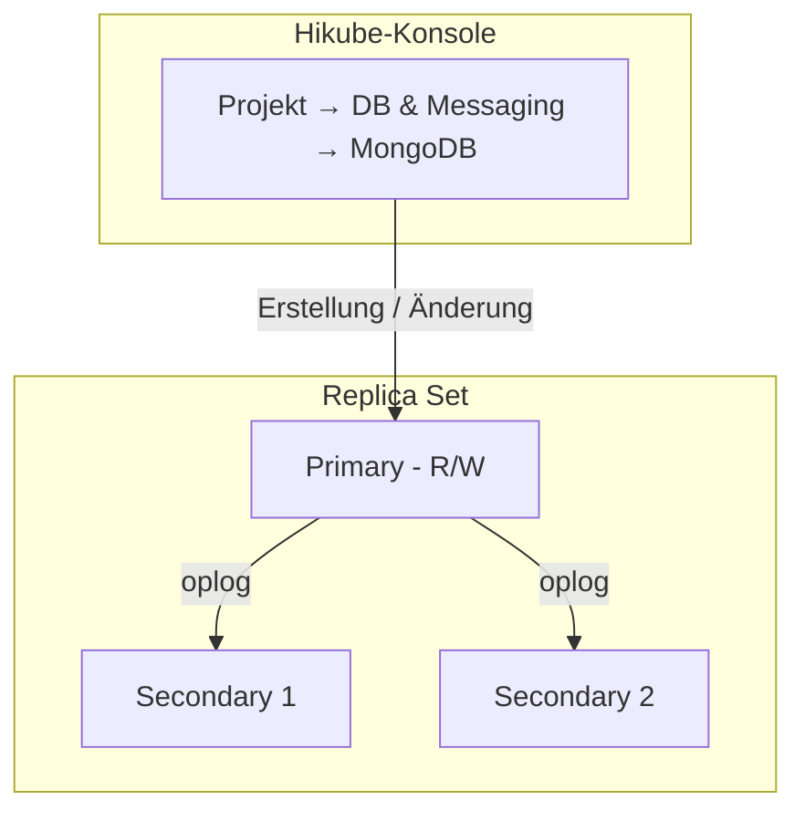

# Konzepte — MongoDB

## Architektur

MongoDB auf Hikube ist ein verwalteter Dienst. Jeder über die Konsole erstellte Cluster ist standardmäßig ein **Replica Set**: eine Gruppe von Mitgliedern, die dieselben Daten tragen und von denen nur eines Schreibvorgänge annimmt. Der Cluster gehört zu einem **Projekt** und verbraucht die Quotas dieses Projekts.

---

## Terminologie

| Begriff | Beschreibung |
|-------|-------------|
| **MongoDB-Cluster** | Verwaltete Instanz, die über die Konsole erstellt wird. |
| **Projekt** | Isolierter Bereich, der Ihre Ressourcen bündelt und die Quotas trägt. |
| **Replica Set** | Gruppe von MongoDB-Mitgliedern, die dieselben Daten replizieren. |
| **Primary** | Mitglied, das Schreibvorgänge annimmt. |
| **Secondary** | Mitglied, das den Primary repliziert und bei einem Ausfall an dessen Stelle gewählt werden kann. |
| **Oplog** | Operationsprotokoll des Primary, das von den Secondaries nachgespielt wird. |
| **Shard** | Teilmenge der Daten, getragen von einem eigenen Replica Set (geshardete Topologie). |
| **Konfigurationsserver** | Mitglieder, die die Metadaten der geshardeten Topologie speichern. |
| **Mongos** | Router, der die Anfragen der Clients entgegennimmt und an die richtigen Shards weiterleitet. |
| **Preset** | Ressourcenprofil (CPU, Arbeitsspeicher), das jedem Knoten zugewiesen wird. |

---

## Replikation und Hochverfügbarkeit

Die Secondaries spielen fortlaufend das Oplog des Primary nach. Wird der Primary unerreichbar, wählen die verbleibenden Mitglieder einen neuen Primary; damit die Wahl gelingt, muss eine Mehrheit der Mitglieder verfügbar sein.

Die **Number of replicas** wird bei der Erstellung gewählt:

| Angebotener Wert | Verwendung |
|-----------------|-------|
| **1 (Standalone)** | Entwicklung, Tests |
| **3 (Max High Availability)** | Produktion: toleriert den Verlust eines Mitglieds |
| **5 (Ultra High Availability)** | Kritische Produktion: toleriert den Verlust von zwei Mitgliedern |

:::warning
Die Anzahl der Replicas, das Preset und das Sharding können nach der Erstellung nicht mehr geändert werden. Um sie zu ändern, [wenden Sie sich an den Support](mailto:support@hidora.io).
:::

---

## Sharding

Die Option **Sharding (Distributed Topology)** des Assistenten „automatically deploys configuration servers and Mongos routers, and configures replica sets as shards“. Die Konsole erstellt dann:

- **2 Shards**, jeweils bestehend aus der gewählten Anzahl Replicas und einer Disk der gewählten Größe;
- **Konfigurationsserver** mit derselben Anzahl Replicas und derselben Disk-Größe;
- **Mongos-Router** mit derselben Anzahl Replicas.

Der Ressourcenverbrauch und die geschätzten Kosten berücksichtigen dies. Siehe [Sharding konfigurieren](./how-to/configure-sharding.md).

---

## Benutzer, Datenbanken und Rollen

Die Seite eines MongoDB-Clusters enthält einen Abschnitt **Users**; eine eigene Registerkarte für Datenbanken gibt es nicht. Rechte werden Datenbank für Datenbank vergeben: Jeder Zugriff verbindet einen **Database name** mit **Rights**, **Administrator (Admin)** oder **Read-only**. **Administrator** entspricht den MongoDB-Rollen `readWrite` und `dbAdmin` auf der Datenbank, **Read-only** der Rolle `read`. Eine globale Rolle gibt es nicht: Ein Benutzer hat nur auf die ihm zugewiesenen Datenbanken Zugriff.

- Bei der Erstellung des Clusters fragt der Schritt **Users** des Assistenten für jeden Benutzer eine Anwendungsdatenbank (**Database**) und eine **Role** ab. Die Datenbank wird angelegt, falls sie noch nicht existiert.
- Danach lassen sich mit **Create a user** und **Manage Access** ein oder mehrere Zugriffe vergeben. Ein MongoDB-Benutzer muss mindestens einen Zugriff behalten: Andernfalls zeigt die Konsole „Please grant access to at least one database.“ an und die Schaltfläche bleibt inaktiv.
- Die Spalte **Databases** der Benutzerliste zeigt jede Datenbank mit der Rolle an, zum Beispiel `myapp (Administrator)`.

Die Systemdatenbanken `admin`, `local` und `config` können keinen Zugriff erhalten: Die Konsole zeigt „“admin” is a system database: choose an application database.“ an, und die API lehnt die Anfrage ab.

Alle Benutzer werden in der Datenbank `admin` angelegt, die als Authentifizierungsdatenbank dient (`authSource=admin`), ohne auf dieser Datenbank eine Rolle zu erhalten.

:::warning Vor der Konsole v1.3.0 erstellte Benutzer
Der Assistent zur Cluster-Erstellung hat früher jedem Benutzer eine Rolle auf der Systemdatenbank `admin` zugewiesen. Öffnen Sie für diese Benutzer **Actions** → **Manage Access**: Die Zeile `admin` wird dort als Fehler angezeigt. Entfernen Sie sie, fügen Sie bei Bedarf die Anwendungsdatenbank des Benutzers hinzu und klicken Sie dann auf **Save**. Solange diese Zeile vorhanden ist, können die Rechte des Benutzers nicht gespeichert werden.
:::

Das Passwort eines Benutzers wird von der Plattform generiert und **nur einmal** angezeigt. Bei Verlust generieren Sie mit **Change Password** ein neues.

### Benennungsregeln

| Element | Regel |
|---------|-------|
| Cluster-Name | 3 bis 16 Zeichen: Kleinbuchstaben, Ziffern und Bindestriche; beginnt mit einem Buchstaben, endet mit einem Buchstaben oder einer Ziffer |
| Benutzername | 3 bis 16 Zeichen: Kleinbuchstaben, Ziffern und Bindestriche; beginnt mit einem Buchstaben, endet mit einem Buchstaben oder einer Ziffer. Einige Namen, etwa `admin` oder `root`, sind reserviert |
| Datenbankname | 1 bis 63 Zeichen: Kleinbuchstaben, Ziffern und Bindestriche; beginnt mit einem Buchstaben, endet mit einem Buchstaben oder einer Ziffer. Die Systemdatenbanken `admin`, `local` und `config` werden abgelehnt |

:::note
Unterstriche (`_`) und Großbuchstaben sind weder in Datenbanknamen noch in Benutzernamen zulässig.
:::

---

## Presets

Das **Preset** legt die Kapazität fest, die **jedem Knoten** zugewiesen wird. Die Presets entsprechen den Größen der [virtuellen Maschinen](../../compute/overview.md) der Serien `u1`, `s1` und `m1`: Ein Preset hat dieselben Ressourcen wie die gleichnamige VM. Maßgeblich ist die im Assistenten angezeigte Liste:

| Preset | CPU | Arbeitsspeicher |
|--------|-----|---------|
| `u1.medium` | 1 | 4Gi |
| `u1.large` | 2 | 8Gi |
| `u1.xlarge` | 4 | 16Gi |
| `u1.2xlarge` | 8 | 32Gi |
| `u1.4xlarge` | 16 | 64Gi |
| `u1.8xlarge` | 32 | 128Gi |
| `s1.small` | 1 | 2Gi |
| `s1.medium` | 2 | 4Gi |
| `s1.large` | 4 | 8Gi |
| `s1.xlarge` | 8 | 16Gi |
| `s1.2xlarge` | 16 | 32Gi |
| `s1.4xlarge` | 32 | 64Gi |
| `m1.large` | 2 | 16Gi |
| `m1.xlarge` | 4 | 32Gi |
| `m1.2xlarge` | 8 | 64Gi |
| `m1.4xlarge` | 16 | 128Gi |
| `m1.8xlarge` | 32 | 256Gi |

Der Assistent wählt kein Preset vor: Wählen Sie eines aus, um fortzufahren. Jede Option zeigt ihre Ressourcen an, zum Beispiel „u1.medium — 1 CPU / 4Gi“. Kann die Liste nicht geladen werden, zeigt der Assistent „The preset list could not be loaded. Try again later or contact support.“ an.

Ein Cluster, der mit einem früheren Preset (`nano`, `micro`, `small`, `medium`, `large`, `xlarge` oder `2xlarge`) erstellt wurde, behält es und läuft wie bisher: Das Formular **Edit** zeigt es unverändert an und speichert es ohne Änderung. Dieses Preset hat keinen Katalogpreis: Die Konsole zeigt „Price unavailable“ an, und das Dashboard des Projekts nimmt es von den Gesamtkosten aus, bis der Cluster auf ein Preset aus der Liste umgestellt ist. Da das Preset nach der Erstellung nicht geändert werden kann, [wenden Sie sich für diese Änderung an den Support](mailto:support@hidora.io). Wurden die Ressourcen eines Clusters abweichend von seinem Preset festgelegt, weist das Formular mit dem Vermerk „(override)“ darauf hin.

---

## Netzwerkzugriff

- **Externer Zugriff deaktiviert** (Standard): Der Cluster ist nicht im Internet erreichbar. Das Feld **Host** der Karte **Network and Connection** zeigt **Not defined** an.
- **Externer Zugriff aktiviert**: Der Port ist der MongoDB-Standardport `27017`, ohne TLS.
  - **Cluster mit Sharding**: Die Plattform weist den Mongos-Routern eine öffentliche Adresse zu, die im Feld **Host** angezeigt wird. Der Assistent liefert einen Verbindungsstring der Form `mongodb://<user>:<password>@<host>`.
  - **Replica Set**: Jedes Mitglied erhält eine eigene öffentliche Adresse. Die Karte **Network and Connection** listet sie unter **Replica set rs0 members** auf, jeweils mit einer Kopierschaltfläche, und bietet einen **External connection string** der Form `mongodb://<user>:<password>@<member>:27017/?directConnection=true&authSource=admin` an. Verbinden Sie sich so direkt mit einem Mitglied, ohne den Parameter `replicaSet`: Die Mitglieder melden sich unter clusterinternen Namen, die von außen nicht aufgelöst werden. Das erreichte Mitglied kann ein Secondary sein, das keine Schreibvorgänge annimmt: Lesen Sie mit `readPreference=secondaryPreferred` und schreiben Sie auf das Primary-Mitglied.

---

## Backup und Wiederherstellung

Die Konfiguration von Backups und die Wiederherstellung werden in der Konsole nicht angeboten; [wenden Sie sich an den Support](mailto:support@hidora.io).

---

## Quotas und Kosten

Der Assistent zeigt die **Estimated Cost** und die Auswirkung des Clusters auf die Quotas des Projekts an. Überschreitet der Cluster die verfügbaren Quotas, bleibt die Schaltfläche **Next** inaktiv.

| Parameter | Wert |
|-----------|--------|
| Versionen | 6.0, 7.0, 8.0; nach der Erstellung nur Versions-Upgrade |
| Replicas | 1, 3 oder 5 |
| Disk-Größe | 1 bis 4 096 GB, im Rahmen des Speicher-Quotas des Projekts; nach der Erstellung nur Vergrößerung |

---

## Weiterführende Informationen

- [Übersicht](./overview.md): Vorstellung des Dienstes
- [Schnellstart](./quick-start.md): Ihren ersten Cluster erstellen
