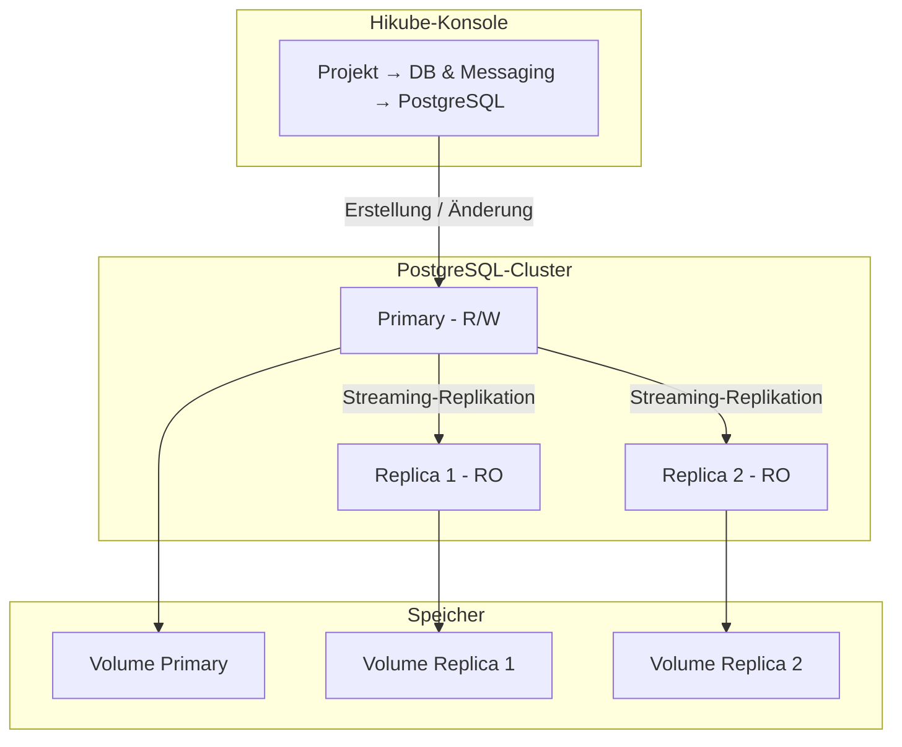
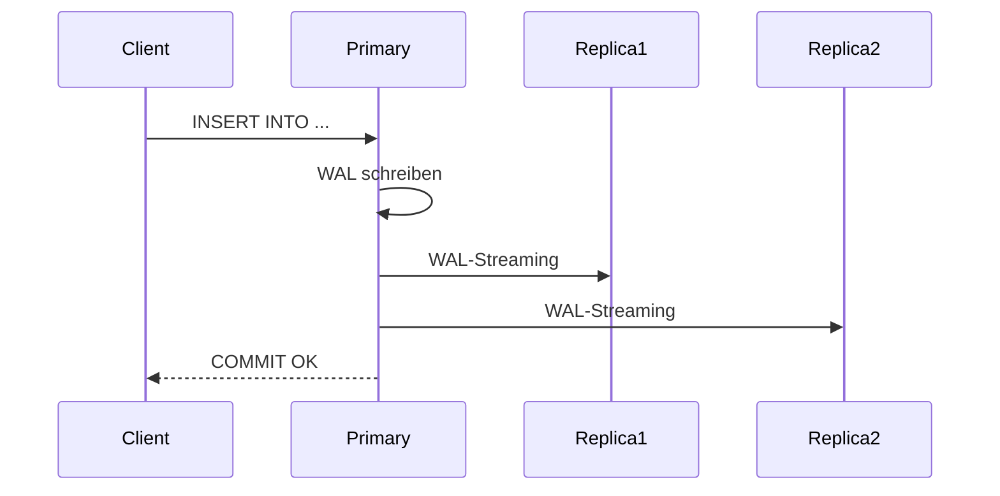

# Konzepte — PostgreSQL

## Architektur

PostgreSQL auf Hikube ist ein verwalteter Service. Jeder in der Konsole erstellte Cluster ist eine Gruppe replizierter PostgreSQL-Instanzen mit automatischem Failover und Streaming-Replikation. Er gehört zu einem **Projekt** und verbraucht die Quotas dieses Projekts (CPU, Arbeitsspeicher, Speicher).

---

## Terminologie

| Begriff | Beschreibung |
|-------|-------------|
| **PostgreSQL-Cluster** | Verwaltete Instanz, die in der Konsole erstellt wird und aus einem Primary und gegebenenfalls Replicas besteht. |
| **Projekt** | Isolierter Bereich, der Ihre Ressourcen bündelt und die Quotas trägt. |
| **Primary** | Hauptinstanz, die Lese- und Schreibvorgänge annimmt. |
| **Replica** | Schreibgeschützte Instanz, die per Streaming-Replikation vom Primary synchronisiert wird. |
| **Instanz-Preset** | Ressourcenvorlage (CPU, Arbeitsspeicher), die jedem Knoten des Clusters zugewiesen wird. |
| **Externer Zugriff** | Option, die den Cluster über eine öffentliche IP-Adresse im Internet verfügbar macht. |
| **Erweiterung (Extension)** | PostgreSQL-Modul (zum Beispiel `pgcrypto`, `vector`), das pro Datenbank aktiviert wird. |
| **WAL** | Write-Ahead Log — das Transaktionsprotokoll von PostgreSQL, Grundlage der Replikation. |

---

## Replikation und Hochverfügbarkeit

Die Hochverfügbarkeit beruht auf:

1. **Streaming-Replikation**: Die Replicas erhalten die WAL fortlaufend vom Primary
2. **Automatisches Failover**: Fällt der Primary aus, wird automatisch eine Replica befördert

Die Anzahl der Replicas wird bei der Erstellung im Feld **Number of replicas** festgelegt:

| Angebotener Wert | Verwendung |
|-----------------|-------|
| **1 (Standalone)** | Entwicklung, Tests |
| **2 (High Availability)** | Produktion mit einem Standby |
| **3 (Max High Availability)** | Kritische Produktion |

:::warning
Die Anzahl der Replicas kann nach der Erstellung nicht mehr geändert werden („The mode cannot be changed after creation“). Wählen Sie sie entsprechend Ihrem Verfügbarkeitsbedarf. Um sie zu ändern, [wenden Sie sich an den Support](mailto:support@hidora.io).
:::

Synchrone Replikation (Quorum) wird in der Konsole nicht angeboten; wenden Sie sich an den Support.

---

## Datenbanken, Benutzer und Rechte

Jeder Cluster verfügt über:

- eine automatisch erstellte Systemdatenbank **`postgres`**, die der Plattform vorbehalten ist (siehe unten);
- die **Datenbanken**, die Sie bei der Erstellung oder später hinzufügen (Registerkarte **Databases**), mit ihren **Erweiterungen**;
- die **Benutzer**, die Sie anlegen (Registerkarte **Users**). Jeder Benutzer erhält pro Datenbank eines der beiden folgenden Rechte:
  - **Administrator (Admin)**: Lesen und Schreiben;
  - **Read-only**: nur Lesen.

Das Passwort eines Benutzers wird von der Plattform generiert und **nur ein einziges Mal** angezeigt, bei der Erstellung oder nach einer Rotation. Danach ist es nicht mehr einsehbar: Wenn Sie es verlieren, generieren Sie mit **Change Password** ein neues.

### Systemdatenbanken

`postgres`, `template0` und `template1` sind Systemdatenbanken, die der Plattform vorbehalten sind:

- Die Benutzer-Assistenten bieten sie nicht an, und auf ihnen kann kein Recht vergeben werden;
- ihre Erstellung wird abgelehnt: „“postgres” is a system database: choose an application database.“;
- in der Datenbankliste sind **Manage extensions** und **Delete database** bei einer Systemdatenbank deaktiviert: „System database: it can be neither changed nor deleted.“

Ein Benutzer, der bereits ein Recht auf einer Systemdatenbank besitzt, behält es unverändert. In **Manage Access** wird dieses Recht gesperrt und mit einem Warnhinweis angezeigt: Sie können die Zeile entfernen, aber nicht ändern. Vergeben Sie die Rechte Ihrer Benutzer auf Anwendungsdatenbanken.

### Benennungsregeln

| Element | Regel |
|---------|-------|
| Clustername | 3 bis 16 Zeichen: Kleinbuchstaben, Ziffern und Bindestriche; beginnt mit einem Buchstaben, endet mit einem Buchstaben oder einer Ziffer |
| Benutzername | 3 bis 16 Zeichen: Kleinbuchstaben, Ziffern und Unterstriche (`_`); beginnt mit einem Kleinbuchstaben oder einem Unterstrich. Kein Bindestrich (`-`). |
| Datenbankname | 1 bis 54 Zeichen: Kleinbuchstaben, Ziffern, Unterstriche (`_`) und Bindestriche (`-`); beginnt mit einem Buchstaben oder einem Unterstrich, aber nicht mit `pg_` |

Die Benutzernamen `postgres`, `admin`, `root`, `owner`, `superuser`, `streaming_replica` sowie alle Namen, die mit `pg_` beginnen, sind reserviert.

---

## Instanz-Presets

Das **Instance preset** legt die Kapazität fest, die **jedem Knoten** des Clusters zugewiesen wird. Die Presets entsprechen den Größen der [virtuellen Maschinen](../../compute/overview.md) der Serien `u1`, `s1` und `m1`: Ein Preset hat dieselben Ressourcen wie die gleichnamige VM. Maßgeblich ist die im Assistenten angezeigte Liste:

| Preset | CPU | Arbeitsspeicher |
|--------|-----|---------|
| `u1.medium` | 1 | 4Gi |
| `u1.large` | 2 | 8Gi |
| `u1.xlarge` | 4 | 16Gi |
| `u1.2xlarge` | 8 | 32Gi |
| `u1.4xlarge` | 16 | 64Gi |
| `u1.8xlarge` | 32 | 128Gi |
| `s1.small` | 1 | 2Gi |
| `s1.medium` | 2 | 4Gi |
| `s1.large` | 4 | 8Gi |
| `s1.xlarge` | 8 | 16Gi |
| `s1.2xlarge` | 16 | 32Gi |
| `s1.4xlarge` | 32 | 64Gi |
| `m1.large` | 2 | 16Gi |
| `m1.xlarge` | 4 | 32Gi |
| `m1.2xlarge` | 8 | 64Gi |
| `m1.4xlarge` | 16 | 128Gi |
| `m1.8xlarge` | 32 | 256Gi |

Der Assistent wählt kein Preset vor: Wählen Sie eines aus, um fortzufahren. Jede Option zeigt ihre Ressourcen an, zum Beispiel „u1.medium — 1 CPU / 4Gi“. Kann die Liste nicht geladen werden, zeigt der Assistent „The preset list could not be loaded. Try again later or contact support.“ an.

Ein Cluster, der mit einem früheren Preset (`nano`, `micro`, `small`, `medium`, `large`, `xlarge` oder `2xlarge`) erstellt wurde, behält es und läuft wie bisher: Das Formular **Edit** zeigt es unverändert an und speichert es ohne Änderung. Wurden die Ressourcen eines Clusters abweichend von seinem Preset festgelegt, weist das Formular mit dem Vermerk „(override)“ darauf hin.

Die Festlegung freier CPU-/Arbeitsspeicher-Ressourcen (außerhalb der Presets) wird in der Konsole nicht angeboten; wenden Sie sich an den Support.

---

## Netzwerkzugriff

- **Externer Zugriff deaktiviert** (Standard): Der Cluster ist nicht im Internet erreichbar. Das Feld **Host** auf der Seite des Clusters zeigt **Not defined** an.
- **Externer Zugriff aktiviert**: Die Plattform weist eine öffentliche IP-Adresse zu, die im Feld **Host** angezeigt wird. Der Port ist der PostgreSQL-Standardport `5432`.

Der externe Zugriff kann nach der Erstellung über **Edit** aktiviert oder deaktiviert werden. Seine Kosten (öffentliche IP-Adresse) sind in der Angabe **Estimated cost** des Assistenten enthalten.

---

## Backup und Wiederherstellung

PostgreSQL-Cluster werden mit dem [Backup-Service](../../backups/overview.md) in einen S3-Bucket des Projekts gesichert und über die Registerkarte **Backups** ihrer Seite wiederhergestellt. Die Transaktionsprotokolle werden zwischen zwei Backups kontinuierlich archiviert, sodass sich die Datenbank zu einem bestimmten Zeitpunkt wiederherstellen lässt. Siehe [Backups konfigurieren](./how-to/configure-backups.md) und [Ein Backup wiederherstellen](./how-to/restore-backup.md).

---

## Quotas und Kosten

Der Erstellungsassistent zeigt ab dem Schritt **Configuration** die **Estimated cost** (monatlich und stündlich) sowie die Auswirkung des Clusters auf die Quotas des Projekts (CPU, Arbeitsspeicher, Speicher) an. Der Verbrauch berücksichtigt das Preset, die Anzahl der Replicas und die Disk-Größe. Überschreitet der Cluster die verfügbaren Quotas, bleibt die Schaltfläche **Next** inaktiv.

| Parameter | Wert |
|-----------|--------|
| Disk-Größe | 1 bis 4 096 GB, im Rahmen des Speicher-Quotas des Projekts; nach der Erstellung nur Vergrößerung |
| Replicas | 1, 2 oder 3 |

---

## Weiterführende Informationen

- [Übersicht](./overview.md): Vorstellung des Service
- [Schnellstart](./quick-start.md): Ihren ersten Cluster erstellen
