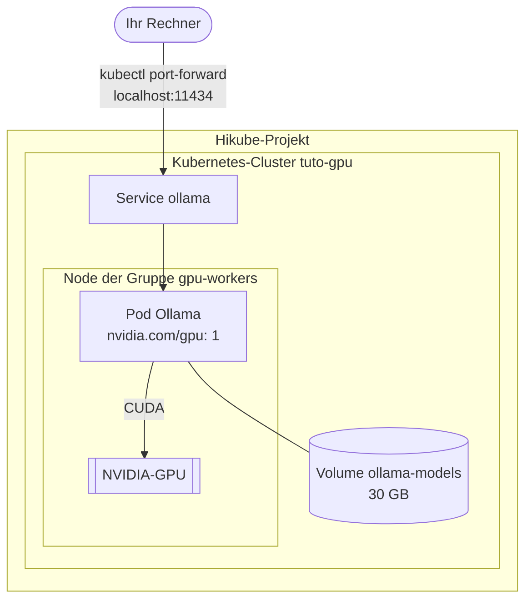

import NavigationFooter from '@site/src/components/NavigationFooter';

# Ein Sprachmodell auf einer GPU mit Kubernetes bereitstellen

In diesem Tutorial stellen Sie ein quelloffenes Sprachmodell (LLM) auf einer NVIDIA-GPU von Hikube bereit: einen Kubernetes-Cluster mit einem GPU-Node, einen Inferenzserver, der das Modell in den Speicher der GPU lädt, eine OpenAI-kompatible API, um es abzufragen, und schließlich den Nachweis, dass die Berechnung tatsächlich auf der GPU erfolgt, sowie die Messung ihres Durchsatzes.

Der Inferenzserver ist [Ollama](https://ollama.com), das offene Modelle herunterlädt und bereitstellt. Das Modell ist [Qwen2.5 7B Instruct](https://ollama.com/library/qwen2.5), unter der Lizenz Apache 2.0: Mit etwa 5 GB passt es problemlos in den Speicher einer Rechenzentrums-GPU.

| | |
|---|---|
| **Schwierigkeit** | Mittel |
| **Dauer** | Etwa 45 Minuten |
| **Sie lernen** | Einem Cluster eine GPU-Node-Gruppe hinzuzufügen, eine GPU für einen Pod zu reservieren, zu prüfen, dass ein Modell tatsächlich auf der GPU läuft, und seinen Generierungsdurchsatz zu messen |

---

## Was Sie aufbauen



- Die GPU ist **für den Ollama-Pod reserviert**: Kein anderer Pod kann sie nutzen, solange er läuft.
- Das Modell wird auf einem **persistenten Volume** gespeichert: Es übersteht einen Neustart des Pods ohne erneuten Download.
- Die API ist **nicht im Internet erreichbar**: Sie erreichen sie von Ihrem Rechner aus über einen Tunnel `kubectl port-forward`.

---

## Voraussetzungen

- Ein **Hikube-Konto** und ein **Projekt** mit ausreichenden Quotas für eine Control Plane, einen Node `u1.2xlarge` (8 vCPU, 32 GB) mit 100 GB Festplatte, eine GPU und ein Volume von 30 GB
- Die **Rolle Projektadministrator**, um die kubeconfig des Clusters herunterzuladen
- **`kubectl`**, **`curl`** und **`jq`** auf Ihrem Rechner installiert
- **Kubernetes-Grundkenntnisse**: Pod, `Deployment`, `Service`

---

## Schritt 1: Den Cluster mit einer GPU-Node-Gruppe erstellen

1. Wählen Sie in der [Hikube-Konsole](https://console.hikube.cloud) Ihr Projekt aus und öffnen Sie dann **Infrastructure** > **Kubernetes**.
2. Klicken Sie auf **Create cluster** und füllen Sie den Assistenten aus:

| Schritt des Assistenten | Feld | Wert |
|----------------------|-------|--------|
| **General** | **Cluster name** | `tuto-gpu` |
| | **Kubernetes Version** | die vorausgewählte Version |
| | **Control Plane Instance Size** | **s1.small — 1 CPU / 2Gi** |
| | **Control Plane High Availability** | **3 (HA)** |
| **Nodes** | **Group name** | `gpu-workers` |
| | **Instance type** | `u1.2xlarge` (8 vCPU, 32 GB) |
| | **Node disk size** | `100`: Container-Images für GPUs sind groß |
| | **Minimum nodes** / **Maximum nodes** | `1` / `1` |
| | Abschnitt **GPU** | Klicken Sie auf die Karte **NVIDIA L40S** oder auf ein anderes verfügbares Modell; behalten Sie 1 GPU pro Node bei |
| **Addons** | | **GPU Operator** ist ausgewählt und gesperrt (**Required when a node group has GPUs**); lassen Sie die anderen Addons unverändert |

3. Klicken Sie im Schritt **Summary** auf **Create cluster**.

Die Wahl des GPU-Modells und seine Einschränkungen sind unter [Eine GPU auf Kubernetes bereitstellen](../services/gpu/how-to/provision-gpu-kubernetes.md) im Detail beschrieben; die mit **Unavailable** gekennzeichneten Modelle können derzeit nicht ausgewählt werden.

**Erwartetes Ergebnis:** `tuto-gpu` erscheint in der Liste **Kubernetes Clusters** mit dem Status **Creating**.

---

## Schritt 2: Mit dem Cluster verbinden

Warten Sie, bis der Cluster **Ready** ist und sein GPU-Node gestartet ist, einige Minuten nach seiner Erstellung.

1. Öffnen Sie **Infrastructure** > **Kubernetes** und dann die Seite des Clusters `tuto-gpu`.
2. Klicken Sie auf **Kubeconfig**. Der Browser lädt `kubeconfig-tuto-gpu.yaml` herunter.

```bash
export KUBECONFIG=~/Downloads/kubeconfig-tuto-gpu.yaml
kubectl get nodes
```

**Erwartetes Ergebnis:** ein Node `kubernetes-tuto-gpu-gpu-workers-…` mit dem Status `Ready`.

:::note Der Cluster ist Ready, aber es erscheint kein Node
Der Status **Ready** betrifft die Control Plane. Der GPU-Node und die Addons starten danach: Antwortet `kubectl get nodes` mit `No resources found`, warten Sie kurz und führen Sie den Befehl erneut aus.
:::

---

## Schritt 3: Prüfen, dass die GPU bereitgestellt wird

Das Addon **GPU Operator** bereitet den Node vor: Es installiert darauf alles Nötige, um die GPU den Pods zur Verfügung zu stellen. Verfolgen Sie seinen Start:

```bash
kubectl get pods -n cozy-gpu-operator
```

**Erwartetes Ergebnis:** Nach einigen Minuten sind alle Pods im Status `Running`.

Prüfen Sie anschließend, dass der Node seine GPU dem Kubernetes-Scheduler meldet:

```bash
kubectl get nodes -o custom-columns=NAME:.metadata.name,GPU:.status.allocatable.'nvidia\.com/gpu'
```

**Erwartetes Ergebnis:** Die Spalte `GPU` des Nodes zeigt `1` an, die in Schritt 1 gewählte Anzahl GPUs. Solange sie `<none>` anzeigt, hat der GPU Operator die Vorbereitung des Nodes nicht abgeschlossen: Warten Sie kurz und führen Sie den Befehl erneut aus.

---

## Schritt 4: Den Inferenzserver bereitstellen

Das Manifest erstellt drei Ressourcen: ein Volume für die Modelle, den Ollama-Server und einen `Service`, um ihn im Cluster zu erreichen.

```yaml title="ollama.yaml"
apiVersion: v1
kind: PersistentVolumeClaim
metadata:
  name: ollama-models
spec:
  accessModes:
    - ReadWriteOnce
  resources:
    requests:
      storage: 30Gi
---
apiVersion: apps/v1
kind: Deployment
metadata:
  name: ollama
  labels:
    app: ollama
spec:
  replicas: 1
  strategy:
    type: Recreate          # das Volume wird immer nur an einen Pod angehängt
  selector:
    matchLabels:
      app: ollama
  template:
    metadata:
      labels:
        app: ollama
    spec:
      containers:
        - name: ollama
          image: ollama/ollama:0.40.18
          ports:
            - containerPort: 11434
          env:
            - name: OLLAMA_KEEP_ALIVE   # hält das Modell im Speicher der GPU geladen
              value: "-1"
          volumeMounts:
            - name: models
              mountPath: /root/.ollama
          readinessProbe:
            httpGet:
              path: /
              port: 11434
          resources:
            requests:
              cpu: "2"
              memory: 8Gi
            limits:
              memory: 16Gi
              nvidia.com/gpu: 1
      volumes:
        - name: models
          persistentVolumeClaim:
            claimName: ollama-models
---
apiVersion: v1
kind: Service
metadata:
  name: ollama
spec:
  selector:
    app: ollama
  ports:
    - port: 11434
      targetPort: 11434
```

Entscheidend ist die Zeile `nvidia.com/gpu: 1`: Sie reserviert eine ganze GPU für den Pod, und Kubernetes platziert den Pod nur auf einem Node, der eine freie GPU hat.

```bash
kubectl apply -f ollama.yaml
kubectl rollout status deployment/ollama --timeout=10m
```

**Erwartetes Ergebnis:** Die Bereitstellung gelingt nach einigen Minuten, sobald das Image heruntergeladen ist.

Beim Start erkennt Ollama die Rechenhardware und schreibt sie in seine Logs:

```bash
kubectl logs deployment/ollama | grep "inference compute"
```

**Erwartetes Ergebnis:** Die Zeile `inference compute` beschreibt die NVIDIA-GPU des Nodes mit ihrem Namen und ihrem Speicher. Zeigt sie `library=cpu` an, sieht Ollama die GPU nicht: siehe die [Fehlerbehebung GPU](../services/gpu/troubleshooting.md).

:::note Der Pod bleibt im Status Pending
`kubectl describe pod -l app=ollama` zeigt dann `Insufficient nvidia.com/gpu` an: Kein Node hat eine freie GPU. Prüfen Sie die Spalte `GPU` aus Schritt 3 und dass kein anderer Pod die GPU bereits reserviert.
:::

---

## Schritt 5: Das Modell herunterladen und abfragen

Laden Sie das Modell in das Volume des Servers herunter:

```bash
kubectl exec deploy/ollama -- ollama pull qwen2.5:7b
kubectl exec deploy/ollama -- ollama list
```

**Erwartetes Ergebnis:** Nach dem Download, der mit `success` endet, erscheint das Modell in der Liste.

```console
NAME          ID              SIZE      MODIFIED
qwen2.5:7b    845dbda0ea48    4.7 GB    2 seconds ago
```

Öffnen Sie einen Tunnel zum Server. Der Befehl bleibt im Vordergrund: Starten Sie ihn in einem zweiten Terminal und lassen Sie dieses bis zum Ende des Tutorials geöffnet.

```bash
kubectl port-forward svc/ollama 11434:11434
```

Stellen Sie dem Modell im ersten Terminal eine Frage über die OpenAI-kompatible API von Ollama:

```bash
curl -s http://localhost:11434/v1/chat/completions \
  -H "Content-Type: application/json" \
  -d '{"model": "qwen2.5:7b", "messages": [{"role": "user", "content": "Erkläre in einem Satz, was eine GPU ist."}]}' \
  | jq '{model, content: .choices[0].message.content, usage}'
```

**Erwartetes Ergebnis:** die Antwort des Modells sowie die Anzahl der gelesenen und generierten Token.

```console
{
  "model": "qwen2.5:7b",
  "content": "Eine GPU ... ist ein spezialisierter Chip ...",
  "usage": {
    "prompt_tokens": 40,
    "completion_tokens": 35,
    "total_tokens": 75
    ...
  }
}
```

Die erste Anfrage ist langsamer: Ollama lädt das Modell in den Speicher. Dank `OLLAMA_KEEP_ALIVE` bleibt es dort für die folgenden Anfragen.

Jeder OpenAI-kompatible Client kann diesen Server nutzen: Geben Sie ihm die Basis-URL `http://localhost:11434/v1` und das Modell `qwen2.5:7b` an.

---

## Schritt 6: Prüfen, dass das Modell auf der GPU läuft

Ein Modell, das antwortet, beweist nicht, dass die GPU arbeitet: Passt das Modell nicht in den Speicher der GPU oder sieht der Pod die GPU nicht, verlagert Ollama die Berechnung ganz oder teilweise auf den Prozessor, ohne Fehlermeldung. Prüfen Sie, wo das Modell geladen ist:

```bash
kubectl exec deploy/ollama -- ollama ps
```

**Erwartetes Ergebnis:** Die Spalte `PROCESSOR` von `qwen2.5:7b` zeigt `100% GPU` an. Der Wert `100% CPU` oder eine Aufteilung wie `48%/52% CPU/GPU` bedeutet, dass das Modell nicht oder nicht vollständig im Speicher der GPU liegt.

Prüfen Sie außerdem auf Kubernetes-Seite, dass die GPU des Nodes zugewiesen ist:

```bash
kubectl describe nodes | grep -A 15 "Allocated resources" | grep nvidia.com/gpu
```

**Erwartetes Ergebnis:** `nvidia.com/gpu` mit `1` als Anforderung und als Limit, die vom Ollama-Pod reservierte GPU.

---

## Schritt 7: Den Generierungsdurchsatz messen

Der Durchsatz eines LLM wird in generierten Token pro Sekunde gemessen. Die native API von Ollama liefert die Anzahl der generierten Token (`eval_count`) und die Generierungsdauer in Nanosekunden (`eval_duration`): `jq` berechnet daraus den Durchsatz.

```bash
PROMPT="Schreibe einen Absatz von 150 Wörtern über die Geschichte des parallelen Rechnens."

curl -s http://localhost:11434/api/generate \
  -d "{\"model\": \"qwen2.5:7b\", \"prompt\": \"$PROMPT\", \"stream\": false}" \
  | jq '{tokens: .eval_count, tokens_per_s: (.eval_count / .eval_duration * 1e9 | floor)}'
```

**Erwartetes Ergebnis:** ein Objekt mit der Anzahl der generierten Token (`tokens`) und dem Durchsatz in Token pro Sekunde (`tokens_per_s`). Führen Sie die Anfrage zwei- oder dreimal aus und merken Sie sich einen typischen Wert.

### Vergleichswert: dasselbe Modell auf dem Prozessor

Um zu messen, was die GPU bringt, führen Sie dieselbe Anfrage mit der Option `num_gpu` auf `0` erneut aus: Ollama lädt das Modell dann **auf den Prozessor des Nodes**, ohne GPU.

```bash
curl -s http://localhost:11434/api/generate \
  -d "{\"model\": \"qwen2.5:7b\", \"prompt\": \"$PROMPT\", \"stream\": false, \"options\": {\"num_gpu\": 0}}" \
  | jq '{tokens: .eval_count, tokens_per_s: (.eval_count / .eval_duration * 1e9 | floor)}'
```

Vergleichen Sie die beiden Werte von `tokens_per_s`: Der Unterschied ist das, was die GPU diesem Modell auf diesem Node bringt. `kubectl exec deploy/ollama -- ollama ps` zeigt jetzt `100% CPU` an: Führen Sie den ersten Befehl ohne `num_gpu` erneut aus, um das Modell wieder auf die GPU zu laden.

---

## Schritt 8: Aufräumen

Beenden Sie den Tunnel (Strg+C im zweiten Terminal). Wenn Sie den Server nicht behalten, löschen Sie den Cluster, um die GPU und die Quotas des Projekts freizugeben:

1. **Infrastructure** > **Kubernetes**: Öffnen Sie das Menü **Actions** von `tuto-gpu`, wählen Sie **Delete**, geben Sie den Namen des Clusters ein und klicken Sie dann auf **Permanently delete**.

Der Server, sein Volume und das heruntergeladene Modell verschwinden mit dem Cluster.

:::warning
Diese Löschung ist unwiderruflich.
:::

---

## Zusammenfassung

Sie haben:

- einen Kubernetes-Cluster mit einer GPU-Node-Gruppe erstellt und den Node vom GPU Operator vorbereiten lassen;
- geprüft, dass der Node seine GPU meldet (`nvidia.com/gpu`);
- einen Inferenzserver bereitgestellt, der eine ganze GPU reserviert, mit einem persistenten Volume für die Modelle;
- ein quelloffenes Modell über eine OpenAI-kompatible API abgefragt;
- geprüft, dass das Modell auf der GPU geladen ist, und dann seinen Durchsatz gemessen und mit dem Prozessor verglichen.

## Weiterführendes

- **Eine GPU teilen**: Um mehrere kleine Modelle auf derselben GPU auszuführen, aktivieren Sie das Addon [HAMi](../services/kubernetes/plugins/hami.md).
- **Größere Modelle**: Der Speicher der GPU begrenzt die Größe des Modells; die angebotenen Modelle und ihre Eigenschaften finden Sie in den [GPU-Konzepten](../services/gpu/concepts.md).
- **Gelegentliche Nutzung**: Eine GPU-Node-Gruppe kann zwischen zwei Nutzungen auf null Nodes schrumpfen, siehe [Autoscaling konfigurieren](../services/kubernetes/how-to/configure-autoscaling.md).
- **Skalierung**: Um viele gleichzeitige Anfragen zu bedienen, nutzt ein spezialisierter Inferenzserver wie [vLLM](https://docs.vllm.ai) die GPU besser aus; die Reservierung über `nvidia.com/gpu` bleibt dieselbe.
- **Die API für andere Anwendungen öffnen**: Ollama authentifiziert keine Anfragen. Bevor Sie den Dienst veröffentlichen, stellen Sie ihn hinter eine Authentifizierung, zum Beispiel an einem Ingress, siehe [Einen Ingress mit TLS bereitstellen](../services/kubernetes/how-to/deploy-ingress-tls.md).
- **Ohne Kubernetes**: Eine GPU lässt sich auch an eine virtuelle Maschine anhängen, siehe [Eine VM mit GPU erstellen](../services/gpu/quick-start.md).

<NavigationFooter
  nextSteps={[
    {label: "Eine GPU auf Kubernetes bereitstellen", href: "../../services/gpu/how-to/provision-gpu-kubernetes"},
    {label: "Plugin GPU Operator", href: "../../services/kubernetes/plugins/gpu-operator"},
  ]}
/>
