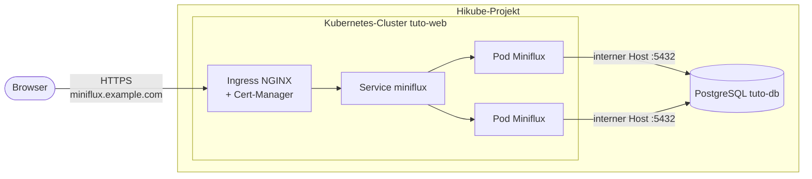

import NavigationFooter from '@site/src/components/NavigationFooter';

# Eine Webanwendung mit PostgreSQL auf Kubernetes bereitstellen

In diesem Tutorial bauen Sie auf Hikube eine vollständige Webanwendung auf: einen Kubernetes-Cluster, auf dem die Anwendung läuft, eine verwaltete **PostgreSQL**-Datenbank, die ihre Daten speichert, eine Veröffentlichung über HTTPS mit automatischem Zertifikat und schließlich die Überwachung des Ganzen.

Die Beispielanwendung ist [Miniflux](https://miniflux.app), ein quelloffener RSS-Feed-Reader: ein einziges Container-Image, eine PostgreSQL-Datenbank, eine Weboberfläche.

| | |
|---|---|
| **Schwierigkeit** | Mittel |
| **Dauer** | Etwa 45 Minuten |
| **Sie lernen** | Einen Kubernetes-Cluster mit einer verwalteten Datenbank desselben Projekts zu verbinden, Zugangsdaten über ein `Secret` zu übergeben und einen Dienst über HTTPS zu veröffentlichen |

---

## Was Sie aufbauen



- Die Datenbank ist **nicht im Internet erreichbar**: Die Anwendung erreicht sie über ihren internen Host, der den Ressourcen des Projekts vorbehalten ist.
- Das Passwort der Datenbank steht in keiner Datei: Es liegt in einem Kubernetes-`Secret`.
- Nur der Ingress ist öffentlich, über HTTPS, mit einem Let's-Encrypt-Zertifikat, das automatisch erneuert wird.

---

## Voraussetzungen

- Ein **Hikube-Konto** und ein **Projekt** mit ausreichenden Quotas für eine Control Plane, einen Node `s1.large` (4 vCPU, 8 GB) und eine Datenbank `s1.small`
- Die **Rolle Projektadministrator**, um die kubeconfig des Clusters herunterzuladen
- **`kubectl`** und **`openssl`** auf Ihrem Rechner installiert
- Ein **Domainname**, dessen DNS-Zone Sie verwalten, für die Veröffentlichung über HTTPS (Schritt 6). Dieses Tutorial verwendet `miniflux.example.com`: Ersetzen Sie ihn überall durch Ihren eigenen.
- **Kubernetes-Grundkenntnisse**: Pod, `Deployment`, `Service`

---

## Schritt 1: Den Kubernetes-Cluster erstellen

Der Cluster ist die Ressource mit der längsten Erstellungszeit: Beginnen Sie mit ihm, die Datenbank erstellen Sie, während er startet.

1. Wählen Sie in der [Hikube-Konsole](https://console.hikube.cloud) Ihr Projekt aus und öffnen Sie dann **Infrastructure** > **Kubernetes**.
2. Klicken Sie auf **Create cluster** und füllen Sie den Assistenten aus:

| Schritt des Assistenten | Feld | Wert |
|----------------------|-------|--------|
| **General** | **Cluster name** | `tuto-web` |
| | **Kubernetes Version** | die vorausgewählte Version |
| | **Control Plane Instance Size** | **s1.small — 1 CPU / 2Gi** |
| | **Control Plane High Availability** | **3 (HA)** |
| **Nodes** | Gruppe `worker-pool-1` | **Instance type** `s1.large`, **Minimum nodes** 1, **Maximum nodes** 3, **Exposed on the internet (Public IP)** aktiviert |
| **Addons** | | Behalten Sie **Cert-Manager**, **Ingress NGINX** und **Monitoring Agents** bei, die standardmäßig ausgewählt sind |

3. Klicken Sie im Schritt **Summary** auf **Create cluster**.

Jedes Feld ist im [Schnellstart Kubernetes](../services/kubernetes/quick-start.md) im Detail beschrieben.

**Erwartetes Ergebnis:** `tuto-web` erscheint in der Liste **Kubernetes Clusters** mit dem Status **Creating**. Gehen Sie ohne Warten zum nächsten Schritt über.

---

## Schritt 2: Die PostgreSQL-Datenbank erstellen

1. Öffnen Sie **DB & Messaging** → **PostgreSQL** und klicken Sie dann auf **Create a cluster**.
2. Füllen Sie den Assistenten aus:

| Schritt des Assistenten | Feld | Wert |
|----------------------|-------|--------|
| **General** | **Cluster Name** | `tuto-db` |
| **Configuration** | **PostgreSQL Version** | `18` |
| | **Instance preset** | `s1.small — 1 CPU / 2Gi` |
| | **Disk size (GB)** | `10` |
| | **Number of replicas** | `1 (Standalone)` |
| | **External access** | **Deaktiviert**: Die Anwendung erreicht die Datenbank aus dem Projekt |
| **Databases** | **Database name** | `miniflux`, dann **Add** |
| **Users** | **Username** | `miniflux`, **Database name** `miniflux`, **Rights** **Administrator (Admin)**, dann **Add** |

3. Klicken Sie im Schritt **Summary** auf **Create cluster**.

Der Schritt **Finish** zeigt das **Password** des Benutzers `miniflux` im Abschnitt **User Credentials** an.

:::warning Kopieren Sie das Passwort jetzt
Es wird nur einmal angezeigt. Kopieren Sie es in Ihren Passwort-Manager, bevor Sie auf **Finish** klicken. Bei Verlust generieren Sie ein neues in der Registerkarte **Users** des Clusters (**Actions** → **Change Password**).
:::

4. Klicken Sie auf **Finish**. Kopieren Sie auf der Seite des Clusters in der Karte **Connection and Databases** mit der Kopierschaltfläche den Host aus dem Bereich **Internal** (*From the project's resources only*): Das ist die Adresse, die die Anwendung auf Port `5432` verwenden wird.

**Erwartetes Ergebnis:** Nach einigen Minuten wechselt `tuto-db` zum Status **Ready**, und der Bereich **External** zeigt **Disabled** an.

---

## Schritt 3: Mit dem Cluster verbinden

Warten Sie, bis der Cluster **Ready** ist und sein erster Node gestartet ist, einige Minuten nach seiner Erstellung.

1. Öffnen Sie **Infrastructure** > **Kubernetes** und dann die Seite des Clusters `tuto-web`.
2. Klicken Sie im Abschnitt **Actions** auf **Kubeconfig**. Der Browser lädt `kubeconfig-tuto-web.yaml` herunter.

```bash
export KUBECONFIG=~/Downloads/kubeconfig-tuto-web.yaml
kubectl get nodes
```

**Erwartetes Ergebnis:** ein Node mit dem Status `Ready`.

```console
NAME                                           STATUS   ROLES    AGE   VERSION
kubernetes-tuto-web-worker-pool-1-xxxxx-xxxxx  Ready    <none>   3m    v1.xx.x
```

:::note Der Cluster ist Ready, aber es erscheint kein Node
Der Status **Ready** betrifft die Control Plane. Der erste Node und die Addons starten danach: Antwortet `kubectl get nodes` mit `No resources found`, warten Sie kurz und führen Sie den Befehl erneut aus.
:::

Prüfen Sie außerdem, dass die Addons laufen:

```bash
kubectl get pods -A | grep -E "cert-manager|ingress-nginx"
```

**Erwartetes Ergebnis:** alle Pods im Status `Running`.

---

## Schritt 4: Den Zugriff des Clusters auf die Datenbank prüfen

Bevor Sie die Anwendung bereitstellen, prüfen Sie, dass der Cluster die Datenbank erreicht. Geben Sie das Passwort von `miniflux` so ein, dass es weder auf dem Bildschirm noch im Verlauf der Shell erscheint, und legen Sie es dann in einem `Secret` ab:

```bash
read -rs PGPASSWORD   # Passwort einfügen, dann Eingabetaste
export PGHOST=<interner-host>   # der in Schritt 2 kopierte Host

kubectl create secret generic pg-test --from-literal=PGPASSWORD="$PGPASSWORD"
```

Starten Sie im Cluster einen kurzlebigen `psql`-Client:

```bash
kubectl run pg-test --rm -i --restart=Never --image=postgres:18-alpine \
  --overrides='{"spec":{"containers":[{"name":"pg-test","image":"postgres:18-alpine",
    "envFrom":[{"secretRef":{"name":"pg-test"}}],
    "command":["psql","host='"$PGHOST"' port=5432 dbname=miniflux user=miniflux sslmode=require",
               "-c","SELECT current_user, version();"]}]}}'
```

**Erwartetes Ergebnis:**

```console
 current_user |                       version
--------------+-----------------------------------------------------
 miniflux     | PostgreSQL 18.x ...
(1 row)
```

Löschen Sie das Test-Secret:

```bash
kubectl delete secret pg-test
```

Wenn der Befehl fehlschlägt, siehe [Ein Pod erreicht eine verwaltete Datenbank des Projekts nicht](../services/kubernetes/troubleshooting.md#base-managee-injoignable).

---

## Schritt 5: Die Anwendung bereitstellen

### Die Zugangsdaten in Secrets ablegen

Miniflux liest die Adresse seiner Datenbank aus der Variable `DATABASE_URL`. Legen Sie sie in einem `Secret` an, mit dem in Schritt 4 eingegebenen Passwort:

```bash
kubectl create secret generic miniflux-db \
  --from-literal=DATABASE_URL="host=$PGHOST port=5432 dbname=miniflux user=miniflux password='$PGPASSWORD' sslmode=require"
```

Erstellen Sie anschließend das Administratorkonto von Miniflux mit einem zufälligen Passwort:

```bash
kubectl create secret generic miniflux-admin \
  --from-literal=username=admin \
  --from-literal=password="$(openssl rand -base64 18)"
```

### Miniflux bereitstellen

```yaml title="miniflux.yaml"
apiVersion: apps/v1
kind: Deployment
metadata:
  name: miniflux
  labels:
    app: miniflux
spec:
  replicas: 1
  selector:
    matchLabels:
      app: miniflux
  template:
    metadata:
      labels:
        app: miniflux
    spec:
      containers:
        - name: miniflux
          image: miniflux/miniflux:2.3.5
          ports:
            - containerPort: 8080
          env:
            - name: LISTEN_ADDR
              value: "0.0.0.0:8080"
            - name: RUN_MIGRATIONS     # legt die Tabellen beim ersten Start an
              value: "1"
            - name: DATABASE_URL
              valueFrom:
                secretKeyRef:
                  name: miniflux-db
                  key: DATABASE_URL
            - name: CREATE_ADMIN       # legt das Admin-Konto an, falls es nicht existiert
              value: "1"
            - name: ADMIN_USERNAME
              valueFrom:
                secretKeyRef:
                  name: miniflux-admin
                  key: username
            - name: ADMIN_PASSWORD
              valueFrom:
                secretKeyRef:
                  name: miniflux-admin
                  key: password
          readinessProbe:
            httpGet:
              path: /healthcheck
              port: 8080
          livenessProbe:
            httpGet:
              path: /healthcheck
              port: 8080
            initialDelaySeconds: 10
          resources:
            requests:
              cpu: 50m
              memory: 64Mi
            limits:
              cpu: 500m
              memory: 256Mi
---
apiVersion: v1
kind: Service
metadata:
  name: miniflux
spec:
  selector:
    app: miniflux
  ports:
    - port: 80
      targetPort: 8080
```

```bash
kubectl apply -f miniflux.yaml
kubectl rollout status deployment/miniflux
kubectl logs deployment/miniflux
```

**Erwartetes Ergebnis:** Die Bereitstellung gelingt, und die Logs zeigen die Erstellung des Schemas und des Admin-Kontos und dann den Start des Servers.

```console
level=INFO msg="Running database migrations" current_version=0 latest_version=...
level=INFO msg="Created new admin user" username=admin user_id=1
level=INFO msg="Starting HTTP server" listen_address=0.0.0.0:8080
```

### Auf zwei Replicas erhöhen

Das Deployment hat nur einen Pod gestartet, während Miniflux seine Tabellen anlegt. Nun, da das Schema existiert, fügen Sie einen zweiten Pod hinzu: Die Anwendung bleibt verfügbar, wenn einer der beiden neu startet.

```bash
kubectl scale deployment/miniflux --replicas=2
kubectl get pods -l app=miniflux
```

**Erwartetes Ergebnis:** zwei Pods `miniflux-…` im Status `Running`, `1/1`.

---

## Schritt 6: Die Anwendung über HTTPS veröffentlichen

### Die Domain auf den Cluster zeigen lassen

Ermitteln Sie die öffentliche IP-Adresse des Ingress-NGINX-Controllers (Spalte `EXTERNAL-IP`):

```bash
kubectl get svc -n cozy-ingress-nginx ingress-nginx-controller
```

Erstellen Sie bei Ihrem DNS-Anbieter einen `A`-Eintrag von `miniflux.example.com` auf diese Adresse. Prüfen Sie die Verbreitung:

```bash
dig +short miniflux.example.com
```

### Den Zertifikatsaussteller erstellen

```yaml title="cluster-issuer.yaml"
apiVersion: cert-manager.io/v1
kind: ClusterIssuer
metadata:
  name: letsencrypt-prod
spec:
  acme:
    server: https://acme-v02.api.letsencrypt.org/directory
    email: admin@example.com   # Ihre Adresse, für Ablaufbenachrichtigungen
    privateKeySecretRef:
      name: letsencrypt-prod-account-key
    solvers:
      - http01:
          ingress:
            ingressClassName: nginx
```

```bash
kubectl apply -f cluster-issuer.yaml
```

### Den Ingress erstellen

```yaml title="miniflux-ingress.yaml"
apiVersion: networking.k8s.io/v1
kind: Ingress
metadata:
  name: miniflux
  annotations:
    cert-manager.io/cluster-issuer: letsencrypt-prod
spec:
  ingressClassName: nginx
  tls:
    - hosts:
        - miniflux.example.com
      secretName: miniflux-tls
  rules:
    - host: miniflux.example.com
      http:
        paths:
          - path: /
            pathType: Prefix
            backend:
              service:
                name: miniflux
                port:
                  number: 80
```

```bash
kubectl apply -f miniflux-ingress.yaml
kubectl get certificate miniflux-tls --watch
```

**Erwartetes Ergebnis:** Nach ein bis zwei Minuten wechselt das Zertifikat auf `READY True`. Beenden Sie den Befehl mit Strg+C.

```console
NAME           READY   SECRET         AGE
miniflux-tls   True    miniflux-tls   90s
```

### Die Anwendung öffnen

```bash
curl -I http://miniflux.example.com       # 308: Weiterleitung auf HTTPS
curl https://miniflux.example.com/healthcheck   # OK
```

Öffnen Sie `https://miniflux.example.com` in Ihrem Browser. Die Seite **Sign In** von Miniflux wird angezeigt. Das Passwort des Kontos `admin` lesen Sie aus seinem Secret:

```bash
kubectl get secret miniflux-admin -o jsonpath='{.data.password}' | base64 -d; echo
```

Melden Sie sich an und fügen Sie dann einen ersten Feed hinzu (**Feeds** → **Add feed**). Jeder Feed und jeder Artikel wird in der Datenbank `tuto-db` gespeichert.

Wenn das Zertifikat auf `False` bleibt, siehe die [Prüfung des Zertifikats](../services/kubernetes/how-to/deploy-ingress-tls.md#verifier-certificat) in der Anleitung zu Ingress mit TLS.

---

## Schritt 7: Die Anwendung überwachen

Das Addon **Monitoring Agents**, das in Schritt 1 aktiviert wurde, erfasst bereits die Metriken und Logs des Clusters. Sehen Sie zuerst nach, was Ihre beiden Pods verbrauchen:

```bash
kubectl top pods -l app=miniflux
```

**Erwartetes Ergebnis:** eine Zeile pro Replica, mit geringem Verbrauch, solange die Anwendung wenig Traffic erhält.

```console
NAME                        CPU(cores)   MEMORY(bytes)
miniflux-xxxxxxxxxx-xxxxx   1m           12Mi
miniflux-xxxxxxxxxx-yyyyy   1m           12Mi
```

Lesen Sie anschließend die Logs der beiden Replicas:

```bash
kubectl logs -l app=miniflux --prefix --tail=5
```

**Erwartetes Ergebnis:** die letzten Zeilen jedes Pods, mit seinem Namen als Präfix, darunter `Starting HTTP server`.

Auf der Datenbankseite zeigt die Seite des Clusters `tuto-db` seinen Status an, und die Registerkarte **Users** verwaltet die Passwörter.

Details zu den installierten Agents finden Sie unter [Das Monitoring konfigurieren](../services/kubernetes/how-to/configure-monitoring.md).

---

## Schritt 8: Aufräumen

Wenn Sie die Anwendung nicht behalten, löschen Sie die Ressourcen, um die Quotas des Projekts freizugeben:

1. **Infrastructure** > **Kubernetes**: Öffnen Sie das Menü **Actions** von `tuto-web`, wählen Sie **Delete**, geben Sie den Namen des Clusters ein und klicken Sie dann auf **Permanently delete**. Die Anwendung, ihre Secrets und ihr Zertifikat verschwinden mit dem Cluster.
2. **DB & Messaging** → **PostgreSQL**: Öffnen Sie `tuto-db`, klicken Sie auf **Delete cluster**, geben Sie seinen Namen ein und klicken Sie dann auf **Permanently delete**.
3. Löschen Sie den DNS-Eintrag `miniflux.example.com` bei Ihrem Anbieter.

:::warning
Diese Löschungen sind unwiderruflich: Die Daten der Datenbank gehen endgültig verloren.
:::

---

## Zusammenfassung

Sie haben:

- einen Kubernetes-Cluster mit Ingress NGINX, Cert-Manager und Überwachung erstellt;
- eine verwaltete PostgreSQL-Datenbank **ohne Exposition im Internet** erstellt;
- die Anwendung über den internen Host mit der Datenbank verbunden, mit in `Secret`-Objekten abgelegten Zugangsdaten;
- die Anwendung nach einer ersten Schema-Migration mit zwei Replicas bereitgestellt;
- die Anwendung über HTTPS mit einem automatischen Let's-Encrypt-Zertifikat veröffentlicht.

## Weiterführendes

- **Hochverfügbarkeit der Datenbank**: Erstellen Sie die Datenbank neu mit **2 (High Availability)** Replicas; die Anzahl der Replicas lässt sich nach der Erstellung nicht mehr ändern. Siehe die [PostgreSQL-Konzepte](../services/databases/postgresql/concepts.md).
- **Backups**: Planen Sie Backups der Datenbank, siehe [Automatische Backups konfigurieren](../services/databases/postgresql/how-to/configure-backups.md).
- **Skalierung**: Die Node-Gruppe wächst von selbst auf bis zu 3 Nodes; um die Anzahl der Pods an die Last anzupassen, siehe [Autoscaling konfigurieren](../services/kubernetes/how-to/configure-autoscaling.md).
- **Continuous Deployment**: Beschreiben Sie die Anwendung in einem Git-Repository und lassen Sie sie von Flux anwenden, siehe [Mit Flux bereitstellen (GitOps)](../services/kubernetes/how-to/deploy-gitops-flux.md).
- **Automatisierung**: Cluster und Datenbank lassen sich auch über die [öffentliche API](../api/overview.md) erstellen; die Registerkarten **API** der Schnellstarts [Kubernetes](../services/kubernetes/quick-start.md) und [PostgreSQL](../services/databases/postgresql/quick-start.md) enthalten die entsprechenden Anfragen.

<NavigationFooter
  nextSteps={[
    {label: "Praxisanleitungen Kubernetes", href: "../../services/kubernetes/how-to/manage-node-groups"},
    {label: "Praxisanleitungen PostgreSQL", href: "../../services/databases/postgresql/how-to/manage-users-databases"},
  ]}
/>
