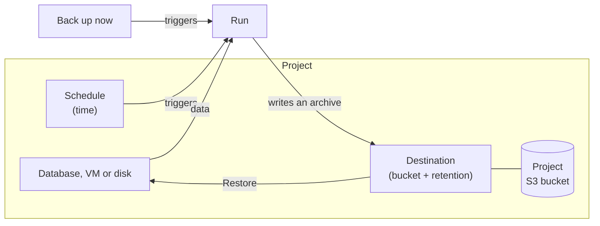

import NavigationFooter from '@site/src/components/NavigationFooter';

# Backups on Hikube

The backup service copies the state of a resource in your project into an **archive**, stored in an [S3 bucket](../storage/buckets/overview.md) that you own, and lets you **restore** that archive. It covers four types of resources:

| Resource | What an archive contains | Restore |
|----------|--------------------------|---------|
| **PostgreSQL** | The complete database, plus its transaction logs archived continuously | Onto the original database or onto another PostgreSQL database, to the state of the backup, to the most recent state or to a **point in time** |
| **MariaDB** | A full export of the database | Onto the original database or onto another MariaDB database |
| **Virtual machine** | The VM and **all its disks** | Onto the original VM |
| **Disk** | The disk alone | Onto the original disk, if it has been deleted |

MongoDB, Redis, RabbitMQ, Kubernetes clusters and buckets are not covered by this service.

In the [Hikube console](https://console.hikube.cloud), everything happens in two places:

- the **Infrastructure** > **Backups** menu, for destinations and the project-wide view (**Destinations**, **Activity**, **Archives** and **Protection** tabs);
- the **Backups** tab of each database, VM or disk, to schedule it, back it up on demand and restore it.

---

## What you can do from the console

| Need | Where to do it |
|------|----------------|
| Choose where backups are written and how long they are kept | **Backups** > **Destinations** > **Create a destination** |
| Schedule a recurring backup | **Backups** tab of the resource > **Schedule** |
| Back up right now | **Backups** tab of the resource > **Back up now** |
| Track ongoing or past backups and restores | **Backups** > **Activity** |
| See which resources are not protected | **Backups** > **Protection** |
| Restore an archive | **Restore** button of an archive (**Backups** tab of the resource or **Backups** > **Archives**) |
| Cancel an ongoing backup or restore | **Cancel** / **Cancel restore** button |
| Delete an archive | **Delete** button of an archive |

---

## How it fits together

1. A **destination** combines a bucket in the project, the bucket user whose credentials it borrows, and a **retention** period. Without a ready destination, no backup is possible.
2. A **schedule** (plan) triggers a backup of a resource to a destination, at set times. You can also trigger a backup **on demand**.
3. Each run produces an **archive**. The archive remains restorable as long as it is ready and its destination exists.
4. A **restore** rewrites the resource from an archive.

---

## Where your data lives

- Archives are written to **your** bucket, in the same project. Hikube keeps no copy elsewhere.
- The space they take up is that of the bucket: there is no quota specific to backups.
- A restore writes into a resource that already exists: it does not consume additional quota. The only exception: a VM restore that **keeps** the old disks creates additional disks (see [Restore a VM or a disk](./how-to/restore-vm-or-disk.md)).

:::tip Locked bucket (WORM)
A destination can write to a bucket created with object locking. Each archive is then locked there for 365 days: no one can delete it before then, and the destination's retention cannot be shorter. See [Concepts](./concepts.md#locked-bucket-worm).
:::

---

## Limits

- **A single destination per PostgreSQL database**: a PostgreSQL database already backed up to one destination cannot be backed up to another (see [Concepts](./concepts.md#postgresql-a-single-destination)).
- **At most one scheduled backup per hour** for a given schedule.
- **A VM or a disk is only restored onto itself**, never onto another resource. Only PostgreSQL and MariaDB databases can be restored onto another database.
- **Archive size is not shown.** For VMs and disks, the console shows the transfer progress, which measures the data read and not the space taken up in the bucket.
- While a resource is being restored, no on-demand backup of that resource is accepted. A **scheduled** backup, however, can still trigger: see [Restore a database](./how-to/restore-database.md#before-you-start).

---

## Next steps

- [Concepts](./concepts.md)
- [Quick start](./quick-start.md)
- [Create a destination](./how-to/create-destination.md)

<NavigationFooter
  nextSteps={[
    {label: "Concepts", href: "../concepts"},
    {label: "Quick start", href: "../quick-start"},
  ]}
  seeAlso={[
    {label: "S3 Buckets", href: "../../storage/buckets/overview"},
  ]}
/>
