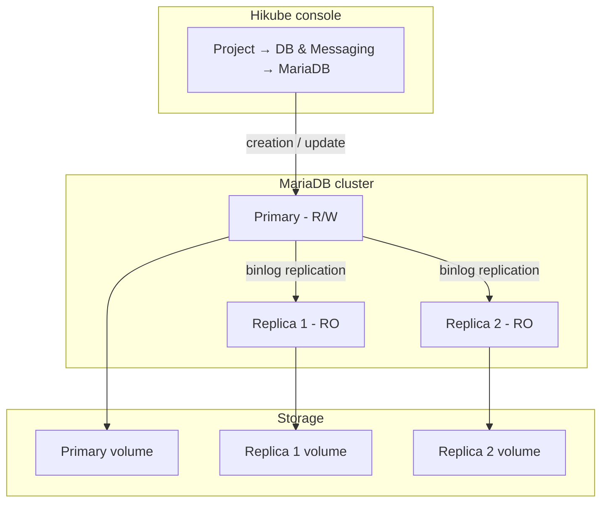
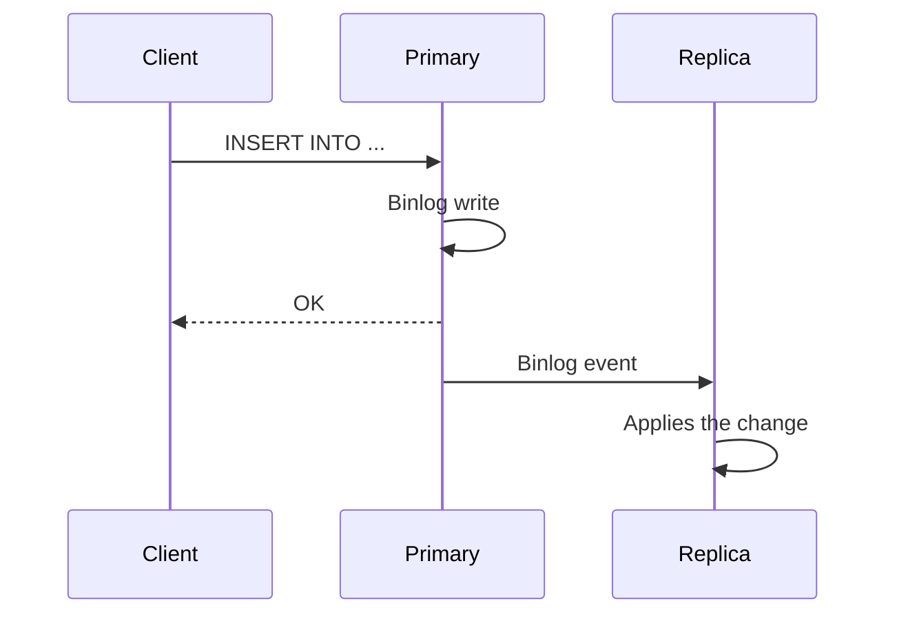

# Concepts — MariaDB

## Architecture

MariaDB on Hikube is a managed service. MariaDB is a fork of MySQL, compatible with its clients and protocol. Each cluster created from the console is a replicated set made up of a primary and optional replicas. It belongs to a **project** and consumes that project's quotas.

---

## Terminology

| Term | Description |
|-------|-------------|
| **MariaDB Cluster** | Managed instance created from the console, made up of a primary and optional replicas. |
| **Project** | Isolated space that groups your resources and carries the quotas. |
| **Primary** | Main node that accepts reads and writes. |
| **Replica** | Read-only node, synchronized from the primary through binlog replication. |
| **Preset** | Resource template (CPU, memory) allocated to each node of the cluster. |
| **External access** | Option that exposes the cluster on the Internet through a public IP address. |
| **Role** | A user's right on a database: **Administrator** or **Read-only**. |

---

## Replication and high availability

The cluster uses MariaDB **binlog replication**:

1. **The primary** writes all changes to the binary log
2. **The replicas** consume the binlog and apply the changes
3. **If the primary fails**, the platform automatically promotes a replica

The **Number of replicas** is chosen at creation:

| Offered value | Use |
|-----------------|-------|
| **1 (Standalone)** | Development, testing |
| **3 (Max High Availability)** | Production |
| **5 (Ultra High Availability)** | Critical production |

:::warning
The number of replicas and the preset cannot be changed after creation. To change them, [contact support](mailto:support@hidora.io).
:::

Manual primary switchover is not offered in the console; contact support.

---

## Users, databases and roles

A MariaDB cluster page has a **Users** section; there is no tab dedicated to databases. Rights are granted database by database: each access pairs a **Database name** with **Rights**, **Administrator (Admin)** or **Read-only**. **Administrator** grants all privileges on the database (`ALL`, with grant option), **Read-only** grants `SELECT`. Granting access to a database that does not exist yet creates it. There is no global role: a user only has access to the databases assigned to them.

- When the cluster is created, the wizard's **Users** step asks for an application **Database** and a **Role** for each user.
- Afterwards, **Create a user** and **Manage Access** let you assign one or more accesses. A user saved without any access has no rights on any database.
- The **Databases** column of the user list shows each database with the role, for example `myapp (Administrator)`.

The system databases `mysql`, `information_schema`, `performance_schema` and `sys` cannot receive access: the console displays "“mysql” is a system database: choose an application database." and the API refuses the request. They cannot be created or deleted either.

:::warning Users created before console v1.3.0
The cluster creation wizard used to give each user a role on the `mysql` system database, which contains the server's accounts and privileges: **Administrator** access to this database makes it possible to change every user's rights, **Read-only** access to read password hashes. For these users, open **Actions** → **Manage Access**: the `mysql` line is shown in error there. Remove it, add the user's application database if needed, then click **Save**.
:::

A user's password is generated by the platform and displayed **only once**. If it is lost, generate a new one with **Change Password**.

### Naming rules

| Item | Rule |
|---------|-------|
| Cluster name | 3 to 16 characters: lowercase letters, digits and hyphens; starts with a letter, ends with a letter or a digit |
| Username | 3 to 16 characters: lowercase letters, digits and hyphens; starts with a letter, ends with a letter or a digit. Some names, such as `admin` or `root`, are reserved |
| Database name | 1 to 63 characters: lowercase letters, digits and hyphens; starts with a letter, ends with a letter or a digit. The system databases `mysql`, `information_schema`, `performance_schema` and `sys` are refused |

:::note
Underscores (`_`) are not accepted in database names or usernames.
:::

---

## Presets

The **Preset** defines the capacity allocated to **each node** of the cluster. Presets are the [virtual machine](../../compute/overview.md) sizes of the `u1`, `s1` and `m1` series: a preset has the same resources as the VM of the same name. The list displayed by the wizard is authoritative:

| Preset | CPU | Memory |
|--------|-----|---------|
| `u1.medium` | 1 | 4Gi |
| `u1.large` | 2 | 8Gi |
| `u1.xlarge` | 4 | 16Gi |
| `u1.2xlarge` | 8 | 32Gi |
| `u1.4xlarge` | 16 | 64Gi |
| `u1.8xlarge` | 32 | 128Gi |
| `s1.small` | 1 | 2Gi |
| `s1.medium` | 2 | 4Gi |
| `s1.large` | 4 | 8Gi |
| `s1.xlarge` | 8 | 16Gi |
| `s1.2xlarge` | 16 | 32Gi |
| `s1.4xlarge` | 32 | 64Gi |
| `m1.large` | 2 | 16Gi |
| `m1.xlarge` | 4 | 32Gi |
| `m1.2xlarge` | 8 | 64Gi |
| `m1.4xlarge` | 16 | 128Gi |
| `m1.8xlarge` | 32 | 256Gi |

The wizard does not preselect any preset: choose one to continue. Each option shows its resources, for example “u1.medium — 1 CPU / 4Gi”. If the list cannot be loaded, the wizard displays “The preset list could not be loaded. Try again later or contact support.”

A cluster created with a former preset (`nano`, `micro`, `small`, `medium`, `large`, `xlarge` or `2xlarge`) keeps it and runs as before: the **Edit** form shows it as is and saves it unchanged. Since the preset cannot be changed after creation, [contact support](mailto:support@hidora.io) for this change. If a cluster's resources were set outside its preset, the form says so with the mention “(override)”.

Defining custom CPU/memory resources is not offered in the console; contact support.

---

## Network access

- **External access disabled** (default): the cluster is not exposed on the Internet. The **Host** field of the **Connection and network** card shows **Not defined**.
- **External access enabled**: the platform assigns a public IP address, shown in the **Host** field. The port is the standard MySQL port, `3306`.

---

## Backup and restore

Backup configuration and restore are not offered in the console; contact support. See [Configure backups](./how-to/configure-backups.md).

---

## Quotas and cost

The wizard displays the **Estimated Cost** and the cluster's impact on the project quotas. If the cluster exceeds the available quotas, the **Next** button stays disabled.

| Parameter | Value |
|-----------|--------|
| Versions | 10.6, 10.11, 11.4, 11.8; upgrade only after creation |
| Replicas | 1, 3 or 5 |
| Disk size | 1 to 4,096 GB, within the project's storage quota; increase only after creation |

---

## Going further

- [Overview](./overview.md): service presentation
- [Quick start](./quick-start.md): create your first cluster
