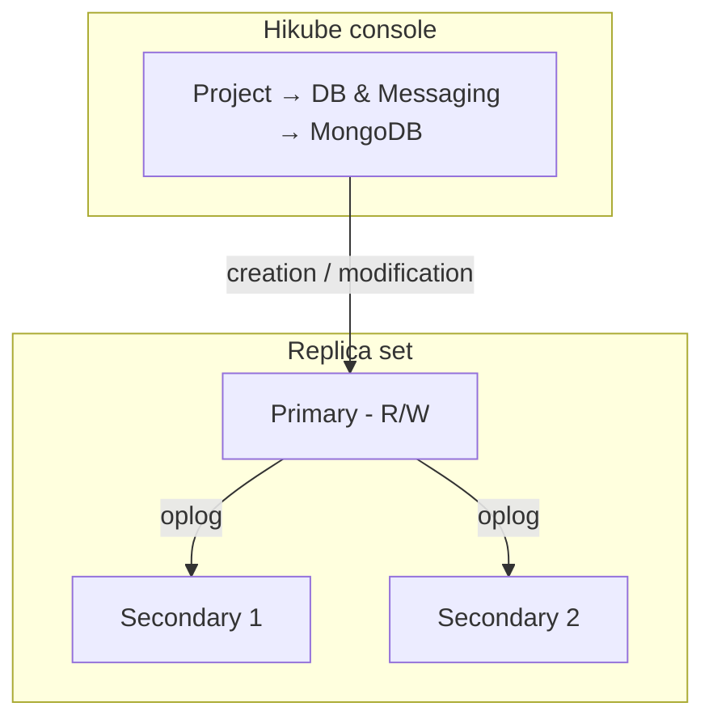

# Concepts — MongoDB

## Architecture

MongoDB on Hikube is a managed service. Each cluster created from the console is, by default, a **replica set**: a group of members holding the same data, only one of which accepts writes. The cluster belongs to a **project** and consumes that project's quotas.

---

## Terminology

| Term | Description |
|------|-------------|
| **MongoDB Cluster** | Managed instance created from the console. |
| **Project** | Isolated space that groups your resources and carries the quotas. |
| **Replica set** | Group of MongoDB members that replicate the same data. |
| **Primary** | Member that accepts writes. |
| **Secondary** | Member that replicates the primary and can be elected in its place if it fails. |
| **Oplog** | The primary's operation log, replayed by the secondaries. |
| **Shard** | Subset of the data, carried by its own replica set (sharded topology). |
| **Configuration servers** | Members that store the metadata of the sharded topology. |
| **Mongos** | Router that receives client requests and directs them to the right shards. |
| **Preset** | Resource template (CPU, memory) allocated to each node. |

---

## Replication and high availability

The secondaries continuously replay the primary's oplog. If the primary becomes unavailable, the remaining members elect a new primary; a majority of members must be available for the election to succeed.

The **Number of replicas** is chosen at creation:

| Offered value | Usage |
|---------------|-------|
| **1 (Standalone)** | Development, testing |
| **3 (Max High Availability)** | Production: tolerates the loss of one member |
| **5 (Ultra High Availability)** | Critical production: tolerates the loss of two members |

:::warning
The number of replicas, the preset and sharding cannot be changed after creation. To change them, [contact support](mailto:support@hidora.io).
:::

---

## Sharding

The wizard's **Sharding (Distributed Topology)** option "automatically deploys configuration servers and Mongos routers, and configures replica sets as shards". The console then creates:

- **2 shards**, each made up of the chosen number of replicas and a disk of the chosen size;
- **configuration servers**, with the same number of replicas and the same disk size;
- **Mongos routers**, with the same number of replicas.

Resource consumption and the estimated cost take this into account. See [Configure sharding](./how-to/configure-sharding.md).

---

## Users, databases and roles

The page of a MongoDB cluster has a **Users** section; there is no dedicated databases tab. Permissions are granted database by database: each access pairs a **Database name** with **Rights**, **Administrator (Admin)** or **Read-only**. **Administrator** corresponds to the MongoDB roles `readWrite` and `dbAdmin` on the database, **Read-only** to the `read` role. There is no global role: a user only has access to the databases assigned to them.

- When the cluster is created, the wizard's **Users** step asks for an application **Database** and a **Role** for each user. The database is created if it does not exist.
- Afterwards, **Create a user** and **Manage Access** let you assign one or more accesses. A MongoDB user must keep at least one access: otherwise, the console displays "Please grant access to at least one database." and the button stays disabled.
- The **Databases** column of the user list shows each database with the role, for example `myapp (Administrator)`.

The system databases `admin`, `local` and `config` cannot receive access: the console displays "“admin” is a system database: choose an application database." and the API refuses the request.

All users are created in the `admin` database, which serves as the authentication database (`authSource=admin`), without receiving a role on that database.

:::warning Users created before console v1.3.0
The cluster creation wizard used to give each user a role on the `admin` system database. For these users, open **Actions** → **Manage Access**: the `admin` line is shown in error there. Remove it, add the user's application database if needed, then click **Save**. As long as this line is present, the user's permissions cannot be saved.
:::

A user's password is generated by the platform and displayed **only once**. If it is lost, generate a new one with **Change Password**.

### Naming rules

| Item | Rule |
|------|------|
| Cluster name | 3 to 16 characters: lowercase letters, digits and hyphens; starts with a letter, ends with a letter or a digit |
| Username | 3 to 16 characters: lowercase letters, digits and hyphens; starts with a letter, ends with a letter or a digit. Some names, such as `admin` or `root`, are reserved |
| Database name | 1 to 63 characters: lowercase letters, digits and hyphens; starts with a letter, ends with a letter or a digit. The system databases `admin`, `local` and `config` are refused |

:::note
Underscores (`_`) and uppercase letters are not accepted in database names or usernames.
:::

---

## Presets

The **Preset** defines the capacity allocated to **each node**. Presets are the [virtual machine](../../compute/overview.md) sizes of the `u1`, `s1` and `m1` series: a preset has the same resources as the VM of the same name. The list displayed by the wizard is authoritative:

| Preset | CPU | Memory |
|--------|-----|--------|
| `u1.medium` | 1 | 4Gi |
| `u1.large` | 2 | 8Gi |
| `u1.xlarge` | 4 | 16Gi |
| `u1.2xlarge` | 8 | 32Gi |
| `u1.4xlarge` | 16 | 64Gi |
| `u1.8xlarge` | 32 | 128Gi |
| `s1.small` | 1 | 2Gi |
| `s1.medium` | 2 | 4Gi |
| `s1.large` | 4 | 8Gi |
| `s1.xlarge` | 8 | 16Gi |
| `s1.2xlarge` | 16 | 32Gi |
| `s1.4xlarge` | 32 | 64Gi |
| `m1.large` | 2 | 16Gi |
| `m1.xlarge` | 4 | 32Gi |
| `m1.2xlarge` | 8 | 64Gi |
| `m1.4xlarge` | 16 | 128Gi |
| `m1.8xlarge` | 32 | 256Gi |

The wizard does not preselect any preset: choose one to continue. Each option shows its resources, for example “u1.medium — 1 CPU / 4Gi”. If the list cannot be loaded, the wizard displays “The preset list could not be loaded. Try again later or contact support.”

A cluster created with a former preset (`nano`, `micro`, `small`, `medium`, `large`, `xlarge` or `2xlarge`) keeps it and runs as before: the **Edit** form shows it as is and saves it unchanged. This preset has no catalog price: the console displays “Price unavailable” and the project dashboard leaves it out of the total cost, until the cluster moves to a preset from the list. Since the preset cannot be changed after creation, [contact support](mailto:support@hidora.io) for this change. If a cluster's resources were set outside its preset, the form says so with the mention “(override)”.

---

## Network access

- **External access disabled** (default): the cluster is not exposed on the Internet. The **Host** field of the **Network and Connection** card shows **Not defined**.
- **External access enabled**: the port is the standard MongoDB port, `27017`, without TLS.
  - **Sharded cluster**: the platform assigns a public address to the Mongos routers, displayed in the **Host** field. The wizard provides a connection string of the form `mongodb://<user>:<password>@<host>`.
  - **Replica set**: each member receives its own public address. The **Network and Connection** card lists them under **Replica set rs0 members**, each with a copy button, and offers an **External connection string** of the form `mongodb://<user>:<password>@<member>:27017/?directConnection=true&authSource=admin`. Connect this way to one member in direct connection, without the `replicaSet` parameter: the members advertise themselves under in-cluster names, which do not resolve from outside. The member you reach may be a secondary, which does not accept writes: read with `readPreference=secondaryPreferred`, and write to the primary member.

---

## Backup and restore

Backup configuration and restore are not offered in the console; [contact support](mailto:support@hidora.io).

---

## Quotas and cost

The wizard displays the **Estimated cost** and the cluster's impact on the project quotas. If the cluster exceeds the available quotas, the **Next** button stays disabled.

| Parameter | Value |
|-----------|-------|
| Versions | 6.0, 7.0, 8.0; upgrade only after creation |
| Replicas | 1, 3 or 5 |
| Disk size | 1 to 4,096 GB, within the project's storage quota; increase only after creation |

---

## Further reading

- [Overview](./overview.md): service presentation
- [Quick start](./quick-start.md): create your first cluster
