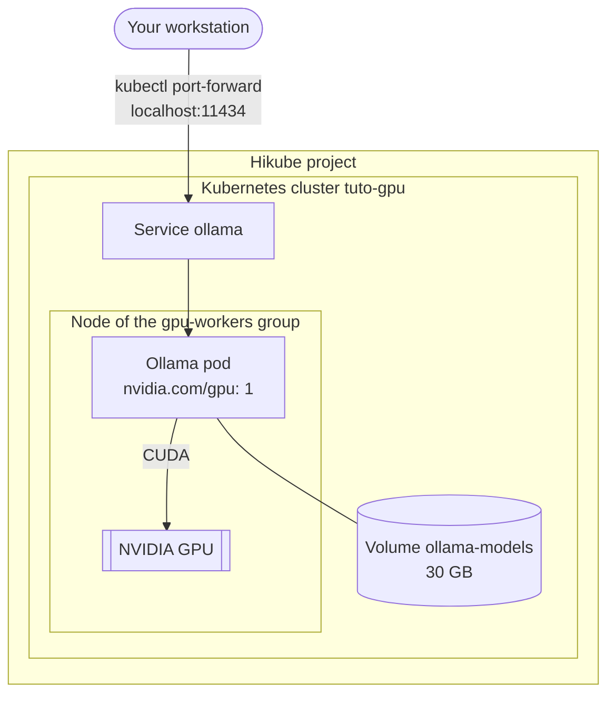

import NavigationFooter from '@site/src/components/NavigationFooter';

# Serve a language model on a GPU with Kubernetes

This tutorial has you serve an open source large language model (LLM) on a Hikube NVIDIA GPU: a Kubernetes cluster with a GPU node, an inference server that loads the model into GPU memory, an OpenAI-compatible API to query it, then proof that the computation really runs on the GPU and a measurement of its throughput.

The inference server is [Ollama](https://ollama.com), which downloads and serves open models. The model is [Qwen2.5 7B Instruct](https://ollama.com/library/qwen2.5), under the Apache 2.0 license: about 5 GB, it fits comfortably in the memory of a data center GPU.

| | |
|---|---|
| **Difficulty** | Intermediate |
| **Duration** | About 45 minutes |
| **You will learn to** | Add a GPU node group to a cluster, reserve a GPU for a pod, check that a model really runs on the GPU, measure its generation throughput |

---

## What you will build



- The GPU is **reserved for the Ollama pod**: no other pod can use it while it runs.
- The model is stored on a **persistent volume**: it survives a pod restart, without a new download.
- The API is **not exposed on the Internet**: you reach it from your workstation through a `kubectl port-forward` tunnel.

---

## Prerequisites

- A **Hikube account** and a **project** with enough quota for a control plane, a `u1.2xlarge` node (8 vCPU, 32 GB) with 100 GB of disk, one GPU and a 30 GB volume
- The **project administrator role**, to download the cluster kubeconfig
- **`kubectl`**, **`curl`** and **`jq`** installed on your workstation
- **Basic Kubernetes knowledge**: pod, `Deployment`, `Service`

---

## Step 1: Create the cluster with a GPU node group

1. In the [Hikube console](https://console.hikube.cloud), select your project, then open **Infrastructure** > **Kubernetes**.
2. Click **Create cluster** and fill in the wizard:

| Wizard step | Field | Value |
|-------------|-------|-------|
| **General** | **Cluster name** | `tuto-gpu` |
| | **Kubernetes Version** | the preselected version |
| | **Control Plane Instance Size** | **s1.small — 1 CPU / 2Gi** |
| | **Control Plane High Availability** | **3 (HA)** |
| **Nodes** | **Group name** | `gpu-workers` |
| | **Instance type** | `u1.2xlarge` (8 vCPU, 32 GB) |
| | **Node disk size** | `100`: GPU container images are large |
| | **Minimum nodes** / **Maximum nodes** | `1` / `1` |
| | **GPU** section | Click the **NVIDIA L40S** card, or another available model; keep 1 GPU per node |
| **Addons** | | **GPU Operator** is checked and locked (**Required when a node group has GPUs**); leave the other addons as they are |

3. At the **Summary** step, click **Create cluster**.

Choosing the GPU model and its constraints are detailed in [How to provision a GPU on Kubernetes](../services/gpu/how-to/provision-gpu-kubernetes.md); models marked **Unavailable** cannot be selected for the moment.

**Expected result**: `tuto-gpu` appears in the **Kubernetes Clusters** list with the **Creating** status.

---

## Step 2: Connect to the cluster

Wait until the cluster is **Ready** and its GPU node has started, several minutes after its creation.

1. Open **Infrastructure** > **Kubernetes**, then the `tuto-gpu` cluster page.
2. Click **Kubeconfig**. The browser downloads `kubeconfig-tuto-gpu.yaml`.

```bash
export KUBECONFIG=~/Downloads/kubeconfig-tuto-gpu.yaml
kubectl get nodes
```

**Expected result**: one `kubernetes-tuto-gpu-gpu-workers-…` node with the `Ready` status.

:::note The cluster is Ready, but no node shows up
The **Ready** status applies to the control plane. The GPU node and the addons start afterwards: if `kubectl get nodes` answers `No resources found`, wait and run the command again.
:::

---

## Step 3: Check that the GPU is exposed

The **GPU Operator** addon prepares the node: it installs what exposes the GPU to pods. Follow its startup:

```bash
kubectl get pods -n cozy-gpu-operator
```

**Expected result**: after a few minutes, all pods are `Running`.

Then check that the node advertises its GPU to the Kubernetes scheduler:

```bash
kubectl get nodes -o custom-columns=NAME:.metadata.name,GPU:.status.allocatable.'nvidia\.com/gpu'
```

**Expected result**: the node's `GPU` column shows `1`, the number of GPUs chosen in step 1. As long as it shows `<none>`, the GPU Operator has not finished preparing the node: wait and run the command again.

---

## Step 4: Deploy the inference server

The manifest creates three resources: a volume for the models, the Ollama server, and a `Service` to reach it inside the cluster.

```yaml title="ollama.yaml"
apiVersion: v1
kind: PersistentVolumeClaim
metadata:
  name: ollama-models
spec:
  accessModes:
    - ReadWriteOnce
  resources:
    requests:
      storage: 30Gi
---
apiVersion: apps/v1
kind: Deployment
metadata:
  name: ollama
  labels:
    app: ollama
spec:
  replicas: 1
  strategy:
    type: Recreate          # the volume attaches to one pod at a time
  selector:
    matchLabels:
      app: ollama
  template:
    metadata:
      labels:
        app: ollama
    spec:
      containers:
        - name: ollama
          image: ollama/ollama:0.40.18
          ports:
            - containerPort: 11434
          env:
            - name: OLLAMA_KEEP_ALIVE   # keeps the model loaded in GPU memory
              value: "-1"
          volumeMounts:
            - name: models
              mountPath: /root/.ollama
          readinessProbe:
            httpGet:
              path: /
              port: 11434
          resources:
            requests:
              cpu: "2"
              memory: 8Gi
            limits:
              memory: 16Gi
              nvidia.com/gpu: 1
      volumes:
        - name: models
          persistentVolumeClaim:
            claimName: ollama-models
---
apiVersion: v1
kind: Service
metadata:
  name: ollama
spec:
  selector:
    app: ollama
  ports:
    - port: 11434
      targetPort: 11434
```

The `nvidia.com/gpu: 1` line is the one that matters: it reserves a whole GPU for the pod, and Kubernetes only places the pod on a node that has a free one.

```bash
kubectl apply -f ollama.yaml
kubectl rollout status deployment/ollama --timeout=10m
```

**Expected result**: the rollout completes within a few minutes, the time it takes to download the image.

At startup, Ollama detects the compute hardware and writes it to its logs:

```bash
kubectl logs deployment/ollama | grep "inference compute"
```

**Expected result**: the `inference compute` line describes the node's NVIDIA GPU, with its name and memory. If it shows `library=cpu`, Ollama does not see the GPU: see [GPU troubleshooting](../services/gpu/troubleshooting.md).

:::note The pod stays Pending
`kubectl describe pod -l app=ollama` then shows `Insufficient nvidia.com/gpu`: no node has a free GPU. Check the `GPU` column from step 3, and that no other pod already reserves the GPU.
:::

---

## Step 5: Download the model and query it

Download the model into the server's volume:

```bash
kubectl exec deploy/ollama -- ollama pull qwen2.5:7b
kubectl exec deploy/ollama -- ollama list
```

**Expected result**: after the download, which ends with `success`, the model appears in the list.

```console
NAME          ID              SIZE      MODIFIED
qwen2.5:7b    845dbda0ea48    4.7 GB    2 seconds ago
```

Open a tunnel to the server. The command stays in the foreground: run it in a second terminal, and keep it open until the end of the tutorial.

```bash
kubectl port-forward svc/ollama 11434:11434
```

In the first terminal, ask the model a question through Ollama's OpenAI-compatible API:

```bash
curl -s http://localhost:11434/v1/chat/completions \
  -H "Content-Type: application/json" \
  -d '{"model": "qwen2.5:7b", "messages": [{"role": "user", "content": "Explain in one sentence what a GPU is."}]}' \
  | jq '{model, content: .choices[0].message.content, usage}'
```

**Expected result**: the model's answer, and the number of tokens read and generated.

```console
{
  "model": "qwen2.5:7b",
  "content": "A GPU ... is a specialized chip ...",
  "usage": {
    "prompt_tokens": 40,
    "completion_tokens": 35,
    "total_tokens": 75
    ...
  }
}
```

The first request is slower: Ollama loads the model into memory. Thanks to `OLLAMA_KEEP_ALIVE`, it stays there for the next ones.

Any OpenAI-compatible client can use this server: give it the base URL `http://localhost:11434/v1` and the model `qwen2.5:7b`.

---

## Step 6: Check that the model runs on the GPU

A model that answers does not prove that the GPU is working: if the model does not fit in GPU memory, or if the pod does not see the GPU, Ollama moves all or part of the computation to the processor, without any error. Check where the model is loaded:

```bash
kubectl exec deploy/ollama -- ollama ps
```

**Expected result**: the `PROCESSOR` column of `qwen2.5:7b` shows `100% GPU`. The value `100% CPU`, or a split such as `48%/52% CPU/GPU`, means that the model is not, or not entirely, in GPU memory.

Also check, on the Kubernetes side, that the node's GPU is allocated:

```bash
kubectl describe nodes | grep -A 15 "Allocated resources" | grep nvidia.com/gpu
```

**Expected result**: `nvidia.com/gpu` with `1` as request and limit, the GPU reserved by the Ollama pod.

---

## Step 7: Measure the generation throughput

An LLM's throughput is measured in tokens generated per second. Ollama's native API returns the number of generated tokens (`eval_count`) and the generation time in nanoseconds (`eval_duration`): `jq` derives the throughput from them.

```bash
PROMPT="Write a 150-word paragraph about the history of parallel computing."

curl -s http://localhost:11434/api/generate \
  -d "{\"model\": \"qwen2.5:7b\", \"prompt\": \"$PROMPT\", \"stream\": false}" \
  | jq '{tokens: .eval_count, tokens_per_s: (.eval_count / .eval_duration * 1e9 | floor)}'
```

**Expected result**: an object with the number of generated tokens (`tokens`) and the throughput in tokens per second (`tokens_per_s`). Run it two or three times and keep a typical value.

### Point of comparison: the same model on the processor

To measure what the GPU brings, run the same request again with the `num_gpu` option set to `0`: Ollama then reloads the model **on the node's processor**, without the GPU.

```bash
curl -s http://localhost:11434/api/generate \
  -d "{\"model\": \"qwen2.5:7b\", \"prompt\": \"$PROMPT\", \"stream\": false, \"options\": {\"num_gpu\": 0}}" \
  | jq '{tokens: .eval_count, tokens_per_s: (.eval_count / .eval_duration * 1e9 | floor)}'
```

Compare the two `tokens_per_s` values: the gap is what the GPU brings to this model, on this node. `kubectl exec deploy/ollama -- ollama ps` now shows `100% CPU`: run the first command again, without `num_gpu`, to reload the model on the GPU.

---

## Step 8: Clean up

Stop the tunnel (Ctrl+C in the second terminal). If you do not keep the server, delete the cluster to release the GPU and the project quotas:

1. **Infrastructure** > **Kubernetes**: open the **Actions** menu of `tuto-gpu`, choose **Delete**, type the cluster name, then click **Permanently delete**.

The server, its volume and the downloaded model disappear with the cluster.

:::warning
This deletion is irreversible.
:::

---

## Summary

You have:

- created a Kubernetes cluster with a GPU node group, and let the GPU Operator prepare the node;
- checked that the node advertises its GPU (`nvidia.com/gpu`);
- deployed an inference server that reserves a whole GPU, with a persistent volume for the models;
- queried an open source model through an OpenAI-compatible API;
- checked that the model is loaded on the GPU, then measured its throughput and compared it with the processor.

## Going further

- **Share a GPU**: to run several small models on the same GPU, enable the [HAMi](../services/kubernetes/plugins/hami.md) addon.
- **Larger models**: GPU memory limits the model size; the available models and their characteristics are in the [GPU concepts](../services/gpu/concepts.md).
- **Occasional use**: a GPU node group can scale down to zero nodes between two uses, see [How to configure autoscaling](../services/kubernetes/how-to/configure-autoscaling.md).
- **Scaling up**: to serve many concurrent requests, a specialized inference server such as [vLLM](https://docs.vllm.ai) makes better use of the GPU; the reservation through `nvidia.com/gpu` stays the same.
- **Open the API to other applications**: Ollama does not authenticate requests. Before publishing the service, put it behind authentication, for example on an Ingress, see [How to deploy an Ingress with TLS](../services/kubernetes/how-to/deploy-ingress-tls.md).
- **Without Kubernetes**: a GPU can also be attached to a virtual machine, see [Create a VM with a GPU](../services/gpu/quick-start.md).

<NavigationFooter
  nextSteps={[
    {label: "Provision a GPU on Kubernetes", href: "../../services/gpu/how-to/provision-gpu-kubernetes"},
    {label: "GPU Operator plugin", href: "../../services/kubernetes/plugins/gpu-operator"},
  ]}
/>
