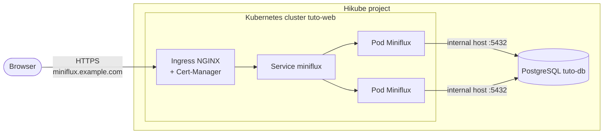

import NavigationFooter from '@site/src/components/NavigationFooter';

# Deploy a web application with PostgreSQL on Kubernetes

In this tutorial, you build a complete web application on Hikube: a Kubernetes cluster that runs the application, a managed **PostgreSQL** database that stores its data, an HTTPS publication with an automatic certificate, and then monitoring of the whole setup.

The example application is [Miniflux](https://miniflux.app), an open source RSS feed reader: a single container image, a PostgreSQL database, a web interface.

| | |
|---|---|
| **Difficulty** | Intermediate |
| **Duration** | About 45 minutes |
| **You will learn to** | Connect a Kubernetes cluster to a managed database in the same project, pass credentials through a `Secret`, publish a service over HTTPS |

---

## What you will build



- The database is **not exposed on the Internet**: the application reaches it through its internal host, reserved for the project's resources.
- The database password appears in no file: it lives in a Kubernetes `Secret`.
- Only the Ingress is public, over HTTPS, with a Let's Encrypt certificate that renews automatically.

---

## Prerequisites

- A **Hikube account** and a **project** with enough quota for a control plane, one `s1.large` node (4 vCPU, 8 GB) and an `s1.small` database
- The **project administrator role**, to download the cluster's kubeconfig
- **`kubectl`** and **`openssl`** installed on your workstation
- A **domain name** whose DNS zone you manage, for the HTTPS publication (step 6). This tutorial uses `miniflux.example.com`: replace it with your own everywhere.
- **Basic Kubernetes knowledge**: pod, `Deployment`, `Service`

---

## Step 1: Create the Kubernetes cluster

The cluster is the slowest resource to create: start with it, and create the database while it boots.

1. In the [Hikube console](https://console.hikube.cloud), select your project, then open **Infrastructure** > **Kubernetes**.
2. Click **Create cluster** and fill in the wizard:

| Wizard step | Field | Value |
|-------------|-------|-------|
| **General** | **Cluster name** | `tuto-web` |
| | **Kubernetes Version** | the preselected version |
| | **Control Plane Instance Size** | **s1.small — 1 CPU / 2Gi** |
| | **Control Plane High Availability** | **3 (HA)** |
| **Nodes** | Group `worker-pool-1` | **Instance type** `s1.large`, **Minimum nodes** 1, **Maximum nodes** 3, **Exposed on the internet (Public IP)** enabled |
| **Addons** | | Keep **Cert-Manager**, **Ingress NGINX** and **Monitoring Agents**, checked by default |

3. At the **Summary** step, click **Create cluster**.

Each field is detailed in the [Kubernetes quick start](../services/kubernetes/quick-start.md).

**Expected result**: `tuto-web` appears in the **Kubernetes Clusters** list with the **Creating** status. Move on to the next step without waiting.

---

## Step 2: Create the PostgreSQL database

1. Open **DB & Messaging** → **PostgreSQL**, then click **Create a cluster**.
2. Fill in the wizard:

| Wizard step | Field | Value |
|-------------|-------|-------|
| **General** | **Cluster Name** | `tuto-db` |
| **Configuration** | **PostgreSQL Version** | `18` |
| | **Instance preset** | `s1.small — 1 CPU / 2Gi` |
| | **Disk size (GB)** | `10` |
| | **Number of replicas** | `1 (Standalone)` |
| | **External access** | **Disabled**: the application will reach the database from within the project |
| **Databases** | **Database name** | `miniflux`, then **Add** |
| **Users** | **Username** | `miniflux`, **Database name** `miniflux`, **Rights** **Administrator (Admin)**, then **Add** |

3. At the **Summary** step, click **Create cluster**.

The **Finish** step shows the **Password** of the `miniflux` user, in the **User Credentials** section.

:::warning Copy the password now
It is displayed only once. Copy it into your password manager before clicking **Finish**. If you lose it, generate a new one from the cluster's **Users** tab (**Actions** → **Change Password**).
:::

4. Click **Finish**. On the cluster page, in the **Connection and Databases** card, copy the host from the **Internal** zone (*From the project's resources only*) with the copy button: this is the address the application will use, on port `5432`.

**Expected result**: after a few minutes, `tuto-db` changes to the **Ready** status, and the **External** zone shows **Disabled**.

---

## Step 3: Connect to the cluster

Wait for the cluster to be **Ready** and its first node to have started, a few minutes after its creation.

1. Open **Infrastructure** > **Kubernetes**, then the `tuto-web` cluster page.
2. In the **Actions** section, click **Kubeconfig**. The browser downloads `kubeconfig-tuto-web.yaml`.

```bash
export KUBECONFIG=~/Downloads/kubeconfig-tuto-web.yaml
kubectl get nodes
```

**Expected result**: one node with the `Ready` status.

```console
NAME                                           STATUS   ROLES    AGE   VERSION
kubernetes-tuto-web-worker-pool-1-xxxxx-xxxxx  Ready    <none>   3m    v1.xx.x
```

:::note The cluster is Ready, but no node appears
The **Ready** status applies to the control plane. The first node and the addons start afterwards: if `kubectl get nodes` answers `No resources found`, wait and run the command again.
:::

Also check that the addons are running:

```bash
kubectl get pods -A | grep -E "cert-manager|ingress-nginx"
```

**Expected result**: all pods in `Running`.

---

## Step 4: Check the cluster's access to the database

Before deploying the application, check that the cluster reaches the database. Enter the `miniflux` password without it showing on screen or in your shell history, then store it in a `Secret`:

```bash
read -rs PGPASSWORD   # paste the password, then press Enter
export PGHOST=<internal-host>   # the host copied in step 2

kubectl create secret generic pg-test --from-literal=PGPASSWORD="$PGPASSWORD"
```

Run an ephemeral `psql` client in the cluster:

```bash
kubectl run pg-test --rm -i --restart=Never --image=postgres:18-alpine \
  --overrides='{"spec":{"containers":[{"name":"pg-test","image":"postgres:18-alpine",
    "envFrom":[{"secretRef":{"name":"pg-test"}}],
    "command":["psql","host='"$PGHOST"' port=5432 dbname=miniflux user=miniflux sslmode=require",
               "-c","SELECT current_user, version();"]}]}}'
```

**Expected result**:

```console
 current_user |                       version
--------------+-----------------------------------------------------
 miniflux     | PostgreSQL 18.x ...
(1 row)
```

Delete the test secret:

```bash
kubectl delete secret pg-test
```

If the command fails, see [A pod cannot reach a managed database in the project](../services/kubernetes/troubleshooting.md#base-managee-injoignable).

---

## Step 5: Deploy the application

### Store the credentials in secrets

Miniflux reads its database address from the `DATABASE_URL` variable. Create it in a `Secret`, with the password entered in step 4:

```bash
kubectl create secret generic miniflux-db \
  --from-literal=DATABASE_URL="host=$PGHOST port=5432 dbname=miniflux user=miniflux password='$PGPASSWORD' sslmode=require"
```

Then create the Miniflux administrator account, with a random password:

```bash
kubectl create secret generic miniflux-admin \
  --from-literal=username=admin \
  --from-literal=password="$(openssl rand -base64 18)"
```

### Deploy Miniflux

```yaml title="miniflux.yaml"
apiVersion: apps/v1
kind: Deployment
metadata:
  name: miniflux
  labels:
    app: miniflux
spec:
  replicas: 1
  selector:
    matchLabels:
      app: miniflux
  template:
    metadata:
      labels:
        app: miniflux
    spec:
      containers:
        - name: miniflux
          image: miniflux/miniflux:2.3.5
          ports:
            - containerPort: 8080
          env:
            - name: LISTEN_ADDR
              value: "0.0.0.0:8080"
            - name: RUN_MIGRATIONS     # creates the tables on first startup
              value: "1"
            - name: DATABASE_URL
              valueFrom:
                secretKeyRef:
                  name: miniflux-db
                  key: DATABASE_URL
            - name: CREATE_ADMIN       # creates the admin account if it does not exist
              value: "1"
            - name: ADMIN_USERNAME
              valueFrom:
                secretKeyRef:
                  name: miniflux-admin
                  key: username
            - name: ADMIN_PASSWORD
              valueFrom:
                secretKeyRef:
                  name: miniflux-admin
                  key: password
          readinessProbe:
            httpGet:
              path: /healthcheck
              port: 8080
          livenessProbe:
            httpGet:
              path: /healthcheck
              port: 8080
            initialDelaySeconds: 10
          resources:
            requests:
              cpu: 50m
              memory: 64Mi
            limits:
              cpu: 500m
              memory: 256Mi
---
apiVersion: v1
kind: Service
metadata:
  name: miniflux
spec:
  selector:
    app: miniflux
  ports:
    - port: 80
      targetPort: 8080
```

```bash
kubectl apply -f miniflux.yaml
kubectl rollout status deployment/miniflux
kubectl logs deployment/miniflux
```

**Expected result**: the deployment completes, and the logs show the schema creation, the admin account creation, then the server starting.

```console
level=INFO msg="Running database migrations" current_version=0 latest_version=...
level=INFO msg="Created new admin user" username=admin user_id=1
level=INFO msg="Starting HTTP server" listen_address=0.0.0.0:8080
```

### Scale to two replicas

The deployment started a single pod, while Miniflux created its tables. Now that the schema exists, add a second pod: the application stays available if one of the two restarts.

```bash
kubectl scale deployment/miniflux --replicas=2
kubectl get pods -l app=miniflux
```

**Expected result**: two `miniflux-…` pods in `Running`, `1/1`.

---

## Step 6: Publish the application over HTTPS

### Point the domain to the cluster

Get the public IP address of the Ingress NGINX controller (`EXTERNAL-IP` column):

```bash
kubectl get svc -n cozy-ingress-nginx ingress-nginx-controller
```

At your DNS provider, create an `A` record for `miniflux.example.com` pointing to this address. Check the propagation:

```bash
dig +short miniflux.example.com
```

### Create the certificate issuer

```yaml title="cluster-issuer.yaml"
apiVersion: cert-manager.io/v1
kind: ClusterIssuer
metadata:
  name: letsencrypt-prod
spec:
  acme:
    server: https://acme-v02.api.letsencrypt.org/directory
    email: admin@example.com   # your address, for expiry notices
    privateKeySecretRef:
      name: letsencrypt-prod-account-key
    solvers:
      - http01:
          ingress:
            ingressClassName: nginx
```

```bash
kubectl apply -f cluster-issuer.yaml
```

### Create the Ingress

```yaml title="miniflux-ingress.yaml"
apiVersion: networking.k8s.io/v1
kind: Ingress
metadata:
  name: miniflux
  annotations:
    cert-manager.io/cluster-issuer: letsencrypt-prod
spec:
  ingressClassName: nginx
  tls:
    - hosts:
        - miniflux.example.com
      secretName: miniflux-tls
  rules:
    - host: miniflux.example.com
      http:
        paths:
          - path: /
            pathType: Prefix
            backend:
              service:
                name: miniflux
                port:
                  number: 80
```

```bash
kubectl apply -f miniflux-ingress.yaml
kubectl get certificate miniflux-tls --watch
```

**Expected result**: after one to two minutes, the certificate changes to `READY True`. Stop the command with Ctrl+C.

```console
NAME           READY   SECRET         AGE
miniflux-tls   True    miniflux-tls   90s
```

### Open the application

```bash
curl -I http://miniflux.example.com       # 308: redirect to HTTPS
curl https://miniflux.example.com/healthcheck   # OK
```

Open `https://miniflux.example.com` in your browser. The Miniflux **Sign In** page is displayed. The `admin` account password is read from its secret:

```bash
kubectl get secret miniflux-admin -o jsonpath='{.data.password}' | base64 -d; echo
```

Sign in, then add a first feed (**Feeds** → **Add feed**). Each feed and each article is stored in the `tuto-db` database.

If the certificate stays at `False`, see the [certificate check](../services/kubernetes/how-to/deploy-ingress-tls.md#verifier-certificat) in the Ingress with TLS guide.

---

## Step 7: Monitor the application

The **Monitoring Agents** addon, enabled in step 1, already collects the cluster's metrics and logs. First look at what your two pods consume:

```bash
kubectl top pods -l app=miniflux
```

**Expected result**: one line per replica, with low consumption as long as the application receives little traffic.

```console
NAME                        CPU(cores)   MEMORY(bytes)
miniflux-xxxxxxxxxx-xxxxx   1m           12Mi
miniflux-xxxxxxxxxx-yyyyy   1m           12Mi
```

Then read the logs of both replicas:

```bash
kubectl logs -l app=miniflux --prefix --tail=5
```

**Expected result**: the last lines of each pod, prefixed with its name, including `Starting HTTP server`.

On the database side, the `tuto-db` cluster page shows its status, and the **Users** tab manages passwords.

See [How to configure monitoring](../services/kubernetes/how-to/configure-monitoring.md) for details on the installed agents.

---

## Step 8: Clean up

If you are not keeping the application, delete the resources to free up the project's quotas:

1. **Infrastructure** > **Kubernetes**: open the **Actions** menu of `tuto-web`, choose **Delete**, enter the cluster name, then click **Permanently delete**. The application, its secrets and its certificate disappear with the cluster.
2. **DB & Messaging** → **PostgreSQL**: open `tuto-db`, click **Delete cluster**, enter its name, then click **Permanently delete**.
3. Delete the `miniflux.example.com` DNS record at your provider.

:::warning
These deletions are irreversible: the database data is permanently lost.
:::

---

## Summary

You have:

- created a Kubernetes cluster with Ingress NGINX, Cert-Manager and monitoring;
- created a managed PostgreSQL database **with no Internet exposure**;
- connected the application to the database through the internal host, with credentials stored in `Secret` objects;
- deployed the application on two replicas, after a first schema migration;
- published the application over HTTPS with an automatic Let's Encrypt certificate.

## Going further

- **Database high availability**: recreate the database with **2 (High Availability)** replicas; the number of replicas can no longer be changed after creation. See the [PostgreSQL concepts](../services/databases/postgresql/concepts.md).
- **Backups**: schedule database backups, see [How to configure backups](../services/databases/postgresql/how-to/configure-backups.md).
- **Scaling**: the node group scales up on its own to 3 nodes; to adjust the number of pods to the load, see [How to configure autoscaling](../services/kubernetes/how-to/configure-autoscaling.md).
- **Continuous deployment**: describe the application in a Git repository and let Flux apply it, see [How to deploy with FluxCD](../services/kubernetes/how-to/deploy-gitops-flux.md).
- **Automation**: the cluster and the database can also be created through the [public API](../api/overview.md); the **API** tabs of the [Kubernetes](../services/kubernetes/quick-start.md) and [PostgreSQL](../services/databases/postgresql/quick-start.md) quick starts give the equivalent requests.

<NavigationFooter
  nextSteps={[
    {label: "Kubernetes how-to guides", href: "../../services/kubernetes/how-to/manage-node-groups"},
    {label: "PostgreSQL how-to guides", href: "../../services/databases/postgresql/how-to/manage-users-databases"},
  ]}
/>
