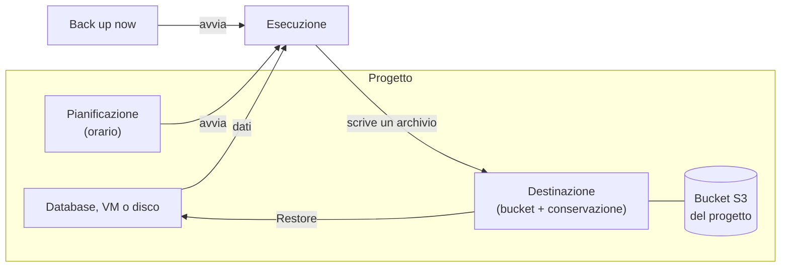

import NavigationFooter from '@site/src/components/NavigationFooter';

# Backup su Hikube

Il servizio di backup copia lo stato di una risorsa del suo progetto in un **archivio**, conservato in un [bucket S3](../storage/buckets/overview.md) di sua proprietà, e permette poi di **ripristinare** questo archivio. Copre quattro tipi di risorse:

| Risorsa | Che cosa contiene un archivio | Ripristino |
|---------|-------------------------------|------------|
| **PostgreSQL** | Il database completo, più i suoi log delle transazioni archiviati in continuo | Sul database di origine o su un altro database PostgreSQL, allo stato del backup, allo stato più recente o a un **istante preciso** |
| **MariaDB** | Un'esportazione completa del database | Sul database di origine o su un altro database MariaDB |
| **Macchina virtuale** | La VM e **tutti i suoi dischi** | Sulla VM di origine |
| **Disco** | Il solo disco | Sul disco di origine, se è stato eliminato |

MongoDB, Redis, RabbitMQ, i cluster Kubernetes e i bucket non sono coperti da questo servizio.

Nella [console Hikube](https://console.hikube.cloud), tutto avviene in due punti:

- il menu **Infrastructure** > **Backups**, per le destinazioni e la visione d'insieme del progetto (schede **Destinations**, **Activity**, **Archives** e **Protection**);
- la scheda **Backups** di ogni database, VM o disco, per pianificarne il backup, eseguirlo su richiesta e ripristinarlo.

---

## Che cosa può fare dalla console

| Esigenza | Dove farlo |
|----------|------------|
| Scegliere dove scrivere i backup e per quanto tempo conservarli | **Backups** > **Destinations** > **Create a destination** |
| Pianificare un backup ricorrente | Scheda **Backups** della risorsa > **Schedule** |
| Eseguire subito un backup | Scheda **Backups** della risorsa > **Back up now** |
| Seguire i backup e i ripristini in corso o passati | **Backups** > **Activity** |
| Vedere quali risorse non sono protette | **Backups** > **Protection** |
| Ripristinare un archivio | Pulsante **Restore** di un archivio (scheda **Backups** della risorsa o **Backups** > **Archives**) |
| Annullare un backup o un ripristino in corso | Pulsante **Cancel** / **Cancel restore** |
| Eliminare un archivio | Pulsante **Delete** di un archivio |

---

## Come si articola

1. Una **destinazione** associa un bucket del progetto, l'utente del bucket di cui utilizza le credenziali e una durata di **conservazione**. Senza una destinazione pronta, nessun backup è possibile.
2. Una **pianificazione** (piano) avvia il backup di una risorsa verso una destinazione, secondo un orario. Può anche avviare un backup **su richiesta**.
3. Ogni esecuzione produce un **archivio**. L'archivio resta ripristinabile finché è pronto e la sua destinazione esiste.
4. Un **ripristino** riscrive la risorsa a partire da un archivio.

---

## Dove si trovano i suoi dati

- Gli archivi vengono scritti nel **suo** bucket, nello stesso progetto. Hikube non ne conserva una copia altrove.
- Lo spazio che occupano è quello del bucket: non esiste una quota specifica per i backup.
- Un ripristino scrive in una risorsa che esiste già: non consuma quota aggiuntiva. Unica eccezione: un ripristino di VM che **conserva** i vecchi dischi crea dischi aggiuntivi (vedere [Ripristinare una VM o un disco](./how-to/restore-vm-or-disk.md)).

:::tip Bucket bloccato (WORM)
Una destinazione può scrivere in un bucket creato con il blocco degli oggetti. Ogni archivio vi resta allora bloccato per 365 giorni: nessuno può eliminarlo prima, e la conservazione della destinazione non può essere più breve. Vedere [Concetti](./concepts.md#bucket-bloccato-worm).
:::

---

## Limiti

- **Una sola destinazione per database PostgreSQL**: un database PostgreSQL già salvato verso una destinazione non può esserlo verso un'altra (vedere [Concetti](./concepts.md#postgresql-una-sola-destinazione)).
- **Al massimo un backup pianificato all'ora** per una stessa pianificazione.
- **Una VM o un disco si ripristina solo su sé stesso**, mai su un'altra risorsa. Solo i database PostgreSQL e MariaDB si ripristinano su un altro database.
- **La dimensione degli archivi non viene mostrata.** Per le VM e i dischi, la console mostra l'avanzamento del trasferimento, che misura i dati letti e non lo spazio occupato nel bucket.
- Durante il ripristino di una risorsa, nessun backup su richiesta di questa risorsa viene accettato. Un backup **pianificato**, invece, può avviarsi: vedere [Ripristinare un database](./how-to/restore-database.md#prima-di-iniziare).

---

## Passi successivi

- [Concetti](./concepts.md)
- [Avvio rapido](./quick-start.md)
- [Creare una destinazione](./how-to/create-destination.md)

<NavigationFooter
  nextSteps={[
    {label: "Concetti", href: "../concepts"},
    {label: "Avvio rapido", href: "../quick-start"},
  ]}
  seeAlso={[
    {label: "Bucket S3", href: "../../storage/buckets/overview"},
  ]}
/>
