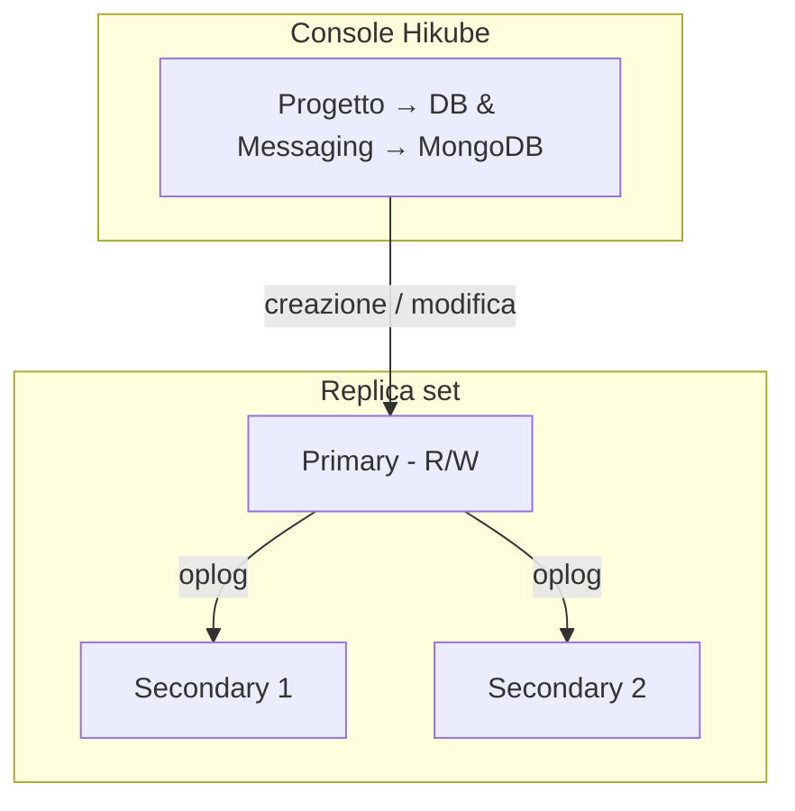

# Concetti — MongoDB

## Architettura

MongoDB su Hikube è un servizio gestito. Ogni cluster creato dalla console è, per impostazione predefinita, un **replica set**: un insieme di membri che contengono gli stessi dati, di cui uno solo accetta le scritture. Il cluster appartiene a un **progetto** e consuma le quote di tale progetto.

---

## Terminologia

| Termine | Descrizione |
|-------|-------------|
| **Cluster MongoDB** | Istanza gestita creata dalla console. |
| **Progetto** | Spazio isolato che raggruppa le sue risorse e a cui si applicano le quote. |
| **Replica set** | Gruppo di membri MongoDB che replicano gli stessi dati. |
| **Primary** | Membro che accetta le scritture. |
| **Secondary** | Membro che replica il primary e può essere eletto al suo posto in caso di guasto. |
| **Oplog** | Registro delle operazioni del primary, rieseguito dai secondary. |
| **Shard** | Sottoinsieme dei dati, ospitato dal proprio replica set (topologia shardata). |
| **Server di configurazione** | Membri che memorizzano i metadati della topologia shardata. |
| **Mongos** | Router che riceve le richieste dei client e le indirizza verso gli shard corretti. |
| **Preset** | Modello di risorse (CPU, memoria) allocato a ogni nodo. |

---

## Replicazione e alta disponibilità

I secondary rieseguono in continuo l'oplog del primary. Se il primary diventa indisponibile, i membri restanti eleggono un nuovo primary; perché l'elezione vada a buon fine deve essere disponibile la maggioranza dei membri.

Il valore **Number of replicas** si sceglie alla creazione:

| Valore proposto | Utilizzo |
|-----------------|-------|
| **1 (Standalone)** | Sviluppo, test |
| **3 (Max High Availability)** | Produzione: tollera la perdita di un membro |
| **5 (Ultra High Availability)** | Produzione critica: tollera la perdita di due membri |

:::warning
Il numero di repliche, il preset e lo sharding non possono essere modificati dopo la creazione. Per cambiarli, [contatti il supporto](mailto:support@hidora.io).
:::

---

## Sharding

L'opzione **Sharding (Distributed Topology)** della procedura guidata è descritta così: «Enable sharding (automatically deploys configuration servers and Mongos routers, and configures replica sets as shards)». La console crea quindi:

- **2 shard**, ciascuno composto dal numero di repliche scelto e da un disco della dimensione scelta;
- dei **server di configurazione**, con lo stesso numero di repliche e la stessa dimensione del disco;
- dei **router Mongos**, con lo stesso numero di repliche.

Il consumo di risorse e il costo stimato ne tengono conto. Si veda [Configurare lo sharding](./how-to/configure-sharding.md).

---

## Utenti, database e ruoli

La pagina di un cluster MongoDB comprende una sezione **Users**; non esiste una scheda dedicata ai database. I diritti si assegnano database per database: ogni accesso associa un **Database name** a dei **Rights**, **Administrator (Admin)** o **Read-only**. **Administrator** corrisponde ai ruoli MongoDB `readWrite` e `dbAdmin` sul database, **Read-only** al ruolo `read`. Non esiste un ruolo globale: un utente ha accesso solo ai database che gli sono assegnati.

- Alla creazione del cluster, il passaggio **Users** della procedura guidata chiede per ogni utente un **Database** applicativo e un **Role**. Il database viene creato se non esiste.
- In seguito, **Create a user** e **Manage Access** permettono di assegnare uno o più accessi. Un utente MongoDB deve conservare almeno un accesso: altrimenti la console mostra «Please grant access to at least one database.» e il pulsante resta inattivo.
- La colonna **Databases** dell'elenco degli utenti mostra ogni database con il ruolo, ad esempio `myapp (Administrator)`.

I database di sistema `admin`, `local` e `config` non possono ricevere accessi: la console mostra «“admin” is a system database: choose an application database.» e l'API rifiuta la richiesta.

Tutti gli utenti vengono creati nel database `admin`, che funge da database di autenticazione (`authSource=admin`), senza ricevere alcun ruolo su tale database.

:::warning Utenti creati prima della console v1.3.0
La procedura guidata di creazione del cluster assegnava in precedenza a ogni utente un ruolo sul database di sistema `admin`. Per questi utenti, apra **Actions** → **Manage Access**: la riga `admin` vi appare in errore. La rimuova, aggiunga se necessario il database applicativo dell'utente, quindi faccia clic su **Save**. Finché questa riga è presente, i diritti dell'utente non possono essere salvati.
:::

La password di un utente è generata dalla piattaforma e mostrata **una sola volta**. In caso di smarrimento, ne generi una nuova con **Change Password**.

### Regole di denominazione

| Elemento | Regola |
|---------|-------|
| Nome del cluster | Da 3 a 16 caratteri: minuscole, cifre e trattini; inizia con una lettera, termina con una lettera o una cifra |
| Nome utente | Da 3 a 16 caratteri: minuscole, cifre e trattini; inizia con una lettera, termina con una lettera o una cifra. Alcuni nomi, come `admin` o `root`, sono riservati |
| Nome del database | Da 1 a 63 caratteri: minuscole, cifre e trattini; inizia con una lettera, termina con una lettera o una cifra. I database di sistema `admin`, `local` e `config` sono rifiutati |

:::note
I trattini bassi (`_`) e le maiuscole non sono accettati né nei nomi dei database né nei nomi utente.
:::

---

## Preset

Il **Preset** definisce la capacità allocata a **ogni nodo**. I preset riprendono le taglie delle [macchine virtuali](../../compute/overview.md) delle serie `u1`, `s1` e `m1`: un preset ha le stesse risorse della VM con lo stesso nome. Fa fede l'elenco mostrato dalla procedura guidata:

| Preset | CPU | Memoria |
|--------|-----|---------|
| `u1.medium` | 1 | 4Gi |
| `u1.large` | 2 | 8Gi |
| `u1.xlarge` | 4 | 16Gi |
| `u1.2xlarge` | 8 | 32Gi |
| `u1.4xlarge` | 16 | 64Gi |
| `u1.8xlarge` | 32 | 128Gi |
| `s1.small` | 1 | 2Gi |
| `s1.medium` | 2 | 4Gi |
| `s1.large` | 4 | 8Gi |
| `s1.xlarge` | 8 | 16Gi |
| `s1.2xlarge` | 16 | 32Gi |
| `s1.4xlarge` | 32 | 64Gi |
| `m1.large` | 2 | 16Gi |
| `m1.xlarge` | 4 | 32Gi |
| `m1.2xlarge` | 8 | 64Gi |
| `m1.4xlarge` | 16 | 128Gi |
| `m1.8xlarge` | 32 | 256Gi |

La procedura guidata non preseleziona alcun preset: ne scelga uno per proseguire. Ogni opzione indica le sue risorse, ad esempio « u1.medium — 1 CPU / 4Gi ». Se l'elenco non può essere caricato, la procedura guidata mostra « The preset list could not be loaded. Try again later or contact support. »

Un cluster creato con un vecchio preset (`nano`, `micro`, `small`, `medium`, `large`, `xlarge` o `2xlarge`) lo conserva e funziona come prima: il modulo **Edit** lo mostra così com'è e lo salva senza modifiche. Poiché il preset non può essere modificato dopo la creazione, [contatti il supporto](mailto:support@hidora.io) per questa modifica. Se le risorse di un cluster sono state fissate al di fuori del suo preset, il modulo lo indica con la menzione « (override) ».

---

## Accesso di rete

- **External access** disattivato (impostazione predefinita): il cluster non è esposto su Internet. Il campo **Host** del riquadro **Network and Connection** mostra **Not defined**.
- **External access** attivato: la porta è quella standard di MongoDB, `27017`, senza TLS.
  - **Cluster con sharding**: la piattaforma assegna un indirizzo pubblico ai router Mongos, mostrato nel campo **Host**. La procedura guidata fornisce una stringa di connessione nella forma `mongodb://<utente>:<password>@<host>`.
  - **Replica set**: ciascun membro riceve il proprio indirizzo pubblico. Il riquadro **Network and Connection** li elenca in **Replica set rs0 members**, ciascuno con un pulsante di copia, e propone una **External connection string** nella forma `mongodb://<user>:<password>@<membro>:27017/?directConnection=true&authSource=admin`. Si connetta così a un membro in connessione diretta, senza il parametro `replicaSet`: i membri si annunciano con nomi interni al cluster, che non si risolvono dall'esterno. Il membro raggiunto può essere un secondario, che non accetta scritture: legga con `readPreference=secondaryPreferred` e scriva sul membro primario.

---

## Backup e ripristino

La configurazione dei backup e il ripristino non sono disponibili nella console; [contatti il supporto](mailto:support@hidora.io).

---

## Quote e costi

La procedura guidata mostra l'**Estimated Cost** e l'impatto del cluster sulle quote del progetto. Se il cluster supera le quote disponibili, il pulsante **Next** resta inattivo.

| Parametro | Valore |
|-----------|--------|
| Versioni | 6.0, 7.0, 8.0; dopo la creazione, solo aggiornamento di versione |
| Repliche | 1, 3 o 5 |
| Dimensione del disco | Da 1 a 4.096 GB, entro il limite della quota di storage del progetto; dopo la creazione, solo aumento |

---

## Per approfondire

- [Panoramica](./overview.md): presentazione del servizio
- [Avvio rapido](./quick-start.md): creare il suo primo cluster
