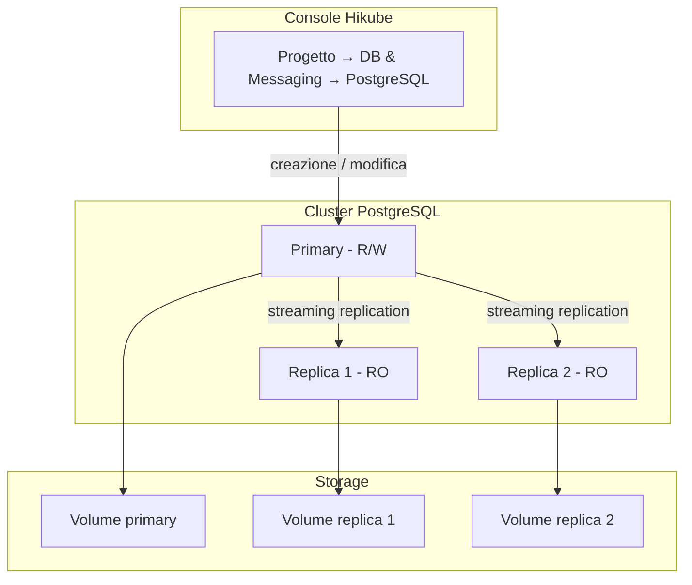
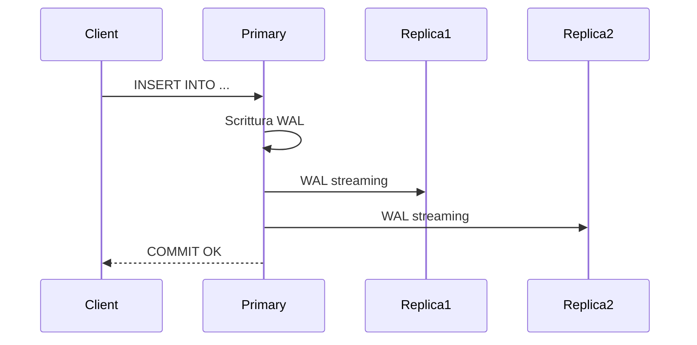

# Concetti — PostgreSQL

## Architettura

PostgreSQL su Hikube è un servizio gestito. Ogni cluster creato dalla console è un insieme di istanze PostgreSQL replicate, con failover automatico e streaming replication. Appartiene a un **progetto** e consuma la quota di tale progetto (CPU, memoria, storage).

---

## Terminologia

| Termine | Descrizione |
|---------|-------------|
| **Cluster PostgreSQL** | Istanza gestita creata dalla console, composta da un primary e da eventuali repliche. |
| **Progetto** | Spazio isolato che raggruppa le sue risorse e a cui è associata la quota. |
| **Primary** | Istanza principale che accetta letture e scritture. |
| **Replica** | Istanza in sola lettura, sincronizzata tramite streaming replication dal primary. |
| **Instance preset** | Profilo di risorse (CPU, memoria) assegnato a ogni nodo del cluster. |
| **Accesso esterno** | Opzione che espone il cluster su Internet tramite un indirizzo IP pubblico. |
| **Estensione** | Modulo PostgreSQL (ad esempio `pgcrypto`, `vector`) attivato per database. |
| **WAL** | Write-Ahead Log — registro delle transazioni PostgreSQL, base della replica. |

---

## Replica e alta disponibilità

L'alta disponibilità si basa su:

1. **Streaming replication**: le repliche ricevono i WAL in modo continuo dal primary
2. **Failover automatico**: se il primary cade, una replica viene promossa automaticamente

Il numero di repliche si sceglie al momento della creazione, nel campo **Number of replicas**:

| Valore proposto | Utilizzo |
|-----------------|----------|
| **1 (Standalone)** | Sviluppo, test |
| **2 (High Availability)** | Produzione con uno standby |
| **3 (Max High Availability)** | Produzione critica |

:::warning
Il numero di repliche non può essere modificato dopo la creazione (« The mode cannot be changed after creation »). Lo scelga in base alle sue esigenze di disponibilità. Per modificarlo, [contatti il supporto](mailto:support@hidora.io).
:::

La replica sincrona (quorum) non è proposta nella console; contatti il supporto.

---

## Database, utenti e diritti

Ogni cluster dispone di:

- un database di sistema **`postgres`**, creato automaticamente e riservato alla piattaforma (vedere sotto);
- i **database** che lei aggiunge, alla creazione o in seguito (scheda **Databases**), con le relative **estensioni**;
- gli **utenti** che lei crea (scheda **Users**). Ogni utente riceve, database per database, uno dei due diritti seguenti:
  - **Administrator (Admin)**: lettura e scrittura;
  - **Read-only**: solo lettura.

La password di un utente è generata dalla piattaforma e mostrata **una sola volta**, alla creazione o dopo una rotazione. Non è più consultabile in seguito: in caso di smarrimento, ne generi una nuova con **Change Password**.

### Database di sistema

`postgres`, `template0` e `template1` sono database di sistema, riservati alla piattaforma:

- le procedure guidate degli utenti non li propongono, e su di essi non può essere attribuito alcun diritto;
- la loro creazione viene rifiutata: « “postgres” is a system database: choose an application database. »;
- nell'elenco dei database, **Manage extensions** e **Delete database** sono disattivati su un database di sistema: « System database: it can be neither changed nor deleted. »

Un utente che detiene già un diritto su un database di sistema lo conserva così com'è. In **Manage Access**, questo diritto viene mostrato bloccato, con un avviso: può rimuovere la riga, ma non modificarla. Attribuisca ai suoi utenti i diritti su database applicativi.

### Regole di denominazione

| Elemento | Regola |
|----------|--------|
| Nome del cluster | Da 3 a 16 caratteri: lettere minuscole, cifre e trattini; inizia con una lettera, termina con una lettera o una cifra |
| Nome utente | Da 3 a 16 caratteri: lettere minuscole, cifre e trattini bassi (`_`); inizia con una lettera minuscola o un trattino basso. Nessun trattino (`-`). |
| Nome del database | Da 1 a 54 caratteri: lettere minuscole, cifre, trattini bassi (`_`) e trattini (`-`); inizia con una lettera o un trattino basso, ma non con `pg_` |

I nomi utente `postgres`, `admin`, `root`, `owner`, `superuser`, `streaming_replica` e quelli che iniziano con `pg_` sono riservati.

---

## Preset di istanza

L'**Instance preset** definisce la capacità assegnata a **ogni nodo** del cluster. I preset riprendono le taglie delle [macchine virtuali](../../compute/overview.md) delle serie `u1`, `s1` e `m1`: un preset ha le stesse risorse della VM con lo stesso nome. Fa fede l'elenco mostrato dalla procedura guidata:

| Preset | CPU | Memoria |
|--------|-----|---------|
| `u1.medium` | 1 | 4Gi |
| `u1.large` | 2 | 8Gi |
| `u1.xlarge` | 4 | 16Gi |
| `u1.2xlarge` | 8 | 32Gi |
| `u1.4xlarge` | 16 | 64Gi |
| `u1.8xlarge` | 32 | 128Gi |
| `s1.small` | 1 | 2Gi |
| `s1.medium` | 2 | 4Gi |
| `s1.large` | 4 | 8Gi |
| `s1.xlarge` | 8 | 16Gi |
| `s1.2xlarge` | 16 | 32Gi |
| `s1.4xlarge` | 32 | 64Gi |
| `m1.large` | 2 | 16Gi |
| `m1.xlarge` | 4 | 32Gi |
| `m1.2xlarge` | 8 | 64Gi |
| `m1.4xlarge` | 16 | 128Gi |
| `m1.8xlarge` | 32 | 256Gi |

La procedura guidata non preseleziona alcun preset: ne scelga uno per proseguire. Ogni opzione indica le sue risorse, ad esempio « u1.medium — 1 CPU / 4Gi ». Se l'elenco non può essere caricato, la procedura guidata mostra « The preset list could not be loaded. Try again later or contact support. »

Un cluster creato con un vecchio preset (`nano`, `micro`, `small`, `medium`, `large`, `xlarge` o `2xlarge`) lo conserva e funziona come prima: il modulo **Edit** lo mostra così com'è e lo salva senza modifiche. Questo preset non ha un prezzo di listino: la console mostra « Price unavailable » e la dashboard del progetto lo esclude dal costo totale, finché non sceglie un preset dell'elenco. Se le risorse di un cluster sono state fissate al di fuori del suo preset, il modulo lo indica con la menzione « (override) ».

La definizione di risorse CPU/memoria libere (al di fuori dei preset) non è proposta nella console; contatti il supporto.

---

## Accesso di rete

- **Accesso esterno disattivato** (impostazione predefinita): il cluster non è esposto su Internet. Il campo **Host** della pagina del cluster mostra **Not defined**.
- **Accesso esterno attivato**: la piattaforma assegna un indirizzo IP pubblico, mostrato nel campo **Host**. La porta è la porta PostgreSQL standard, `5432`.

L'accesso esterno può essere attivato o disattivato dopo la creazione, tramite **Edit**. Il suo costo (indirizzo IP pubblico) è incluso nell'**Estimated cost** della procedura guidata.

---

## Backup e ripristino

La configurazione dei backup e il ripristino non sono proposti nella console; contatti il supporto. Consulti [Configurare i backup](./how-to/configure-backups.md).

---

## Quota e costo

La procedura guidata di creazione mostra, già dal passaggio **Configuration**, l'**Estimated cost** (mensile e orario) e l'impatto del cluster sulla quota del progetto (CPU, memoria, storage). Il consumo tiene conto del preset, del numero di repliche e della dimensione del disco. Se il cluster supera la quota disponibile, il pulsante **Next** resta inattivo.

| Parametro | Valore |
|-----------|--------|
| Dimensione del disco | Da 1 a 4.096 GB, entro il limite della quota di storage del progetto; dopo la creazione, solo aumento |
| Repliche | 1, 2 o 3 |

---

## Per approfondire

- [Panoramica](./overview.md): presentazione del servizio
- [Avvio rapido](./quick-start.md): creare il suo primo cluster
