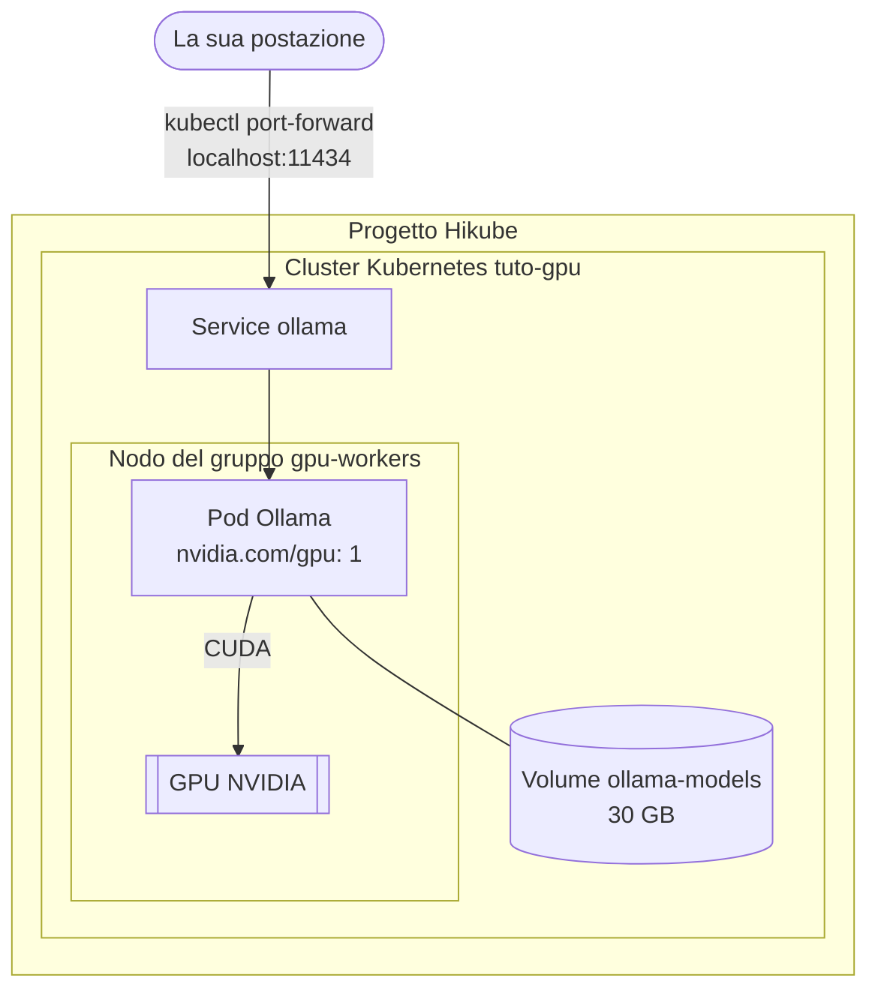

import NavigationFooter from '@site/src/components/NavigationFooter';

# Servire un modello linguistico su GPU con Kubernetes

Questo tutorial le fa servire un modello linguistico (LLM) open source su una GPU NVIDIA di Hikube: un cluster Kubernetes con un nodo GPU, un server di inferenza che carica il modello nella memoria della GPU, un'API compatibile con OpenAI per interrogarlo, quindi la prova che il calcolo avviene davvero sulla GPU e la misura del suo throughput.

Il server di inferenza è [Ollama](https://ollama.com), che scarica e serve modelli aperti. Il modello è [Qwen2.5 7B Instruct](https://ollama.com/library/qwen2.5), con licenza Apache 2.0: circa 5 GB, sta ampiamente nella memoria di una GPU da data center.

| | |
|---|---|
| **Difficoltà** | Intermedio |
| **Durata** | Circa 45 minuti |
| **Imparerà a** | Aggiungere un gruppo di nodi GPU a un cluster, riservare una GPU a un pod, verificare che un modello giri realmente sulla GPU, misurarne il throughput di generazione |

---

## Cosa costruirà



- La GPU è **riservata al pod** Ollama: nessun altro pod può utilizzarla finché è in esecuzione.
- Il modello è memorizzato su un **volume persistente**: sopravvive al riavvio del pod, senza un nuovo download.
- L'API **non è esposta su Internet**: la raggiunge dalla sua postazione tramite un tunnel `kubectl port-forward`.

---

## Prerequisiti

- Un **account Hikube** e un **progetto** con quote sufficienti per un control plane, un nodo `u1.2xlarge` (8 vCPU, 32 GB) con 100 GB di disco, una GPU e un volume da 30 GB
- Il **ruolo di amministratore del progetto**, per scaricare il kubeconfig del cluster
- **`kubectl`**, **`curl`** e **`jq`** installati sulla sua postazione
- **Nozioni di base di Kubernetes**: pod, `Deployment`, `Service`

---

## Passo 1: Creare il cluster con un gruppo di nodi GPU

1. Nella [console Hikube](https://console.hikube.cloud), selezioni il suo progetto, quindi apra **Infrastructure** > **Kubernetes**.
2. Faccia clic su **Create cluster** e compili la procedura guidata:

| Passaggio della procedura guidata | Campo | Valore |
|-----------------------------------|-------|--------|
| **General** | **Cluster name** | `tuto-gpu` |
| | **Kubernetes Version** | la versione preselezionata |
| | **Control Plane Instance Size** | **s1.small — 1 CPU / 2Gi** |
| | **Control Plane High Availability** | **3 (HA)** |
| **Nodes** | **Group name** | `gpu-workers` |
| | **Instance type** | `u1.2xlarge` (8 vCPU, 32 GB) |
| | **Node disk size** | `100`: le immagini di container GPU sono voluminose |
| | **Minimum nodes** / **Maximum nodes** | `1` / `1` |
| | Sezione **GPU** | Faccia clic sulla scheda **NVIDIA L40S**, o su un altro modello disponibile; mantenga 1 GPU per nodo |
| **Addons** | | **GPU Operator** è selezionato e bloccato (**Required when a node group has GPUs**); lasci gli altri addon invariati |

3. Al passaggio **Summary**, faccia clic su **Create cluster**.

La scelta del modello di GPU e i relativi vincoli sono descritti in dettaglio in [Come effettuare il provisioning di una GPU su Kubernetes](../services/gpu/how-to/provision-gpu-kubernetes.md); i modelli contrassegnati come **Unavailable** non possono essere selezionati per il momento.

**Risultato atteso**: `tuto-gpu` compare nell'elenco **Kubernetes Clusters** con lo stato **Creating**.

---

## Passo 2: Connettersi al cluster

Attenda che il cluster sia **Ready** e che il suo nodo GPU si sia avviato, diversi minuti dopo la creazione.

1. Apra **Infrastructure** > **Kubernetes**, quindi la pagina del cluster `tuto-gpu`.
2. Faccia clic su **Kubeconfig**. Il browser scarica `kubeconfig-tuto-gpu.yaml`.

```bash
export KUBECONFIG=~/Downloads/kubeconfig-tuto-gpu.yaml
kubectl get nodes
```

**Risultato atteso**: un nodo `kubernetes-tuto-gpu-gpu-workers-…` con stato `Ready`.

:::note Il cluster è Ready, ma non compare alcun nodo
Lo stato **Ready** riguarda il control plane. Il nodo GPU e gli addon si avviano subito dopo: se `kubectl get nodes` risponde `No resources found`, attenda e rilanci il comando.
:::

---

## Passo 3: Verificare che la GPU sia esposta

L'addon **GPU Operator** prepara il nodo: vi installa il necessario per esporre la GPU ai pod. Ne segua l'avvio:

```bash
kubectl get pods -n cozy-gpu-operator
```

**Risultato atteso**: dopo alcuni minuti, tutti i pod sono in `Running`.

Verifichi poi che il nodo annunci la sua GPU allo scheduler di Kubernetes:

```bash
kubectl get nodes -o custom-columns=NAME:.metadata.name,GPU:.status.allocatable.'nvidia\.com/gpu'
```

**Risultato atteso**: la colonna `GPU` del nodo mostra `1`, il numero di GPU scelto al passo 1. Finché mostra `<none>`, il GPU Operator non ha finito di preparare il nodo: attenda e rilanci il comando.

---

## Passo 4: Distribuire il server di inferenza

Il manifesto crea tre risorse: un volume per i modelli, il server Ollama e un `Service` per raggiungerlo all'interno del cluster.

```yaml title="ollama.yaml"
apiVersion: v1
kind: PersistentVolumeClaim
metadata:
  name: ollama-models
spec:
  accessModes:
    - ReadWriteOnce
  resources:
    requests:
      storage: 30Gi
---
apiVersion: apps/v1
kind: Deployment
metadata:
  name: ollama
  labels:
    app: ollama
spec:
  replicas: 1
  strategy:
    type: Recreate          # il volume si collega a un solo pod alla volta
  selector:
    matchLabels:
      app: ollama
  template:
    metadata:
      labels:
        app: ollama
    spec:
      containers:
        - name: ollama
          image: ollama/ollama:0.40.18
          ports:
            - containerPort: 11434
          env:
            - name: OLLAMA_KEEP_ALIVE   # mantiene il modello caricato nella memoria della GPU
              value: "-1"
          volumeMounts:
            - name: models
              mountPath: /root/.ollama
          readinessProbe:
            httpGet:
              path: /
              port: 11434
          resources:
            requests:
              cpu: "2"
              memory: 8Gi
            limits:
              memory: 16Gi
              nvidia.com/gpu: 1
      volumes:
        - name: models
          persistentVolumeClaim:
            claimName: ollama-models
---
apiVersion: v1
kind: Service
metadata:
  name: ollama
spec:
  selector:
    app: ollama
  ports:
    - port: 11434
      targetPort: 11434
```

La riga `nvidia.com/gpu: 1` è quella che conta: riserva un'intera GPU al pod, e Kubernetes colloca il pod solo su un nodo che ne ha una libera.

```bash
kubectl apply -f ollama.yaml
kubectl rollout status deployment/ollama --timeout=10m
```

**Risultato atteso**: la distribuzione va a buon fine in pochi minuti, il tempo di scaricare l'immagine.

All'avvio, Ollama rileva l'hardware di calcolo e lo scrive nei suoi log:

```bash
kubectl logs deployment/ollama | grep "inference compute"
```

**Risultato atteso**: la riga `inference compute` descrive la GPU NVIDIA del nodo, con il suo nome e la sua memoria. Se indica `library=cpu`, Ollama non vede la GPU: vedere la [risoluzione dei problemi GPU](../services/gpu/troubleshooting.md).

:::note Il pod resta in Pending
`kubectl describe pod -l app=ollama` mostra allora `Insufficient nvidia.com/gpu`: nessun nodo ha una GPU libera. Verifichi la colonna `GPU` del passo 3, e che nessun altro pod riservi già la GPU.
:::

---

## Passo 5: Scaricare il modello e interrogarlo

Scarichi il modello nel volume del server:

```bash
kubectl exec deploy/ollama -- ollama pull qwen2.5:7b
kubectl exec deploy/ollama -- ollama list
```

**Risultato atteso**: dopo il download, che termina con `success`, il modello compare nell'elenco.

```console
NAME          ID              SIZE      MODIFIED
qwen2.5:7b    845dbda0ea48    4.7 GB    2 seconds ago
```

Apra un tunnel verso il server. Il comando resta in primo piano: lo avvii in un secondo terminale e lo lasci aperto fino alla fine del tutorial.

```bash
kubectl port-forward svc/ollama 11434:11434
```

Nel primo terminale, ponga una domanda al modello tramite l'API compatibile con OpenAI di Ollama:

```bash
curl -s http://localhost:11434/v1/chat/completions \
  -H "Content-Type: application/json" \
  -d '{"model": "qwen2.5:7b", "messages": [{"role": "user", "content": "Spiega in una frase che cos'\''è una GPU."}]}' \
  | jq '{model, content: .choices[0].message.content, usage}'
```

**Risultato atteso**: la risposta del modello e il numero di token letti e generati.

```console
{
  "model": "qwen2.5:7b",
  "content": "Una GPU ... è un tipo di chip specializzato ...",
  "usage": {
    "prompt_tokens": 40,
    "completion_tokens": 35,
    "total_tokens": 75
    ...
  }
}
```

La prima richiesta è più lenta: Ollama carica il modello in memoria. Grazie a `OLLAMA_KEEP_ALIVE`, vi resta per le successive.

Qualsiasi client compatibile con OpenAI può usare questo server: gli fornisca l'URL di base `http://localhost:11434/v1` e il modello `qwen2.5:7b`.

---

## Passo 6: Verificare che il modello giri sulla GPU

Un modello che risponde non prova che la GPU stia lavorando: se il modello non sta nella memoria della GPU, o se il pod non vede la GPU, Ollama sposta tutto o parte del calcolo sul processore, senza errori. Verifichi dove è caricato il modello:

```bash
kubectl exec deploy/ollama -- ollama ps
```

**Risultato atteso**: la colonna `PROCESSOR` di `qwen2.5:7b` mostra `100% GPU`. Il valore `100% CPU`, o una ripartizione del tipo `48%/52% CPU/GPU`, significa che il modello non è, o non è interamente, nella memoria della GPU.

Verifichi anche, lato Kubernetes, che la GPU del nodo sia assegnata:

```bash
kubectl describe nodes | grep -A 15 "Allocated resources" | grep nvidia.com/gpu
```

**Risultato atteso**: `nvidia.com/gpu` con `1` in richiesta e in limite, la GPU riservata dal pod Ollama.

---

## Passo 7: Misurare il throughput di generazione

Il throughput di un LLM si misura in token generati al secondo. L'API nativa di Ollama restituisce il numero di token generati (`eval_count`) e la durata della generazione in nanosecondi (`eval_duration`): `jq` ne ricava il throughput.

```bash
PROMPT="Scrivi un paragrafo di 150 parole sulla storia del calcolo parallelo."

curl -s http://localhost:11434/api/generate \
  -d "{\"model\": \"qwen2.5:7b\", \"prompt\": \"$PROMPT\", \"stream\": false}" \
  | jq '{tokens: .eval_count, tokens_per_s: (.eval_count / .eval_duration * 1e9 | floor)}'
```

**Risultato atteso**: un oggetto con il numero di token generati (`tokens`) e il throughput in token al secondo (`tokens_per_s`). La rilanci due o tre volte e annoti un valore tipico.

### Termine di confronto: lo stesso modello sul processore

Per misurare ciò che apporta la GPU, rilanci la stessa richiesta con l'opzione `num_gpu` a `0`: Ollama ricarica allora il modello **sul processore del nodo**, senza GPU.

```bash
curl -s http://localhost:11434/api/generate \
  -d "{\"model\": \"qwen2.5:7b\", \"prompt\": \"$PROMPT\", \"stream\": false, \"options\": {\"num_gpu\": 0}}" \
  | jq '{tokens: .eval_count, tokens_per_s: (.eval_count / .eval_duration * 1e9 | floor)}'
```

Confronti i due valori di `tokens_per_s`: la differenza è ciò che la GPU apporta a questo modello, su questo nodo. `kubectl exec deploy/ollama -- ollama ps` mostra ora `100% CPU`: rilanci il primo comando, senza `num_gpu`, per ricaricare il modello sulla GPU.

---

## Passo 8: Pulizia

Interrompa il tunnel (Ctrl+C nel secondo terminale). Se non conserva il server, elimini il cluster per liberare la GPU e le quote del progetto:

1. **Infrastructure** > **Kubernetes**: apra il menu **Actions** di `tuto-gpu`, scelga **Delete**, inserisca il nome del cluster, quindi faccia clic su **Permanently delete**.

Il server, il suo volume e il modello scaricato scompaiono con il cluster.

:::warning
Questa eliminazione è irreversibile.
:::

---

## Riepilogo

Ha:

- creato un cluster Kubernetes con un gruppo di nodi GPU e lasciato che il GPU Operator preparasse il nodo;
- verificato che il nodo annunci la sua GPU (`nvidia.com/gpu`);
- distribuito un server di inferenza che riserva un'intera GPU, con un volume persistente per i modelli;
- interrogato un modello open source tramite un'API compatibile con OpenAI;
- verificato che il modello sia caricato sulla GPU, quindi misurato il suo throughput confrontandolo con il processore.

## Per approfondire

- **Condividere una GPU**: per eseguire diversi modelli piccoli su una stessa GPU, attivi l'addon [HAMi](../services/kubernetes/plugins/hami.md).
- **Modelli più grandi**: la memoria della GPU limita la dimensione del modello; i modelli proposti e le loro caratteristiche si trovano nei [concetti GPU](../services/gpu/concepts.md).
- **Uso occasionale**: un gruppo di nodi GPU può scendere a zero nodi tra due utilizzi, vedere [Come configurare l'autoscaling](../services/kubernetes/how-to/configure-autoscaling.md).
- **Scalabilità**: per servire numerose richieste simultanee, un server di inferenza specializzato come [vLLM](https://docs.vllm.ai) sfrutta meglio la GPU; la riserva della GPU tramite `nvidia.com/gpu` resta la stessa.
- **Aprire l'API ad altre applicazioni**: Ollama non autentica le richieste. Prima di pubblicare il servizio, lo collochi dietro un'autenticazione, per esempio su un Ingress, vedere [Come distribuire un Ingress con TLS](../services/kubernetes/how-to/deploy-ingress-tls.md).
- **Senza Kubernetes**: una GPU si collega anche a una macchina virtuale, vedere [Creare una VM con GPU](../services/gpu/quick-start.md).

<NavigationFooter
  nextSteps={[
    {label: "Provisioning di una GPU su Kubernetes", href: "../../services/gpu/how-to/provision-gpu-kubernetes"},
    {label: "Plugin GPU Operator", href: "../../services/kubernetes/plugins/gpu-operator"},
  ]}
/>
