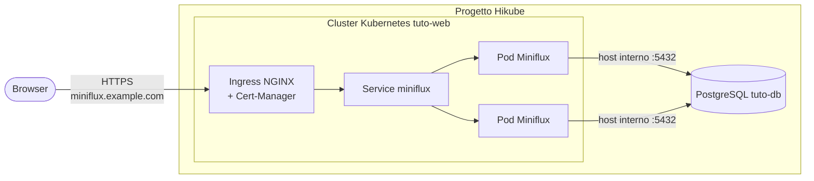

import NavigationFooter from '@site/src/components/NavigationFooter';

# Distribuire un'applicazione web con PostgreSQL su Kubernetes

Questo tutorial le fa costruire un'applicazione web completa su Hikube: un cluster Kubernetes che esegue l'applicazione, un database **PostgreSQL** gestito che ne conserva i dati, una pubblicazione in HTTPS con certificato automatico e infine il monitoraggio dell'insieme.

L'applicazione di esempio è [Miniflux](https://miniflux.app), un lettore di feed RSS open source: una sola immagine di container, un database PostgreSQL, un'interfaccia web. Il percorso resta lo stesso per la sua applicazione.

| | |
|---|---|
| **Difficoltà** | Intermedio |
| **Durata** | Circa 45 minuti, di cui 15-20 minuti di attesa durante la creazione del cluster |
| **Imparerà a** | Collegare un cluster Kubernetes a un database gestito dello stesso progetto, passare le credenziali tramite un `Secret`, pubblicare un servizio in HTTPS |

---

## Cosa costruirà



- Il database **non è esposto su Internet**: l'applicazione lo raggiunge tramite il suo host interno, riservato alle risorse del progetto.
- La password del database non compare in alcun file: si trova in un `Secret` Kubernetes.
- Solo l'Ingress è pubblico, in HTTPS, con un certificato Let's Encrypt rinnovato automaticamente.

---

## Prerequisiti

- Un **account Hikube** e un **progetto** con quote sufficienti per un control plane, un nodo `s1.large` (4 vCPU, 8 GB) e un database `s1.small`
- Il **ruolo di amministratore del progetto**, per scaricare il kubeconfig del cluster
- **`kubectl`** e **`openssl`** installati sulla sua postazione
- Un **nome di dominio** di cui gestisce la zona DNS, per la pubblicazione in HTTPS (passo 6). Questo tutorial usa `miniflux.example.com`: lo sostituisca ovunque con il suo.
- **Nozioni di base di Kubernetes**: pod, `Deployment`, `Service`

---

## Passo 1: Creare il cluster Kubernetes

Il cluster è la risorsa più lunga da creare: inizi da questo, creerà il database mentre si avvia.

1. Nella [console Hikube](https://console.hikube.cloud), selezioni il suo progetto, quindi apra **Infrastructure** > **Kubernetes**.
2. Faccia clic su **Create cluster** e compili la procedura guidata:

| Passaggio della procedura guidata | Campo | Valore |
|-----------------------------------|-------|--------|
| **General** | **Cluster name** | `tuto-web` |
| | **Kubernetes Version** | la versione preselezionata |
| | **Control Plane Instance Size** | **s1.small — 1 CPU / 2Gi** |
| | **Control Plane High Availability** | **3 (HA)** |
| **Nodes** | Gruppo `worker-pool-1` | **Instance type** `s1.large`, **Minimum nodes** 1, **Maximum nodes** 3, **Exposed on the internet (Public IP)** attivato |
| **Addons** | | Mantenga **Cert-Manager**, **Ingress NGINX** e **Monitoring Agents**, selezionati per impostazione predefinita |

3. Al passaggio **Summary**, faccia clic su **Create cluster**.

Ogni campo è descritto in dettaglio nell'[avvio rapido Kubernetes](../services/kubernetes/quick-start.md).

**Risultato atteso**: `tuto-web` compare nell'elenco **Kubernetes Clusters** con lo stato **Creating**. Passi al passo successivo senza attendere.

---

## Passo 2: Creare il database PostgreSQL

1. Apra **DB & Messaging** → **PostgreSQL**, quindi faccia clic su **Create a cluster**.
2. Compili la procedura guidata:

| Passaggio della procedura guidata | Campo | Valore |
|-----------------------------------|-------|--------|
| **General** | **Cluster Name** | `tuto-db` |
| **Configuration** | **PostgreSQL Version** | `18` |
| | **Instance preset** | `s1.small — 1 CPU / 2Gi` |
| | **Disk size (GB)** | `10` |
| | **Number of replicas** | `1 (Standalone)` |
| | **External access** | **Disattivato**: l'applicazione raggiungerà il database dall'interno del progetto |
| **Databases** | **Database name** | `miniflux`, quindi **Add** |
| **Users** | **Username** | `miniflux`, **Database name** `miniflux`, **Rights** **Administrator (Admin)**, quindi **Add** |

3. Al passaggio **Summary**, faccia clic su **Create cluster**.

Il passaggio **Finish** mostra la **Password** dell'utente `miniflux`, nella sezione **User Credentials**.

:::warning Copi subito la password
Viene mostrata una sola volta. La copi in un gestore di password prima di fare clic su **Finish**. In caso di smarrimento, ne generi una nuova dalla scheda **Users** del cluster (**Actions** → **Change Password**).
:::

4. Faccia clic su **Finish**. Nella pagina del cluster, nel riquadro **Connection and Databases**, copi l'host della zona **Internal** (*From the project's resources only*) con il pulsante di copia: è l'indirizzo che l'applicazione utilizzerà, sulla porta `5432`.

**Risultato atteso**: dopo alcuni minuti, `tuto-db` passa allo stato **Ready** e la zona **External** mostra **Disabled**.

---

## Passo 3: Connettersi al cluster

Il cluster deve essere **Ready** e avere almeno un nodo attivo. Conti 15-20 minuti dalla sua creazione.

1. Apra **Infrastructure** > **Kubernetes**, quindi la pagina del cluster `tuto-web`.
2. Nella sezione **Actions**, faccia clic su **Kubeconfig**. Il browser scarica `kubeconfig-tuto-web.yaml`.

```bash
export KUBECONFIG=~/Downloads/kubeconfig-tuto-web.yaml
kubectl get nodes
```

**Risultato atteso**: un nodo con stato `Ready`.

```console
NAME                                           STATUS   ROLES    AGE   VERSION
kubernetes-tuto-web-worker-pool-1-xxxxx-xxxxx  Ready    <none>   3m    v1.xx.x
```

:::note Il cluster è Ready, ma non compare alcun nodo
Lo stato **Ready** riguarda il control plane. Il primo nodo e gli addon si avviano subito dopo, in qualche minuto: se `kubectl get nodes` risponde `No resources found`, attenda e rilanci il comando.
:::

Verifichi anche che gli addon siano in esecuzione:

```bash
kubectl get pods -A | grep -E "cert-manager|ingress-nginx"
```

**Risultato atteso**: tutti i pod in `Running`.

---

## Passo 4: Verificare l'accesso del cluster al database

Prima di distribuire l'applicazione, verifichi che il cluster raggiunga il database. Inserisca la password di `miniflux` senza che compaia a schermo né nella cronologia della shell, quindi la riponga in un `Secret`:

```bash
read -rs PGPASSWORD   # incolli la password, poi Invio
export PGHOST=<host-interno>   # l'host copiato al passo 2

kubectl create secret generic pg-test --from-literal=PGPASSWORD="$PGPASSWORD"
```

Avvii un client `psql` effimero nel cluster:

```bash
kubectl run pg-test --rm -i --restart=Never --image=postgres:18-alpine \
  --overrides='{"spec":{"containers":[{"name":"pg-test","image":"postgres:18-alpine",
    "envFrom":[{"secretRef":{"name":"pg-test"}}],
    "command":["psql","host='"$PGHOST"' port=5432 dbname=miniflux user=miniflux sslmode=require",
               "-c","SELECT current_user, version();"]}]}}'
```

**Risultato atteso**:

```console
 current_user |                       version
--------------+-----------------------------------------------------
 miniflux     | PostgreSQL 18.x ...
(1 row)
```

Elimini il secret di test:

```bash
kubectl delete secret pg-test
```

:::tip In caso di errore
- `could not translate host name` nei primissimi minuti del cluster: il DNS del cluster si sta ancora avviando, rilanci il comando.
- `password authentication failed`: la password non corrisponde. La verifichi, oppure la cambi dalla scheda **Users** di `tuto-db`.
- Un timeout: verifichi che il database e il cluster si trovino nello **stesso progetto**. L'host interno non è raggiungibile da un altro progetto.
:::

---

## Passo 5: Distribuire l'applicazione

### Riporre le credenziali nei secret

Miniflux legge l'indirizzo del suo database dalla variabile `DATABASE_URL`. La crei in un `Secret`, con la password inserita al passo 4:

```bash
kubectl create secret generic miniflux-db \
  --from-literal=DATABASE_URL="host=$PGHOST port=5432 dbname=miniflux user=miniflux password='$PGPASSWORD' sslmode=require"
```

Crei poi l'account amministratore di Miniflux, con una password casuale:

```bash
kubectl create secret generic miniflux-admin \
  --from-literal=username=admin \
  --from-literal=password="$(openssl rand -base64 18)"
```

### Distribuire Miniflux

```yaml title="miniflux.yaml"
apiVersion: apps/v1
kind: Deployment
metadata:
  name: miniflux
  labels:
    app: miniflux
spec:
  replicas: 1
  selector:
    matchLabels:
      app: miniflux
  template:
    metadata:
      labels:
        app: miniflux
    spec:
      containers:
        - name: miniflux
          image: miniflux/miniflux:2.3.5
          ports:
            - containerPort: 8080
          env:
            - name: LISTEN_ADDR
              value: "0.0.0.0:8080"
            - name: RUN_MIGRATIONS     # crea le tabelle al primo avvio
              value: "1"
            - name: DATABASE_URL
              valueFrom:
                secretKeyRef:
                  name: miniflux-db
                  key: DATABASE_URL
            - name: CREATE_ADMIN       # crea l'account admin se non esiste
              value: "1"
            - name: ADMIN_USERNAME
              valueFrom:
                secretKeyRef:
                  name: miniflux-admin
                  key: username
            - name: ADMIN_PASSWORD
              valueFrom:
                secretKeyRef:
                  name: miniflux-admin
                  key: password
          readinessProbe:
            httpGet:
              path: /healthcheck
              port: 8080
          livenessProbe:
            httpGet:
              path: /healthcheck
              port: 8080
            initialDelaySeconds: 10
          resources:
            requests:
              cpu: 50m
              memory: 64Mi
            limits:
              cpu: 500m
              memory: 256Mi
---
apiVersion: v1
kind: Service
metadata:
  name: miniflux
spec:
  selector:
    app: miniflux
  ports:
    - port: 80
      targetPort: 8080
```

```bash
kubectl apply -f miniflux.yaml
kubectl rollout status deployment/miniflux
kubectl logs deployment/miniflux
```

**Risultato atteso**: la distribuzione va a buon fine e i log mostrano la creazione dello schema, dell'account admin, poi l'avvio del server.

```console
level=INFO msg="Running database migrations" current_version=0 latest_version=...
level=INFO msg="Created new admin user" username=admin user_id=1
level=INFO msg="Starting HTTP server" listen_address=0.0.0.0:8080
```

### Passare a due repliche

Una volta creato lo schema, aggiunga un secondo pod: l'applicazione resta disponibile se uno dei due si riavvia.

```bash
kubectl scale deployment/miniflux --replicas=2
kubectl get pods -l app=miniflux
```

:::note Perché una sola replica all'inizio
Al primo avvio, Miniflux crea le proprie tabelle. Due pod che si avviano insieme su un database vuoto si contendono questa creazione: uno dei due si riavvia una o due volte prima di stabilizzarsi. Partire con una replica evita questo rumore; è una buona pratica per qualsiasi applicazione che migra il proprio schema all'avvio.
:::

**Risultato atteso**: due pod `miniflux-…` in `Running`, `1/1`.

---

## Passo 6: Pubblicare l'applicazione in HTTPS

### Puntare il dominio al cluster

Recuperi l'indirizzo IP pubblico del controller Ingress NGINX (colonna `EXTERNAL-IP`):

```bash
kubectl get svc -n cozy-ingress-nginx ingress-nginx-controller
```

Presso il suo provider DNS, crei un record `A` da `miniflux.example.com` verso questo indirizzo. Verifichi la propagazione:

```bash
dig +short miniflux.example.com
```

### Creare l'emittente di certificati

```yaml title="cluster-issuer.yaml"
apiVersion: cert-manager.io/v1
kind: ClusterIssuer
metadata:
  name: letsencrypt-prod
spec:
  acme:
    server: https://acme-v02.api.letsencrypt.org/directory
    email: admin@example.com   # il suo indirizzo, per gli avvisi di scadenza
    privateKeySecretRef:
      name: letsencrypt-prod-account-key
    solvers:
      - http01:
          ingress:
            ingressClassName: nginx
```

```bash
kubectl apply -f cluster-issuer.yaml
```

### Creare l'Ingress

```yaml title="miniflux-ingress.yaml"
apiVersion: networking.k8s.io/v1
kind: Ingress
metadata:
  name: miniflux
  annotations:
    cert-manager.io/cluster-issuer: letsencrypt-prod
spec:
  ingressClassName: nginx
  tls:
    - hosts:
        - miniflux.example.com
      secretName: miniflux-tls
  rules:
    - host: miniflux.example.com
      http:
        paths:
          - path: /
            pathType: Prefix
            backend:
              service:
                name: miniflux
                port:
                  number: 80
```

```bash
kubectl apply -f miniflux-ingress.yaml
kubectl get certificate miniflux-tls --watch
```

**Risultato atteso**: dopo uno o due minuti, il certificato passa a `READY True`. Interrompa il comando con Ctrl+C.

```console
NAME           READY   SECRET         AGE
miniflux-tls   True    miniflux-tls   90s
```

### Aprire l'applicazione

```bash
curl -I http://miniflux.example.com       # 308: reindirizzamento a HTTPS
curl https://miniflux.example.com/healthcheck   # OK
```

Apra `https://miniflux.example.com` nel browser. Viene visualizzata la pagina **Sign In** di Miniflux. La password dell'account `admin` si legge nel suo secret:

```bash
kubectl get secret miniflux-admin -o jsonpath='{.data.password}' | base64 -d; echo
```

Si connetta, quindi aggiunga un primo feed (**Feeds** → **Add feed**). Ogni feed e ogni articolo vengono salvati nel database `tuto-db`.

:::tip Il certificato resta a `False`
Verifichi che `dig +short miniflux.example.com` restituisca davvero l'IP del controller, poi legga la causa in `kubectl describe certificate miniflux-tls` e `kubectl get challenges`. La porta 80 deve restare raggiungibile da Internet: Let's Encrypt vi convalida il dominio. Per le sue prove ripetute, utilizzi prima il server di staging di Let's Encrypt (vedere [Come distribuire un Ingress con TLS](../services/kubernetes/how-to/deploy-ingress-tls.md)).
:::

---

## Passo 7: Monitorare l'applicazione

L'addon **Monitoring Agents**, attivato al passo 1, raccoglie già le metriche e i log del cluster. Per una prima occhiata dalla sua postazione:

```bash
# Consumo dei pod dell'applicazione
kubectl top pods -l app=miniflux

# Log delle due repliche, in continuo
kubectl logs -l app=miniflux --prefix -f

# Eventi recenti del namespace (riavvii, errori delle sonde...)
kubectl get events --sort-by=.metadata.creationTimestamp | tail -20
```

Sul lato database, la pagina del cluster `tuto-db` mostra il suo stato e la scheda **Users** gestisce le password.

Vedere [Come configurare il monitoraggio](../services/kubernetes/how-to/configure-monitoring.md) per i dettagli sugli agenti installati.

---

## Passo 8: Pulizia

Se non conserva l'applicazione, elimini le risorse per liberare le quote del progetto:

1. **Infrastructure** > **Kubernetes**: apra il menu **Actions** di `tuto-web`, scelga **Delete**, inserisca il nome del cluster, quindi faccia clic su **Permanently delete**. L'applicazione, i suoi secret e il suo certificato scompaiono con il cluster.
2. **DB & Messaging** → **PostgreSQL**: apra `tuto-db`, faccia clic su **Delete cluster**, inserisca il suo nome, quindi faccia clic su **Permanently delete**.
3. Elimini il record DNS `miniflux.example.com` presso il suo provider.

:::warning
Queste eliminazioni sono irreversibili: i dati del database vanno persi definitivamente.
:::

---

## Riepilogo

Ha:

- creato un cluster Kubernetes con Ingress NGINX, Cert-Manager e la supervisione;
- creato un database PostgreSQL gestito **senza esposizione su Internet**;
- collegato l'applicazione al database tramite l'host interno, con credenziali riposte in `Secret`;
- distribuito l'applicazione su due repliche, dopo una prima migrazione dello schema;
- pubblicato l'applicazione in HTTPS con un certificato Let's Encrypt automatico.

## Per approfondire

- **Alta disponibilità del database**: ricrei il database con **2 (High Availability)** repliche; il numero di repliche non può più essere modificato dopo la creazione. Vedere i [concetti PostgreSQL](../services/databases/postgresql/concepts.md).
- **Backup**: programmi i backup del database, vedere [Come configurare i backup](../services/databases/postgresql/how-to/configure-backups.md).
- **Scalabilità**: il gruppo di nodi sale da solo fino a 3 nodi; per adattare il numero di pod al carico, vedere [Come configurare l'autoscaling](../services/kubernetes/how-to/configure-autoscaling.md).
- **Distribuzione continua**: descriva l'applicazione in un repository Git e lasci che Flux la applichi, vedere [Come distribuire con FluxCD](../services/kubernetes/how-to/deploy-gitops-flux.md).
- **Automazione**: il cluster e il database si creano anche tramite l'[API pubblica](../api/overview.md); le schede **API** degli avvii rapidi [Kubernetes](../services/kubernetes/quick-start.md) e [PostgreSQL](../services/databases/postgresql/quick-start.md) forniscono le richieste equivalenti.

<NavigationFooter
  nextSteps={[
    {label: "Guide pratiche Kubernetes", href: "../../services/kubernetes/how-to/manage-node-groups"},
    {label: "Guide pratiche PostgreSQL", href: "../../services/databases/postgresql/how-to/manage-users-databases"},
  ]}
/>
